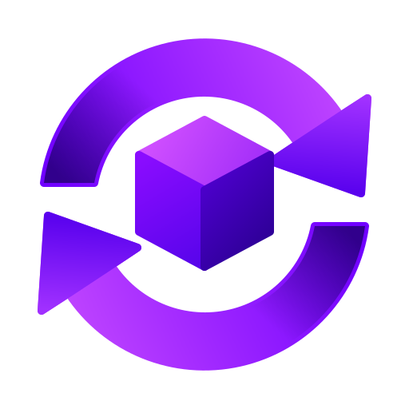
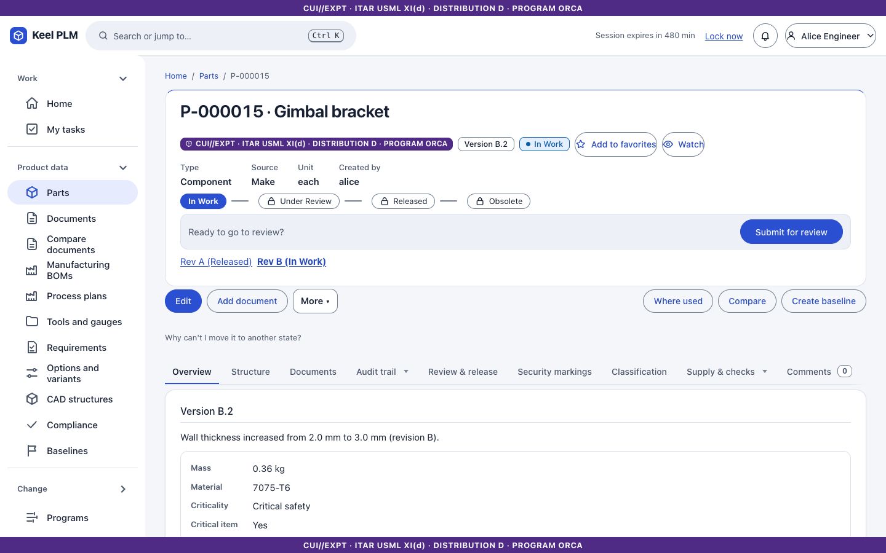
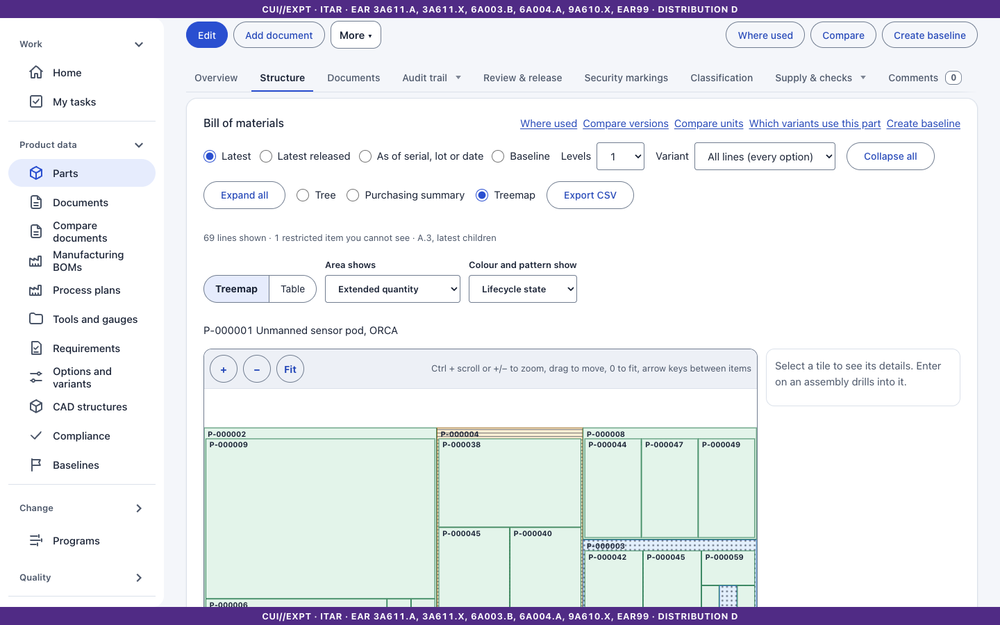
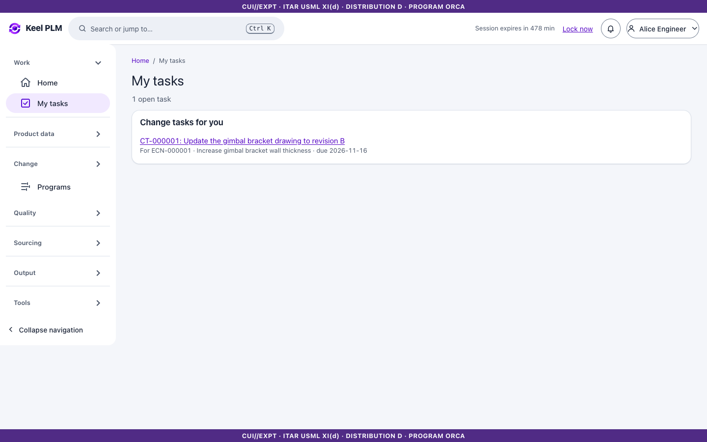
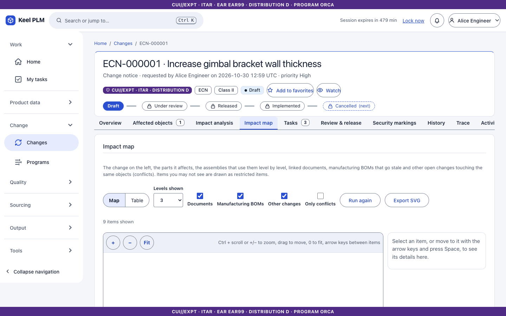
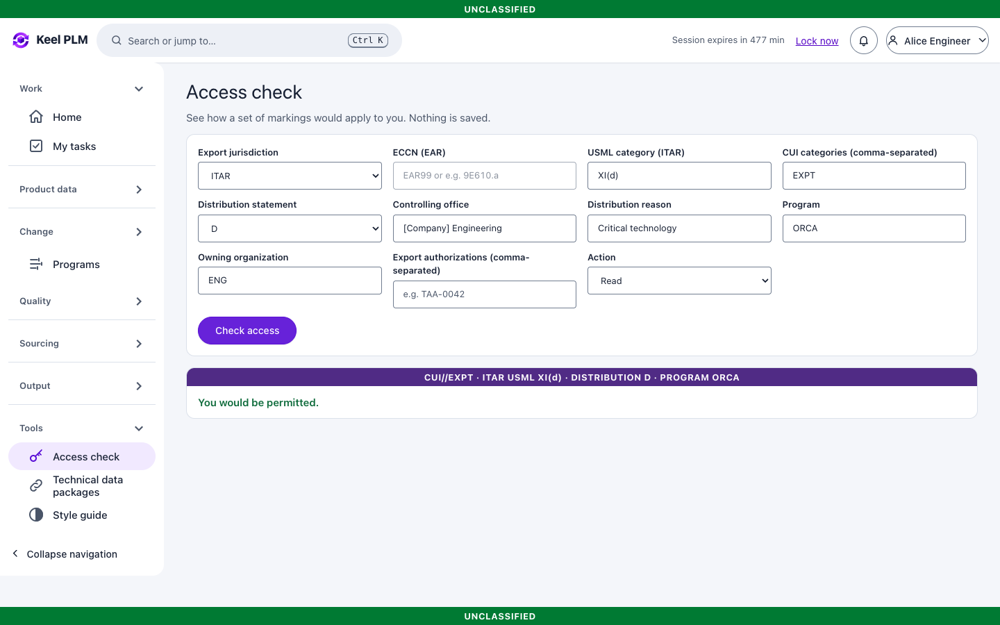
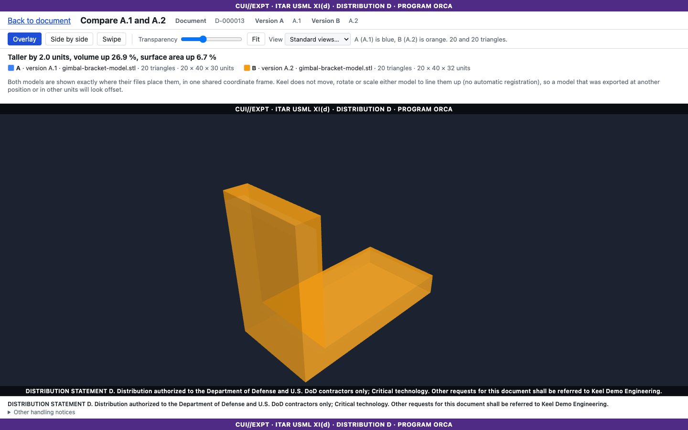
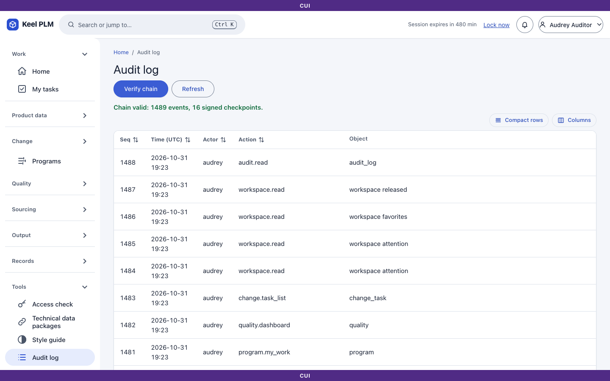
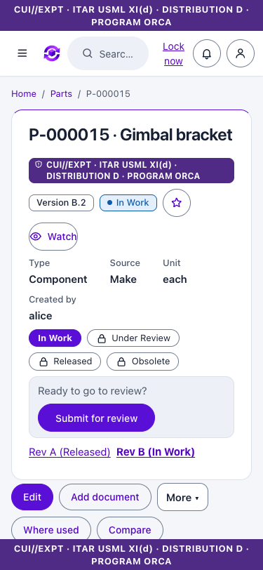

<p align="center">
  
</p>

<h1 align="center">Keel PLM</h1>

<p align="center">
  <strong>Free, self-hosted product lifecycle management for teams whose data cannot leave the building.</strong><br>
  Parts, documents, bills of materials, change control and e-signatures, with export-control markings on everything and a tamper-evident audit trail.
</p>

<p align="center">
  <a href="LICENSE"></a>
  <a href="https://github.com/finepointcgi/Keel-PLM/releases"></a>
  <a href="https://finepointcgi.github.io/Keel-PLM/"></a>
  <a href="https://github.com/finepointcgi/Keel-PLM/pkgs/container/keel-plm"></a>
</p>

<p align="center">
  <a href="https://finepointcgi.github.io/Keel-PLM/">Website</a> ·
  <a href="https://finepointcgi.github.io/Keel-PLM/manual/index.html">User guide</a> ·
  <a href="https://finepointcgi.github.io/Keel-PLM/manual/24-administrator-and-operator-guide.html">Administrator guide</a> ·
  <a href="#try-it-in-one-minute">Try the demo</a>
</p>

<p align="center">
  
</p>

> Keel PLM is a working name. It is built to support ITAR, EAR and CUI handling and NIST SP 800-171 / CMMC Level 2 practices. The software itself is **not certified** by anyone; certification belongs to your organization and its assessor.

## Why Keel

- **Runs where your data lives.** On-premises and air-gapped: no cloud service and no CDN. A strict content security policy and offline installation are part of the design.
- **Export control is built in, not bolted on.** Every part, document and record carries markings. People see only what their access allows, and a restricted item looks like it does not exist.
- **Signatures and an audit trail you can prove.** E-signatures with step-up sign-in. Every action goes into a hash-chained audit log that an offline tool can verify.
- **Easy for the people who use it.** Plain wording, one clear next step on each page, and screens that work on a phone.
- **Free.** The whole product, with no per-seat fee and no locked features. See [how it stays free](docs/business-model.md).

## Try it in one minute

You need Docker. This starts a single container with demo data (a fictional program called ORCA) and a demo sign-in. **Never put real data in it.**

```bash
docker run --rm -p 8080:8080 ghcr.io/finepointcgi/keel-plm-demo:latest
```

Open <http://localhost:8080> and sign in as `alice`. The demo accounts and what each can do are listed in [Getting started](docs/manual/01-getting-started.md); the demo password pattern is the same page.

## What is inside

<table>
  <tr>
    <td width="50%"><br><strong>Parts and BOMs.</strong> Revisions, engineering and manufacturing BOMs, variants, effectivity and baselines.</td>
    <td width="50%"><br><strong>Review and sign.</strong> Lifecycles, routed reviews, tasks and e-signatures that stay tied to the exact version signed.</td>
  </tr>
  <tr>
    <td><br><strong>Change control.</strong> Problem reports, ECRs and ECNs with impact analysis before you release.</td>
    <td><br><strong>Markings and access.</strong> Say why someone can or cannot see something, and prove it.</td>
  </tr>
  <tr>
    <td><br><strong>Documents and 3D.</strong> A content-addressed vault, in-browser 3D viewing, visual compare and redline.</td>
    <td><br><strong>Audit you can verify.</strong> A tamper-evident chain you can check in the browser or offline.</td>
  </tr>
</table>

Also included: quality (NCR, CAPA, deviations), suppliers and RFQs with a supplier portal, manufacturing process data, requirements and traceability, product compliance (RoHS, REACH and more), records and legal holds, programs with schedule and cost, reports, ERP events and technical data packages, migration from Teamcenter and Windchill, and a FreeCAD add-on. The [user guide](https://finepointcgi.github.io/Keel-PLM/manual/index.html) has a chapter for each, with screenshots.

<p align="center">
  
</p>

## Run it for real

| You are | Start here |
|---|---|
| Evaluating on your laptop | The one-line demo above |
| Trying it on one machine | [Quickstart](docs/ops/quickstart.md): `docker compose up -d` in `deploy/quickstart` |
| A small site with one server | [Docker Compose production bundle](docs/ops/compose-example.md) |
| A Kubernetes site | [Helm chart](docs/ops/kubernetes.md) (`deploy/helm/keel`) |
| On a closed network | [Offline install](docs/ops/offline-install.md): a signed bundle with the images, sources and SBOMs |
| Using your own sign-in | [Single sign-on and CAC/PIV](docs/ops/sso-integration.md) |

Keel needs PostgreSQL 17, an S3-compatible object store for the vault (SeaweedFS is used in development) and an OpenID Connect identity provider (Keycloak with synthetic users is used in development). The [administrator guide](https://finepointcgi.github.io/Keel-PLM/manual/24-administrator-and-operator-guide.html) walks through install, configuration, backup, upgrade and hardening.

Production images are published for each release:

```bash
docker pull ghcr.io/finepointcgi/keel-plm:latest
```

## Build and run from source

You need the .NET SDK pinned in `global.json` (10.0) and Docker.

```bash
docker compose -f deploy/compose/compose.yaml up -d      # PostgreSQL, Keycloak, SeaweedFS (dev only)
cd src/Keel.Api && ASPNETCORE_ENVIRONMENT=Development dotnet run -- --migrate
ASPNETCORE_ENVIRONMENT=Development dotnet run            # http://localhost:5080
```

The full steps, including seeding the demo data, are in [docs/setup.md](docs/setup.md). Tests:

```bash
scripts/test.sh                  # unit and integration tests
KEEL_E2E=1 scripts/e2e.sh        # browser tests on an isolated stack
```

## Documentation

| | |
|---|---|
| [User guide](https://finepointcgi.github.io/Keel-PLM/manual/index.html) | 22 task-based chapters with screenshots: parts, BOMs, documents, workflow, change, quality, sourcing and more |
| [Administrator guide](https://finepointcgi.github.io/Keel-PLM/manual/23-administration.html) | Configuring Keel in the browser, then install, operate, back up and harden it |
| [Operations documents](https://finepointcgi.github.io/Keel-PLM/ops/configuration.html) | Settings, Kubernetes, offline install, SIEM, package signing, NIST 800-171 mapping |
| [Architecture decisions](docs/adr/README.md) | Why it is built the way it is |
| [Project guide](docs/CLAUDE.md) | Conventions, glossary and status for contributors |

## Project layout

`src/Keel.Api` is the web host (Blazor UI and REST API). `src/Keel.Web` holds the pages and components. One project per area sits beside it: `Keel.Parts`, `Keel.Bom`, `Keel.Documents`, `Keel.Workflow`, `Keel.Change`, `Keel.Quality`, `Keel.Sourcing`, `Keel.Requirements`, `Keel.Compliance`, `Keel.Records`, `Keel.Programs`, `Keel.Audit`, `Keel.Security` and others. Database migrations are in `db/migrations`, deployment files in `deploy/`, and tests in `tests/`.

## License

Keel PLM is free software under the [GNU Affero General Public License v3.0](LICENSE) (AGPL-3.0-only). In short: you may use, study, change and share it, and if you offer a modified version to others over a network you must share your changes under the same license. Third-party components and their licenses are listed in [THIRD-PARTY-LICENSES.md](THIRD-PARTY-LICENSES.md).

Need terms the AGPL does not give you, or help with installing, migrating or preparing compliance evidence? Open an issue or a discussion on this repository.
