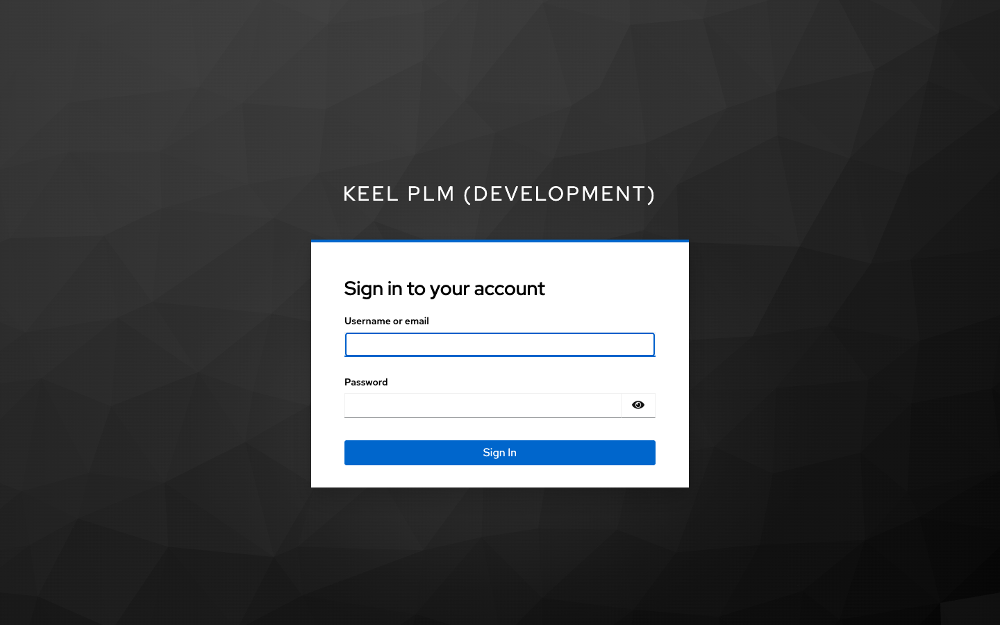
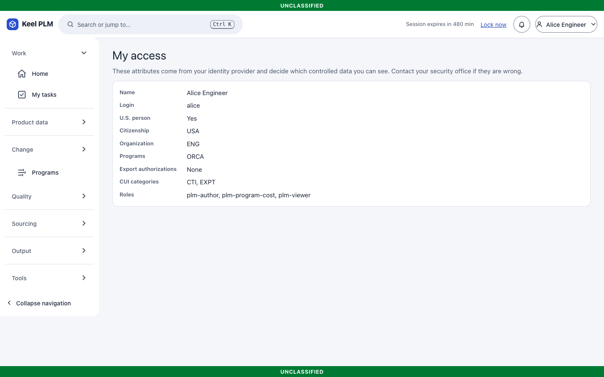
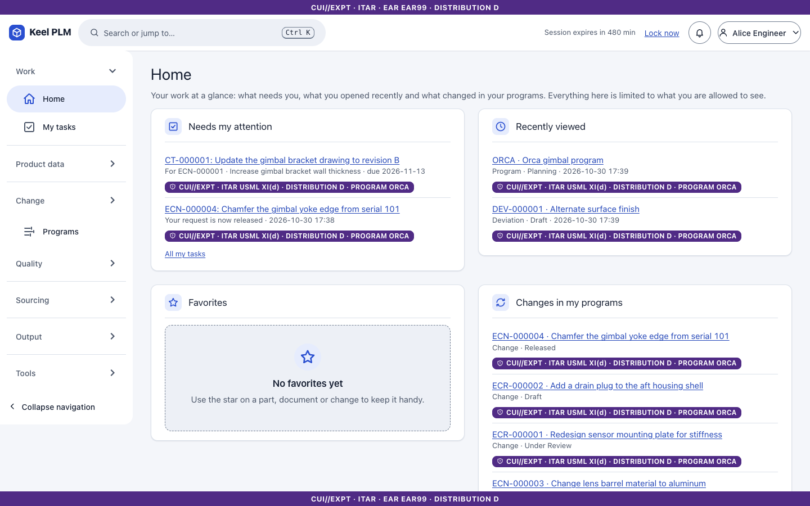

# 1. Getting started

This chapter takes you from a blank browser to a signed-in session, and explains the accounts you can use on a development or demo system.

## Signing in

1. Open the address your administrator gave you (a development machine uses `http://localhost:5080`).
2. Keel sends you to the sign-in page of the identity provider. On a production site this is your organization's single sign-on (with CAC/PIV or multi-factor authentication). Keel itself never sees or stores your password.
3. Enter your user name and password and select **Sign in**.
4. You land on **Home**.

Your session ends after 8 hours at most. Before that, it is locked if you stop working (see [Session lock](02-navigating.md#session-lock)).

### Development and demo accounts

On the development stack and the demo, the identity provider is a Keycloak realm with synthetic users. The password of every account is `keel-dev-<username>` (for example `keel-dev-alice`). These accounts exist only in the development realm; a production site has its own users.

| User | Role in this manual | Keel roles | U.S. person | Citizenship | Programs | Export authorizations |
|---|---|---|---|---|---|---|
| alice | Author, the engineer who does most of the work | viewer, author, program cost | yes | USA | ORCA | none |
| bob | Approver, signs reviews and change boards | viewer, approver | yes | USA | ORCA | none |
| carmen | Author in manufacturing, not on the ORCA program | viewer, author | yes | USA | none | none |
| farid | Partner author, a licensed foreign person | viewer, author | no | GBR | ORCA | TAA-0042 |
| lena | Viewer who is not a U.S. person (shows export-control denials) | viewer | no | DEU | ORCA | none |
| rex | Records manager | viewer, author, records | yes | USA | ORCA | none |
| audrey | Auditor, reads the audit log and verifies it | auditor | yes | USA | none | none |
| ada | Administrator and reviewer | admin, viewer | yes | USA | ORCA | none |
| sup-alpha, sup-bravo | Supplier portal users of two different suppliers | supplier | yes | USA | none | none |
| erp-service | A service account for the ERP integration (not a person; it signs in through the API) | integration | yes | USA | ORCA | none |

Good to know:

- An administrator does **not** bypass export-control markings. Ada sees what her own attributes allow.
- Alice also holds the program cost permission, which opens the **Cost** tab of a program ([chapter 17](17-programs.md)); the other accounts see hours but no rates or amounts.
- Only bob holds the approver role, so he is the only approver the dev realm offers.
- The identity provider keeps one session per browser. To switch users, sign out first, or use a separate browser profile or a private window for each user.
- The supplier accounts see only the supplier portal ([chapter 12](12-sourcing-and-portal.md)).

### Seeing what you are allowed to see

Select your name at the top right, then **My access**. The page lists your roles, whether you are a U.S. person, your citizenship, programs, export authorizations and CUI categories. Every decision about what you may read comes from these attributes.

### Signing out

Open the user menu and choose **Sign out**. This ends your Keel session and your session at the identity provider.

## Home

Home shows only what you may read. The cards are: Needs my attention, Recently viewed, Favorites, Changes in my programs, Recently released, and cards for activity in things you watch, quality, and your work in programs. A card that cannot load shows its own message and does not stop the others.

## A first ten minutes

1. Open **Parts** in the left rail and find the *Gimbal bracket* ([chapter 3](03-parts.md)).
2. Read the marking banners at the top and bottom of every page: they tell you how the data on the page must be handled ([chapter 9](09-markings-and-access.md)).
3. Press `Ctrl+K` (`Cmd+K` on a Mac) and type `bracket` to see the command palette ([chapter 2](02-navigating.md)).
4. Open **My tasks** to see anything waiting for your signature ([chapter 6](06-lifecycles-workflow-signatures.md)).
