# 2. Navigating Keel

## The shell

Every page has the same frame:

- **Marking banners** at the very top and bottom. They show the combined handling markings of everything on the page.
- **Search or jump to...** at the top left (also `Ctrl+K`).
- **Session information** and **Lock now** at the top right, the notification bell ([chapter 19](19-notifications-and-activity.md)) and your **user menu**.
- The **navigation rail** on the left.
- Breadcrumbs, then the page itself.

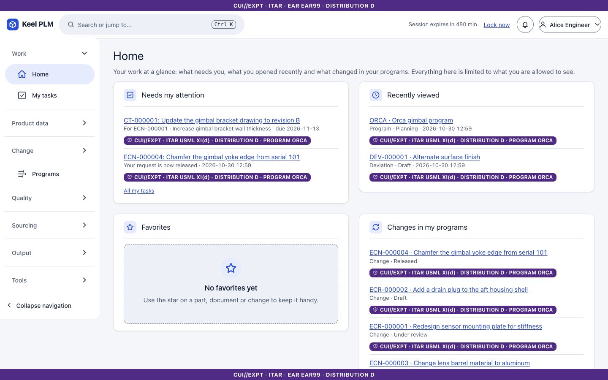

### The navigation rail

The rail is grouped. Which groups you see depends on your roles; hiding a link is only a convenience, and every page and service checks your role again.

| Group | Links |
|---|---|
| Work | Home, My tasks |
| Product data | Parts, Documents, Manufacturing BOMs, Process plans, Tools and gauges, Requirements, Options and variants, CAD structures, Compliance, Baselines |
| Change | Changes |
| Programs | Programs |
| Quality | Nonconformance reports, Corrective actions, Deviations and waivers |
| Sourcing | Suppliers, Supplier requests |
| Output | Reports, Release packages, BOM in Excel, Mass change |
| Records | Records management, Retention schedules, Legal holds, Disposition, Archives (records managers, administrators and auditors) |
| Configuration | Workflows, Lifecycles, Classification (administrators) |
| Administration | Administration, Migration, Integration (administrators) |
| Tools | Access check, Technical data packages, Style guide, and Audit log (auditors) |

A supplier user sees only **Supplier portal > My requests**.

To open or close a group, select its header. The group that holds the current page opens by itself.

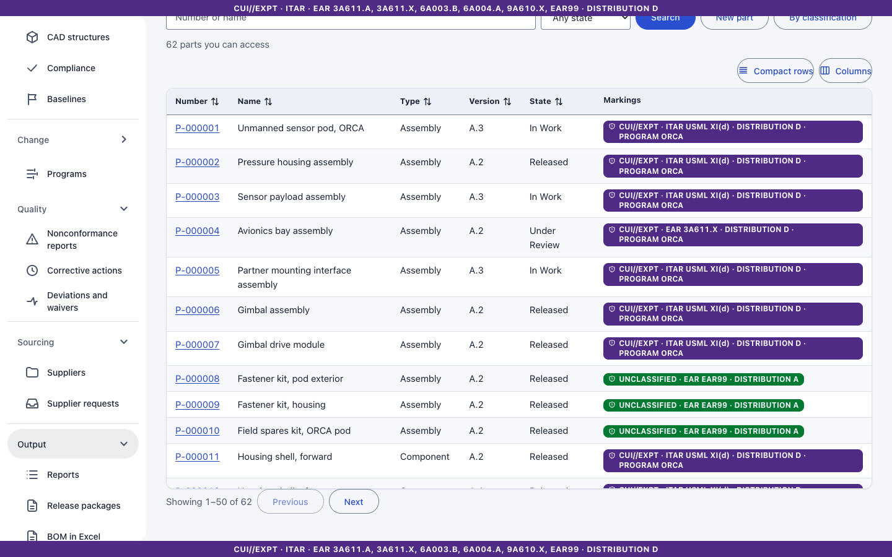

To shrink the rail to icons, select **Collapse navigation** at its bottom; select the same button to expand it again.

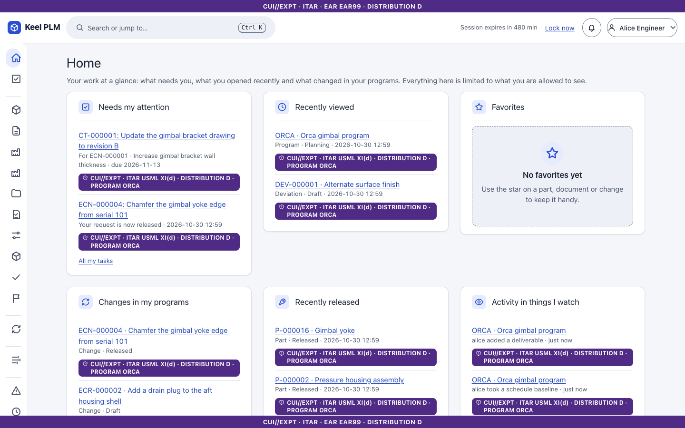

## Search and the command palette

Press `Ctrl+K` (or `Cmd+K`, or `/` when no field has focus), or select the search box.

1. Type at least two characters: a number, a name, or a prefix followed by a colon.
2. Use the arrow keys to move through the results. `Enter` opens the selected result; `Ctrl+Enter` opens it in a new tab.
3. `Esc` closes the palette.

Prefixes narrow the search to one kind of object: `p:` parts, `d:` documents, `c:` changes, `ecn:`, `ecr:`, `pr:`, `b:` baselines, `mb:` manufacturing BOMs, `s:` suppliers, `rs:` requirement specifications, `pp:` process plans, `tl:` tools, `pg:` programs, `sub:` substances. The palette also offers actions such as "Go to Documents". It shows only objects you may read: if a person cannot read a part, it does not appear for them.

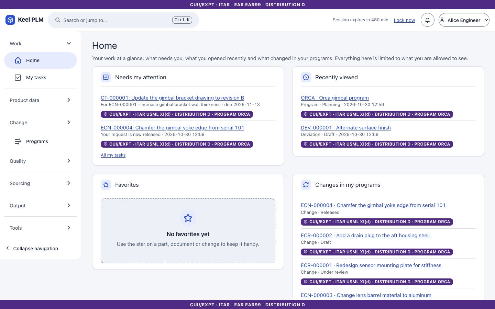

The full search page (`/search`) has a tab per kind of object and can keep saved searches. Saved search text is private to you.

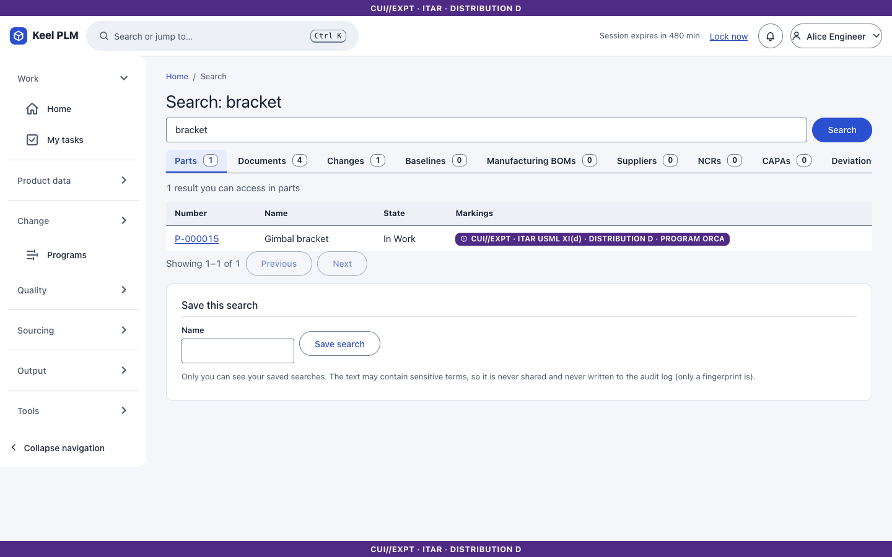

## Object pages

Parts, documents, changes, baselines and manufacturing BOMs share one layout: a header with number, name, markings and version; a **lifecycle stepper** showing where the object is; a sticky action bar (Check out, Check in, Move to...); and tabs. A tab is part of the address (`?tab=history`), so you can bookmark or send a link to it. The star (**Add to favorites**) and **Watch** button sit in the header.

## Themes and density

Open the user menu and use **Theme** (System, Light, Dark, High contrast) and **Density** (Comfortable, Compact). The choice is saved for you on the server and follows you to your next sign-in.

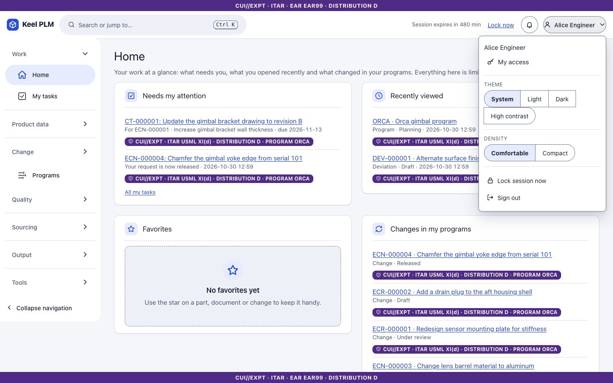

| Dark | High contrast |
|---|---|
| 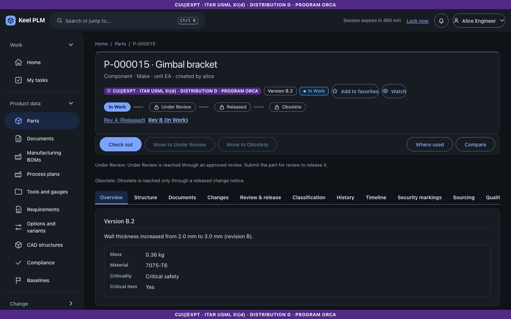 | 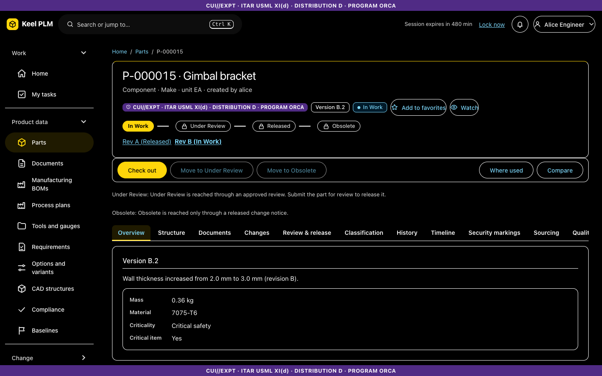 |

Compact density fits more rows on a screen:

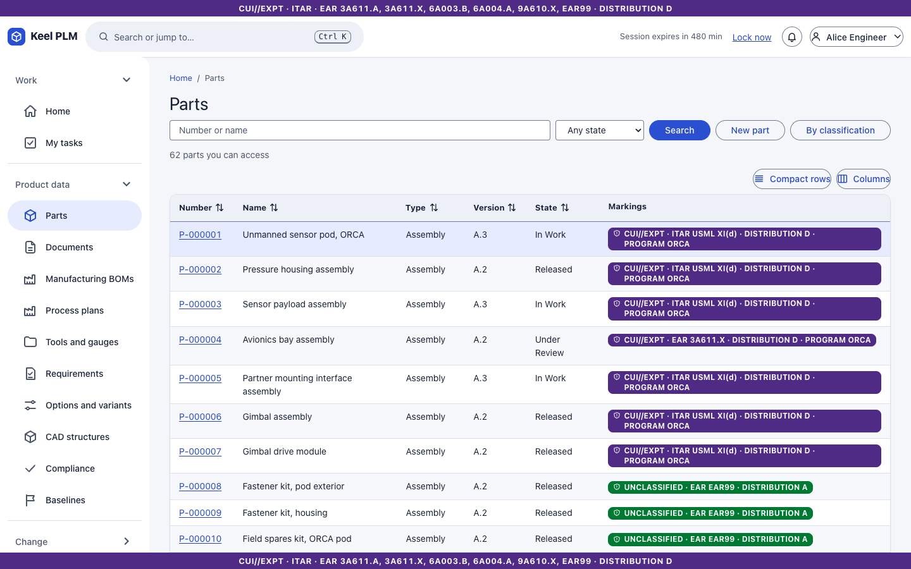

## Phones and narrow windows

Below 768 px the rail becomes a menu button and tables scroll inside their own area; pages do not scroll sideways. The marking banners stay in place.

| Home at 375 px | A part at 375 px | The menu |
|---|---|---|
| 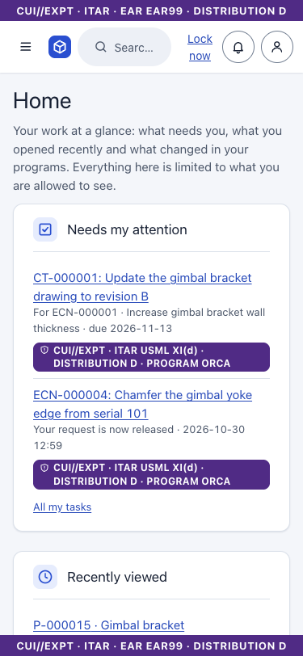 | 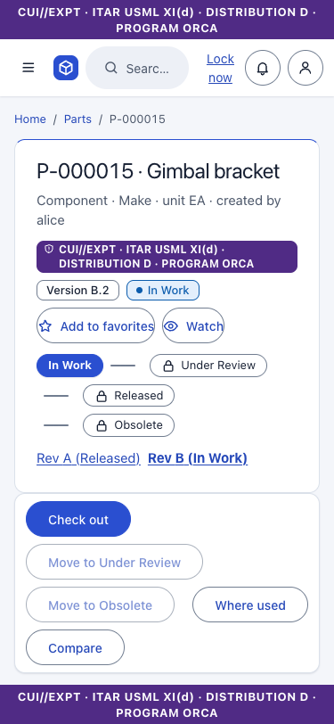 | 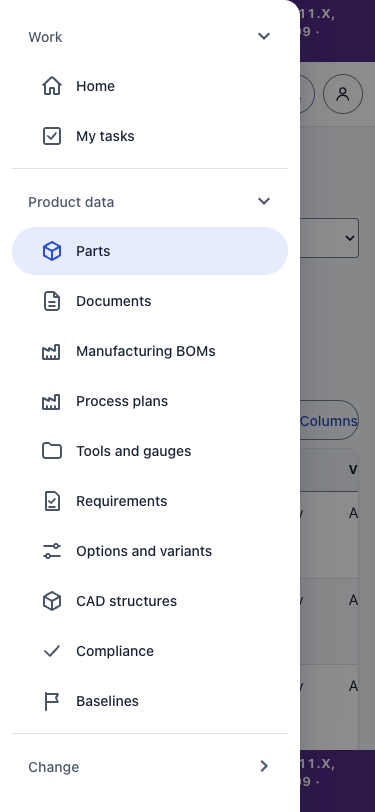 |

## Session lock

If you stop working, Keel warns you (default: after 15 minutes idle, with a 60 second warning), then **locks** the session. While locked, the page's data is removed from the page, not hidden behind a cover, and the server refuses actions. To unlock, select **Sign in to unlock**: you sign in again at the identity provider and return to the same page. Unsaved input is not kept, because that would mean keeping marked data in memory. A session that stays locked for 15 minutes is ended and you are signed out.

To lock your session yourself, select **Lock now** at the top of any page, or **Lock session now** in the user menu.

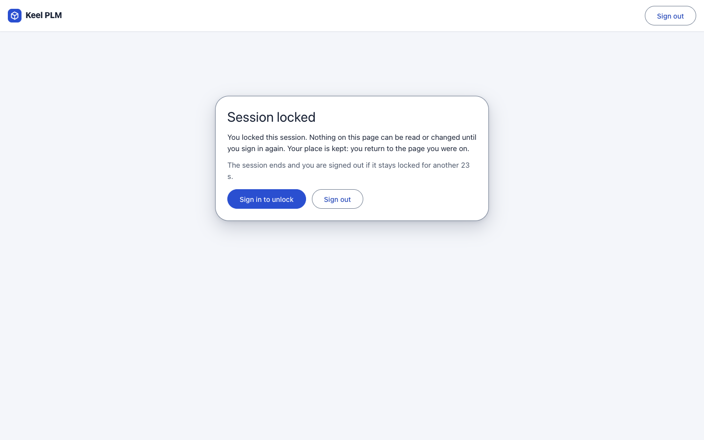

The lock is the server's decision: it also locks if the browser is closed. The time limits are settings ([chapter 24](24-administrator-and-operator-guide.md)).

## Keyboard and accessibility

- A skip link at the top jumps to the main content. Focus moves to the page heading after you navigate.
- Tabs, tables, the BOM grid, diagrams and the palette are operable from the keyboard. Every diagram has a table alternative.
- Keel targets WCAG 2.1 A and AA and is checked automatically with axe-core in light, dark and high-contrast themes; a screen-reader walkthrough is still a manual task ([ux/accessibility.md](../ux/accessibility.md)).

## Style guide

**Tools > Style guide** shows every component (colors, type, buttons, chips, tables, forms, banners, states) in the current theme. It is useful when you want to know what a chip or banner color means.

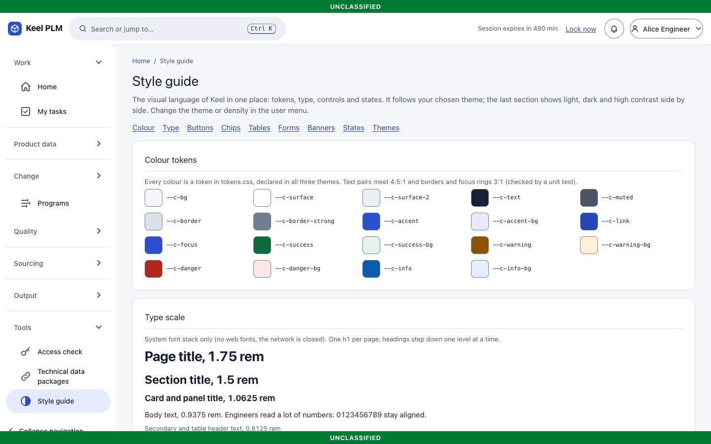
