# 3. Parts

A **part** is an item you design, make or buy. It has a **master** (number and name, shared by all versions), **revisions** (A, B, C... formal, change-controlled releases) and **versions** (A.1, A.2... each save inside a revision; the architecture calls them iterations). The lifecycle state lives on the revision.

## Find parts

1. Select **Parts** in the rail.
2. Type in the search box. The list matches numbers and names (full-text and fuzzy). Use the filters to narrow by type and state, and select a column heading to sort the rows on the page.
3. Each row has a marking chip. The banner at the top and bottom of the page is the **aggregate** of the rows shown.

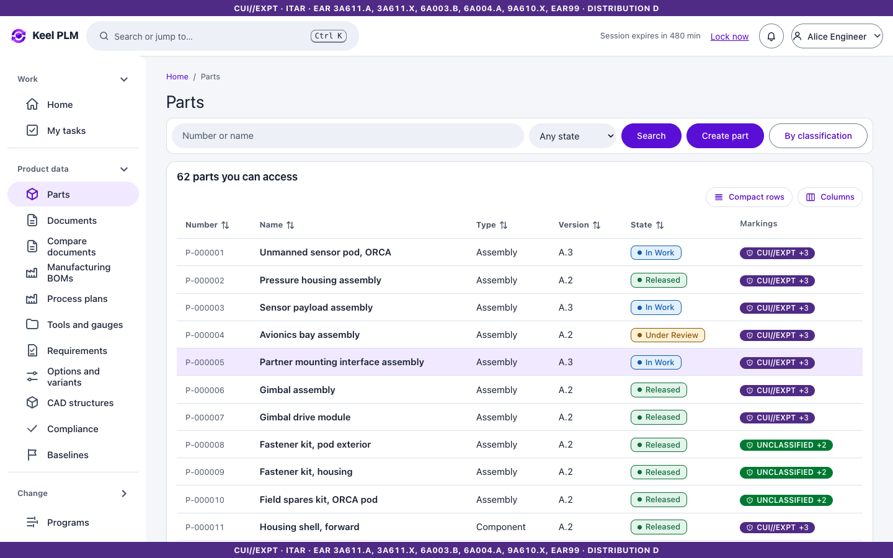

Parts you may not read are not in the list. **Parts > classification** (`/parts/classification`) finds parts by class and class attributes (for example wall thickness).

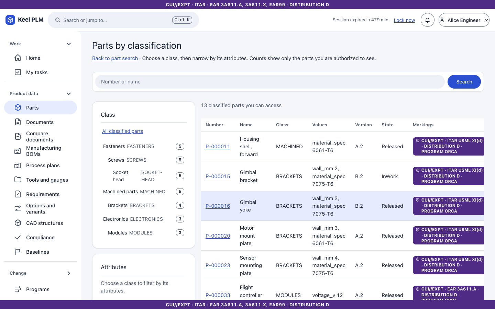

## Create a part

The quick way needs a name and nothing else.

1. On the parts list select **Create part** (or press Ctrl + K and choose **Create part**).
2. Type the name. Add a description if you like.
3. Select **Create part**. The part number is assigned automatically (`P-nnnnnn`); only administrators can choose one.

That is three steps from the parts list. To enter several parts in a row, select **Create and add another**: the form empties its name and puts the cursor back there.

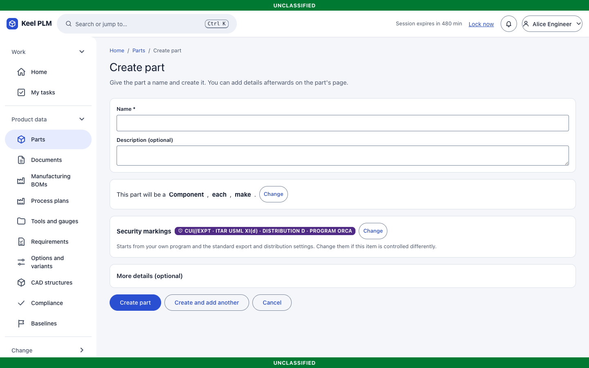

What the form fills in for you, and how to change it:

- **Type, unit and source.** The line "This part will be a Component, each, make" shows what will be used. It starts from what you chose last time, or the common default. Select **Change** to pick another. These three cannot be changed after the part exists.
- **Security markings.** One chip shows the markings the part will get. They start from your own program and the standard export and distribution settings. Select **Change** to open the full markings form (export jurisdiction, CUI categories, distribution statement, program, owning organization). The rules are the same as ever: an ITAR part needs a USML category, export-controlled data must be CUI//EXPT, and it cannot have distribution A. If something is missing you are told in plain words and the markings form opens.
- **Attributes.** Attributes your administrator marked as required are asked for on the form (marked with an asterisk, and the form tells you which one is missing). All other attributes are under **More details (optional)**.

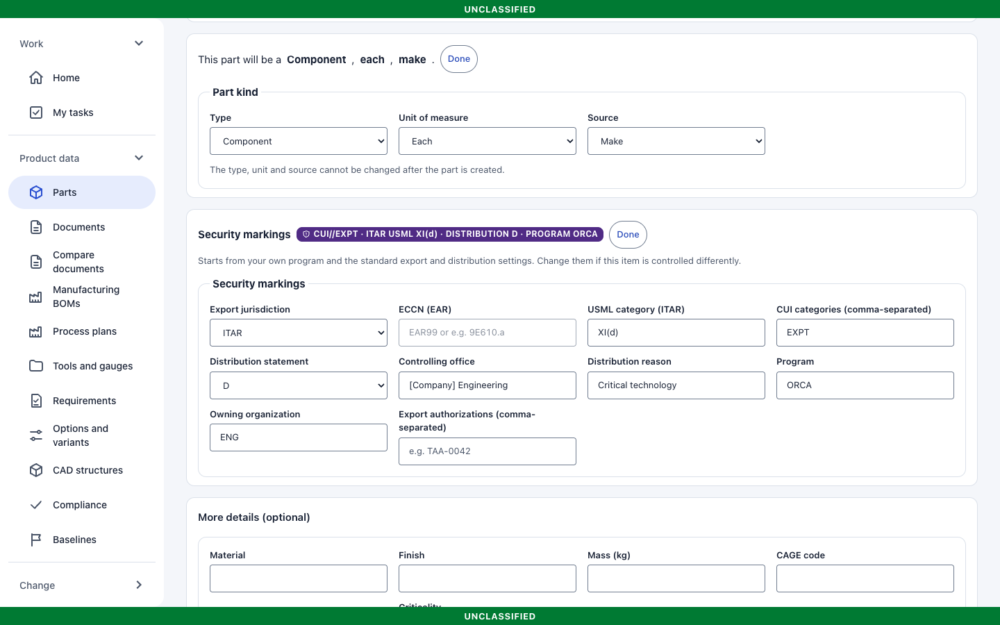

### Create a part with its files

You can give the part its files in the same step. Under **Files (optional)** on the form:

1. Choose all the files together (hold Ctrl or Shift to select several), or drop them on the box. For a gimbal bracket that might be the STL model, the drawing PDF and the specification.
2. Check the list. Each file becomes a document: its **Document name** comes from the file name (`gimbal_bracket.stl` starts as "gimbal bracket") and its **Type** from the file (a model such as STL, STEP or 3MF is CAD; a file with "spec", "procedure" or "report" in its name gets that type; the rest start as Drawing). Change either, or **Remove** a file that does not belong. Choosing files again replaces the list.
3. Under the list, say how the documents relate to the part. The default, "Describes this part", suits models and drawings; use "The part follows this document" for a specification that is revised on its own.
4. Select **Create part**.

Keel creates the part, creates every document with the part's markings, links them and saves the part once, so the part is at version A.2 however many files you gave it. If one of the files cannot be added, the part is still created and a message names the file and the reason; add the rest with **Add document** on the part page. A 3D model is also recorded as the part's model, so the part opens on its **Viewer**.

## Read a part

The part page has the actions **Edit**, **Add document** and the lifecycle moves in a bar that stays in view. The key facts (type, source, unit, who created it) are under the title. The tabs are:

| Tab | What it shows |
|---|---|
| Overview | The version, its description and attributes |
| Structure | The bill of materials ([chapter 4](04-boms-variants-mbom.md)) |
| Documents | Linked documents ([chapter 5](05-documents-and-vault.md)) |
| Audit trail | A group tab: **Changes** (change notices that affect the part, [chapter 7](07-change-management.md)), **History** (every version, with who and when), **Timeline** (events in time order) and **Activity** (who did what, [chapter 19](19-notifications-and-activity.md)) |
| Review & release | The review workflow and its history ([chapter 6](06-lifecycles-workflow-signatures.md)) |
| Security markings | The markings and the history of changes to them |
| Design | A group tab: **Viewer** (the 3D view of the CAD model attached to the part, shown only when a model is attached, [chapter 5](05-documents-and-vault.md#the-viewer-tab-3d-models-on-the-page)) and **Classification** (class and class attribute values) |
| Supply & checks | A group tab: **Sourcing**, **Quality**, **Compliance** and **Trace** (other areas' data for this part, [chapters 10, 12, 14, 15](10-quality.md)) |
| Comments | Discussion ([chapter 19](19-notifications-and-activity.md)) |

A group tab opens a second row of small buttons under the main row. Opening the group again takes you back to the one you used last, and every tab keeps its own address (for example `#history`), so links and bookmarks still work.

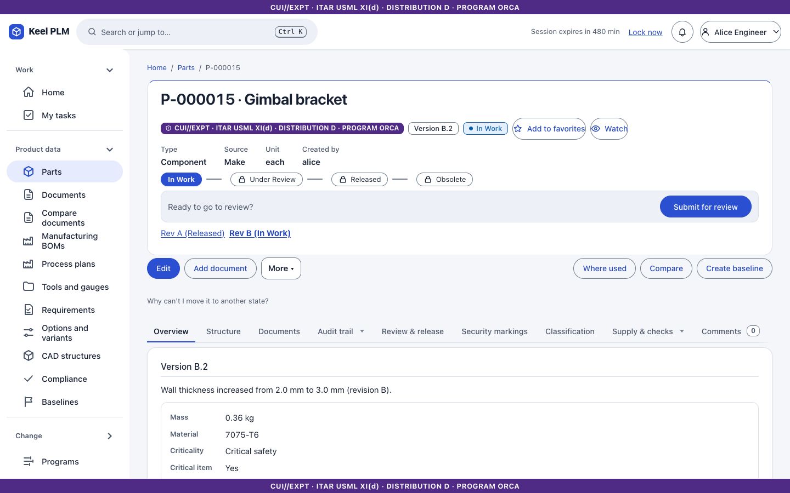

Use the revision links under the stepper (for example **Rev A (Released)**, **Rev B (In Work)**) to switch revisions.

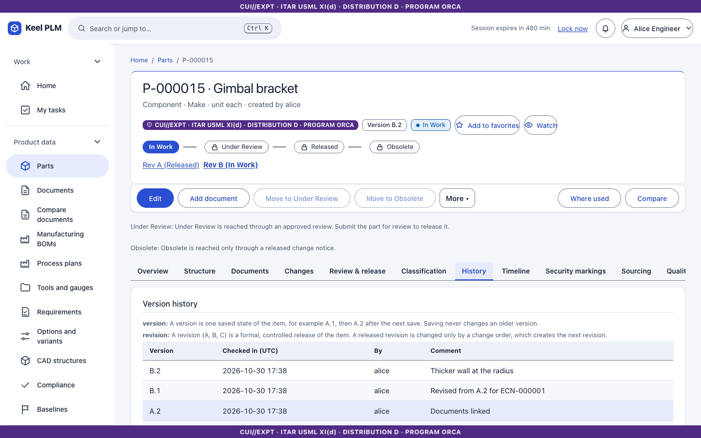
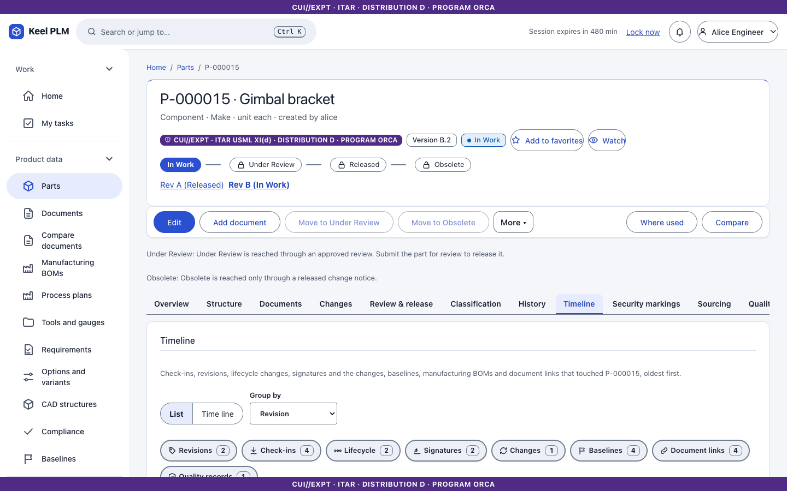
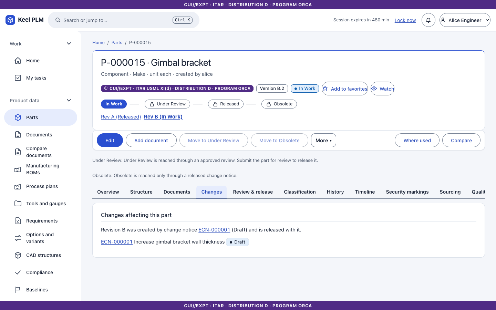
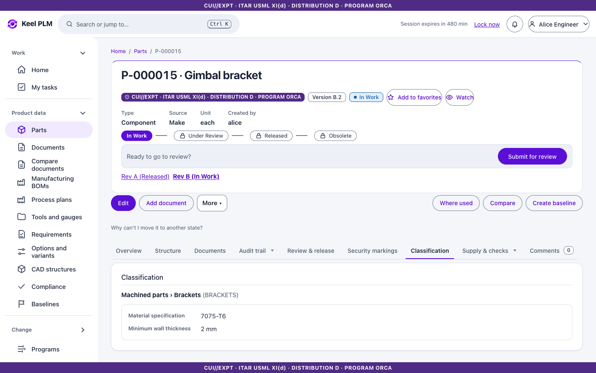
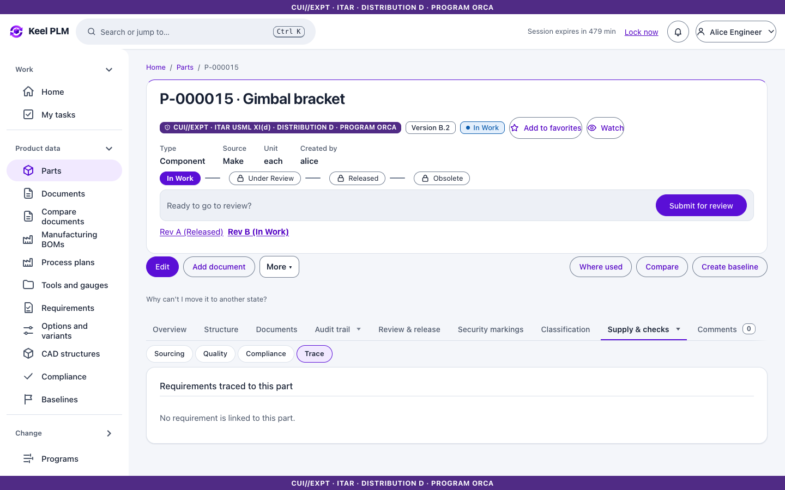

## Change a part: Edit and Save

A part is changed by one person at a time. While you edit, nobody else can, and your changes stay private until you save.

1. On an In Work part select **Edit**. The part is reserved for you and the **Your changes** form opens (description and attributes; on assemblies also the BOM and documents).
2. Make your changes. Add a **change note** if you want the history to say why.
3. Select **Save**. This stores your changes as the next version (A.1 becomes A.2) and releases the reservation. Document links and BOM lines are carried forward.
4. Changed your mind? **Discard changes** throws away what you have not saved (it asks first). The last saved version stays as it is.

If you already have the part reserved (for example from before), **Edit** is not shown: you are already editing, and **Save** and **Discard changes** are there.

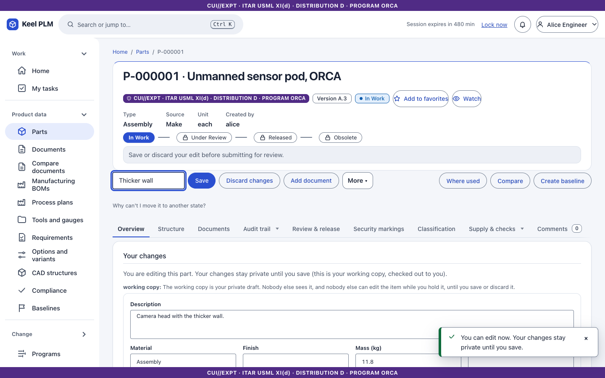

When you cannot edit, one line above the tabs says why and what to do:

- **The part is released.** Changes to a released part go through a change order. **Start change** opens a new change notice with this part already filled in ([chapter 7](07-change-management.md)).
- **The part is under review.** It cannot be edited until the review is finished.
- **Somebody else is editing it.** The line names them and since when.
- **You can see the part but not change it.** The line gives the reason (role, program, organization).
- **You are looking at an older revision.** Open the latest revision to edit.

These are the same rules as before. Edit and Save simply do the steps for you and tell you plainly when a rule says no.

### Step by step (advanced)

Under **More** in the action bar the individual steps are still there, for people who want them: **Check out** (reserve the part), **Save working copy** (store your changes without releasing the part, so you can keep working), **Check in** with a comment (the next version), and **Undo check-out**. Edit does check out; Save does save working copy and check in; Discard changes does undo check-out. The audit log records the same entries either way (check-out, edit, check-in, undo check-out). Only the holder or an administrator can undo a check-out.

Released revisions are locked. To change a released part you revise it inside a change notice ([chapter 7](07-change-management.md)).

## Move through the lifecycle

The stepper shows In Work, Under Review, Released and Obsolete. The action bar offers only the moves you may make:

- **Move to Under Review** and **Released** happen through an approved review ([chapter 6](06-lifecycles-workflow-signatures.md)); the page tells you so.
- **Move to Obsolete** happens only through a released change notice.
- An administrator can **Set state...** as a documented override with a reason (used for migration and corrections); it is audited.

## Change markings

On the **Security markings** tab (In Work only), choose new markings and give a reason. You cannot lock yourself out of your own part. Markings of locked revisions change only through change control.

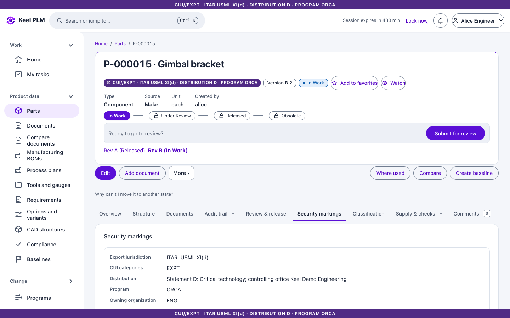

## Favorites, watch and comments

Select **Add to favorites** to pin the part to Home. Select **Watch** to be told about changes ([chapter 19](19-notifications-and-activity.md)).

## Where used and compare

- **Where used** lists the assemblies that use the part, filtered by what you may read ([chapter 4](04-boms-variants-mbom.md)).
- **Compare** shows two versions of the part side by side.

## What is not editable

The name, type, unit and source of a part are fixed once it exists. Renaming is not shipped; description and attributes are per iteration.
