# 4. Bills of materials, variants and manufacturing BOMs

## The engineering BOM (EBOM)

An assembly's **Structure** tab shows its bill of materials. Each line is a **usage link**: parent iteration, child part, quantity, unit, find number, reference designators. A **configuration spec** on the line chooses which version of the child the line shows (Latest, Latest released, Effectivity, or Baseline).

### Read the structure

1. Open an assembly, for example *Unmanned sensor pod, ORCA* (`P-000001`), and select the **Structure** tab.
2. Choose how to resolve it: **Latest**, **Latest released**, **As of serial, lot or date**, or **Baseline**.
3. Select **Expand all** (or **Collapse all**), or use **Levels** to limit depth. The grid supports the keyboard (arrow keys, left and right to collapse and expand).
4. Choose a view: **Tree**, **Purchasing summary** (total quantities with scrap) or **Treemap**. **Export CSV** downloads what you see.

**Treemap** draws parts as rectangles sized by extended quantity. Select a block to drill in; `Backspace` goes up one level. You can color by state or by markings; restricted blocks are hatched. A table alternative is always available.

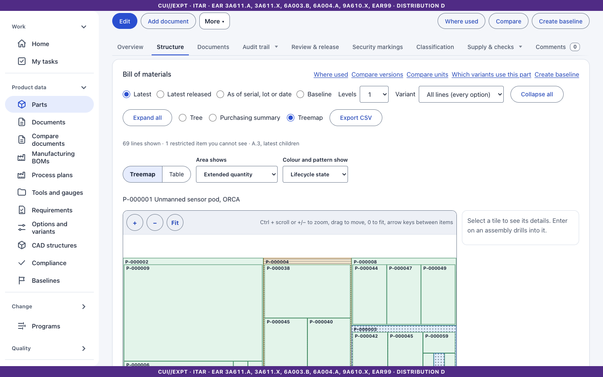

### Restricted lines

If a line holds a part you may not read, you see **Restricted item** with only the quantity and find number. The part is not named, and where-used does not reveal it. Opening an assembly never fails because of one hidden line.

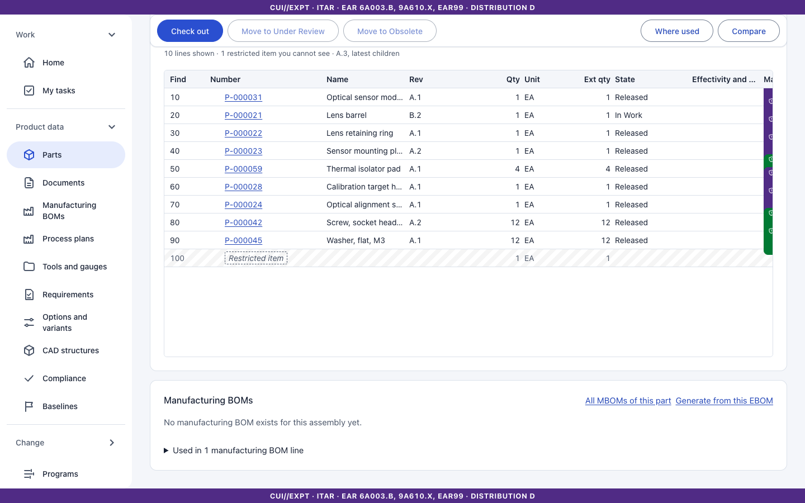

### Edit a BOM

BOM lines change in the assembly's working copy: **Edit** (or **Check out** under **More**), edit lines in the structure editor (add a child by number, change quantity, find number, designators, effectivity, option condition), then **Save** (or **Check in**; [chapter 3](03-parts.md)). Keel refuses a check-in that would make a cycle or add a part you cannot read.

### Where used

From the part page select **Where used** (or `/parts/<number>/where-used`). The page lists parent assemblies up the tree, with the effectivity of each line. Hidden parents appear only as restricted entries. Long results are paged.

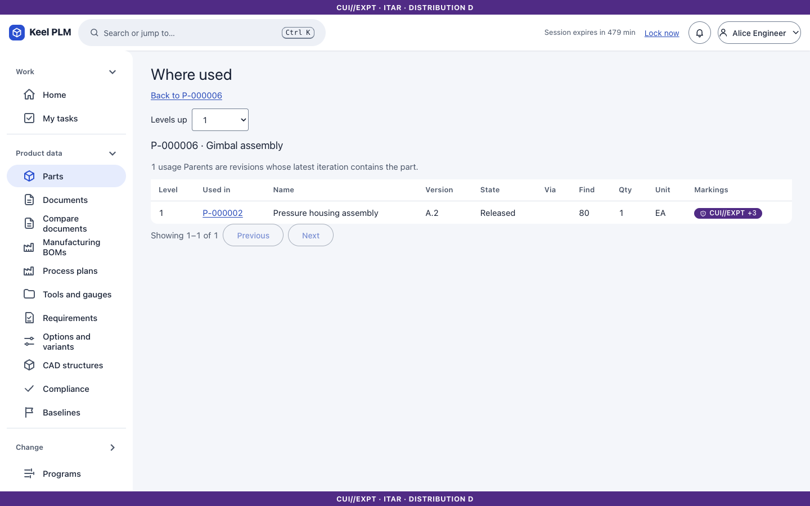

### Compare versions and the structure diff

Select **Compare versions** on the Structure tab (or **Compare** on the part page) to choose two iterations or revisions. The result is a two-pane **structure diff**: the changed lines of both versions, side by side, with the unchanged lines counted and unchanged parents shown as context rows. Use **Next change** to jump. A changed line you cannot read shows as "Restricted item changed".

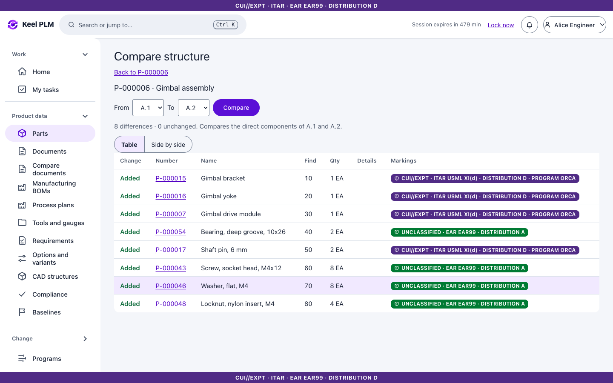

**Compare units** compares the same assembly for two serial numbers, lots or dates (for example serial 100 against 101 of the partner mounting interface assembly):

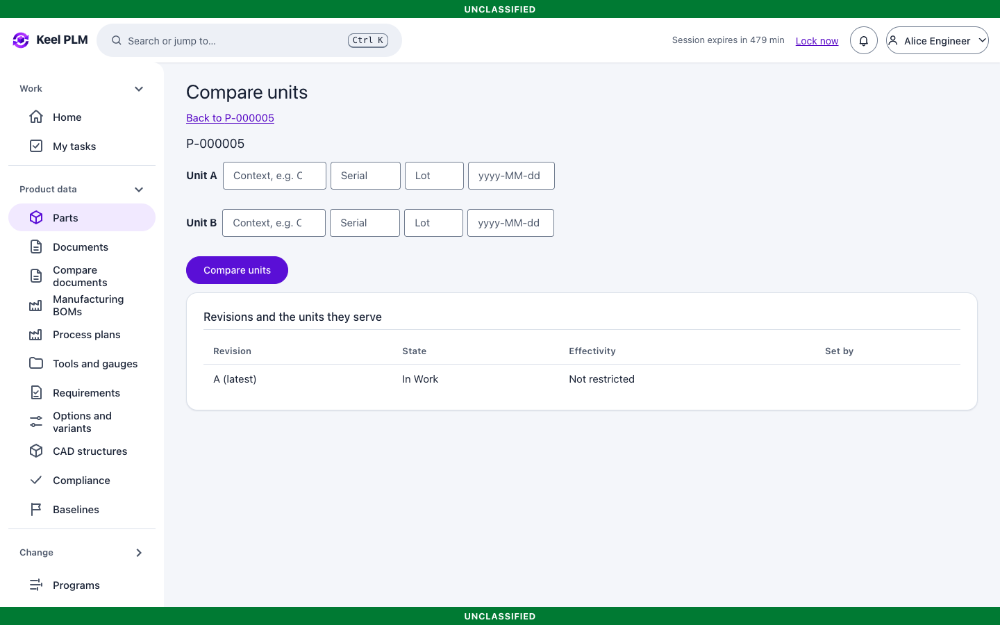

### Alternates and effectivity on a line

A find number can have **alternates**: two lines that apply to different serial ranges (for example M5 screws for serials 1 to 100, M4 from 101). The effectivity column shows the range. Alternates of one find number must not overlap. See [chapter 8](08-baselines-effectivity.md).

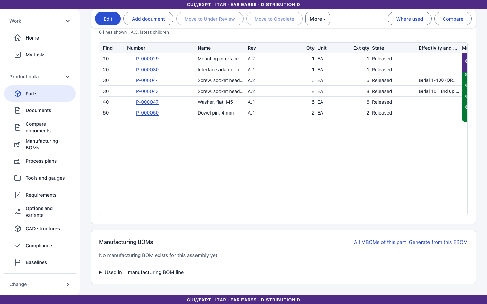

## Options, variants and the 150% BOM

A product that comes in many configurations carries all possible lines in **one** structure (the *150% BOM*), and each line may have an **option condition**. A **variant** is a named, valid selection of options. Resolving the structure with a variant shows only the lines whose condition holds.

### The option model

1. Open **Options and variants** in the rail. The list shows products (assembly parts) with an option model.
2. Open a product (`/options/<number>`). The page has **Options** (families such as Engine and Payload, with their values), **Rules**, **Variants** and **Validity**.

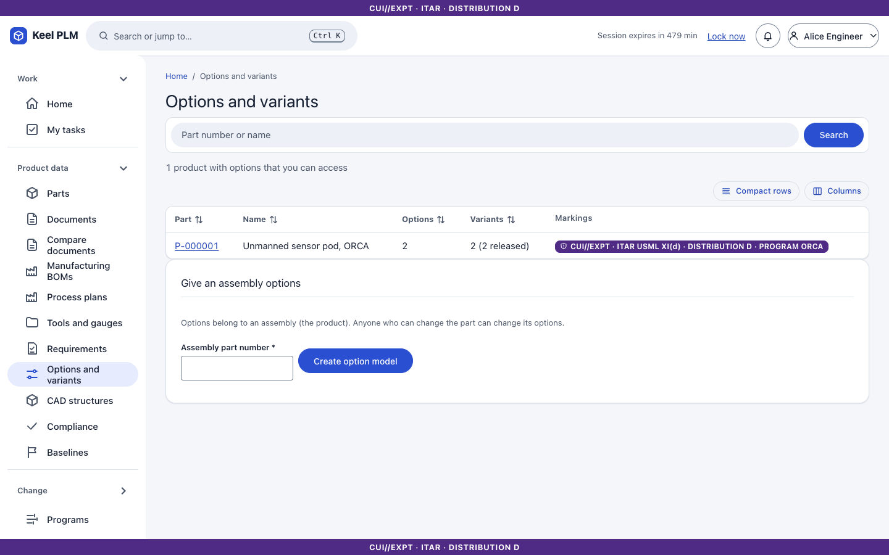
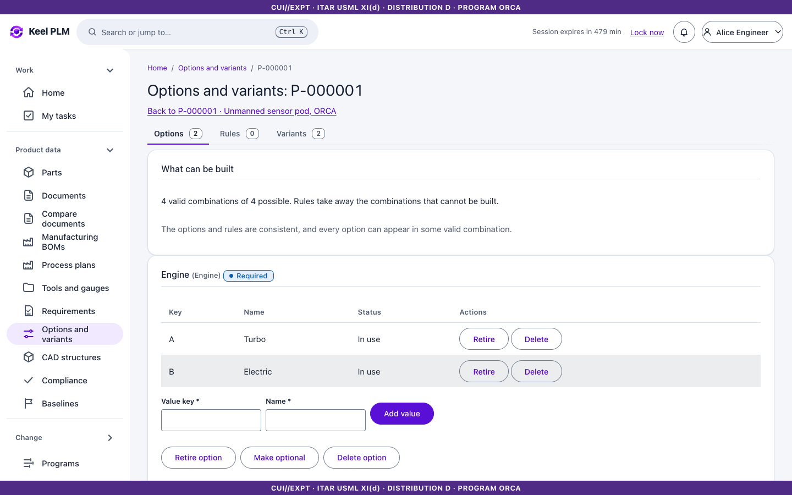

### Rules

On the **Rules** tab add rules of kind **Requires**, **Excludes** or mutually exclusive between option values. Keel refuses a rule that would make the model inconsistent or invalidate a released variant, and says why in plain words.

### Variants

Create a variant by choosing one value per family; Keel validates it against the rules. A variant is **Draft**, **Released** or **Retired**. Releasing a variant needs modify access to the product and a valid configuration (no signature); a released variant is frozen.

### Conditions on BOM lines

In the BOM editor, give a line a **condition** such as `Engine=B and Payload=X` (validated, with a plain-language preview). Option-based alternatives use different find numbers.

### Use a variant

On the Structure tab pick a name under **Variant**. Tree, summary, treemap and CSV then show that variant's lines. The default **All lines (every option)** is the 150% structure.

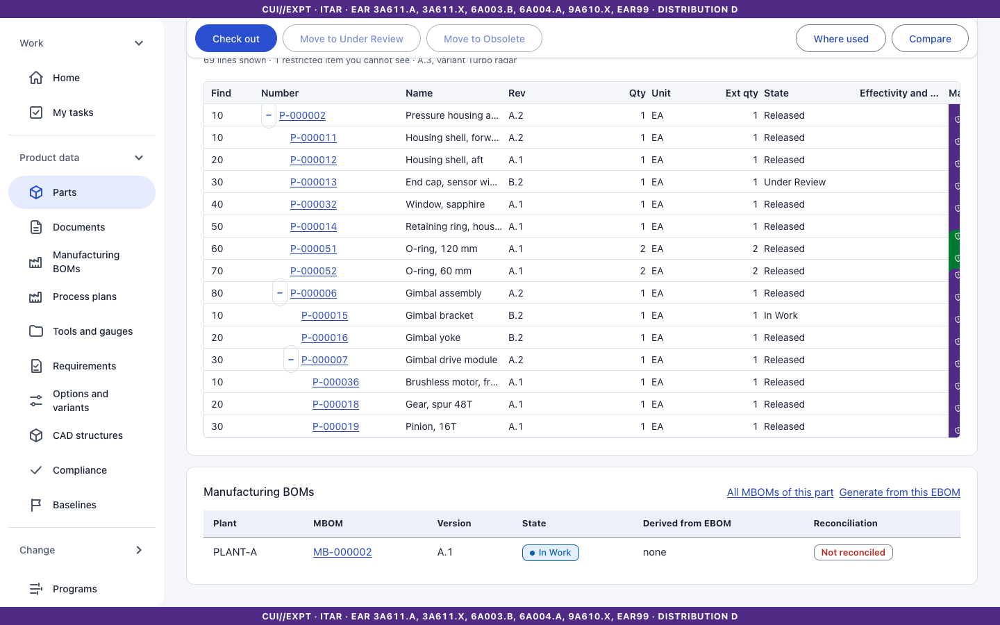

**Compare variants** (`/options/<number>/compare`) lists the lines that differ. **Which variants use this part** (`/parts/<number>/variants`) lists the variants whose structure contains the part.

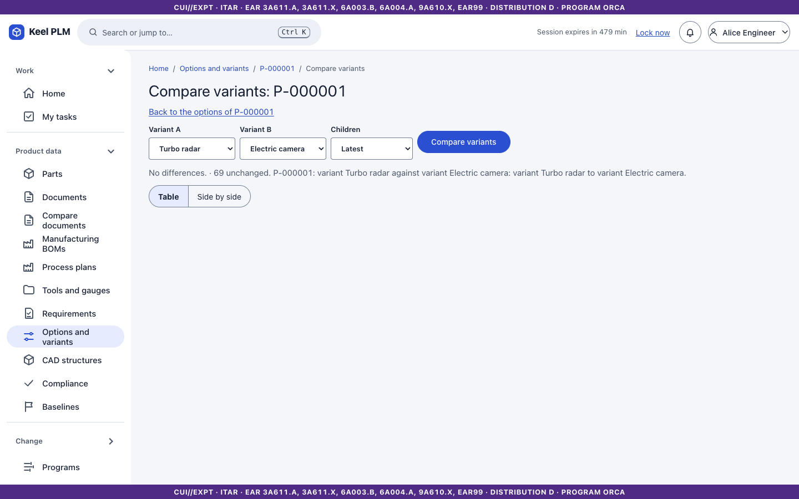
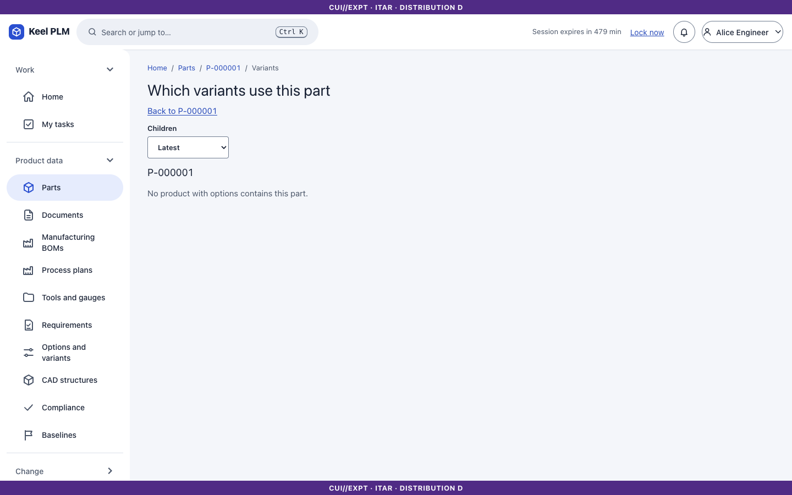

Not shipped: conditions on manufacturing BOM lines of their own, conditions in baselines, and notification of variant release ([increments/8.4-variants.md](../increments/8.4-variants.md)).

## Manufacturing BOMs (MBOM)

An **MBOM** is the structure for one part in one **plant**, and a separate versioned object (`MB-nnnnnn`) with its own revisions, check-out and release. It is linked to the EBOM by **reconciliation**.

### The list

Open **Manufacturing BOMs** in the rail. Choose a plant, then the MBOM.

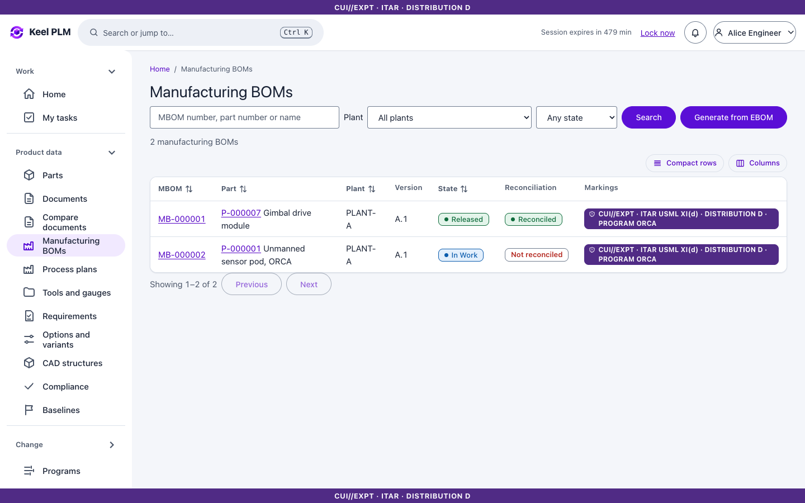

### Generate an MBOM from the EBOM

1. Select **Generate** (or open `/mboms/generate?part=<number>`).
2. Choose the part, the plant, the EBOM spec to use (Latest, Latest released, an effectivity unit, a baseline, or an explicit version) and whether to generate multi-level.
3. Review and create. If the EBOM contains parts you cannot read, generation is refused.

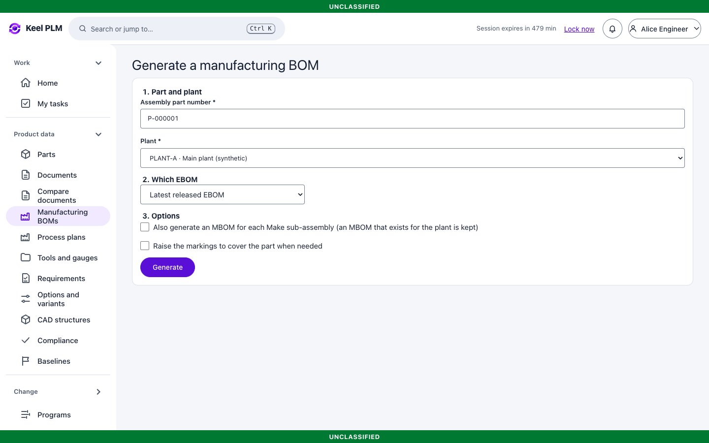

### Work on an MBOM

An MBOM page has tabs **Overview, Lines, Reconciliation, Review & release, Structure, Process plan, Timeline, Security markings**. Lines have a **supply type** (Make, Buy, Consume), a scrap factor, and a link to the EBOM line they come from; **manufacturing-only** lines have no link. Edit in the working copy (check out, edit, check in) as for parts.

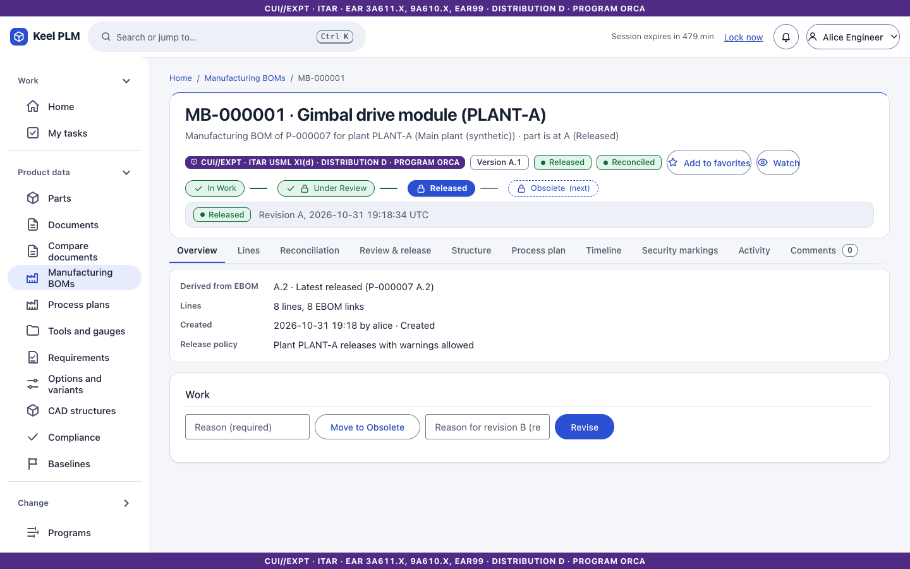

### Reconcile

The **Reconciliation** tab compares the MBOM with its EBOM and groups findings by severity. The overall status is **Reconciled**, **Reconciled with exceptions**, **Not reconciled** or **Stale** (the EBOM moved on). Errors block release; warnings block only where the plant's policy says so. After an EBOM change, **Update from EBOM** proposes a regeneration that you accept line by line, keeping manufacturing edits.

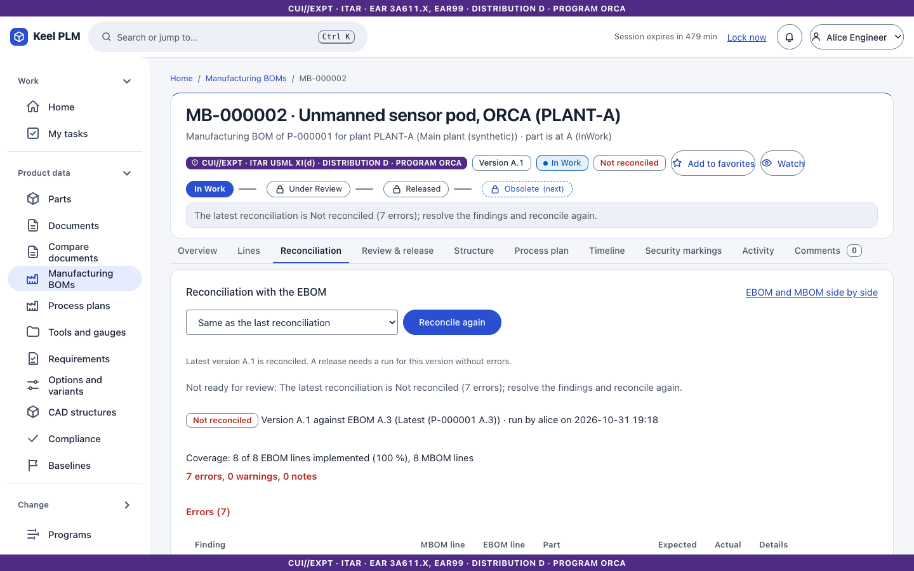

### Release and compare

Release goes through the review workflow with signatures ([chapter 6](06-lifecycles-workflow-signatures.md)). **Side by side** shows EBOM and MBOM next to each other; **Compare** compares two MBOM versions.

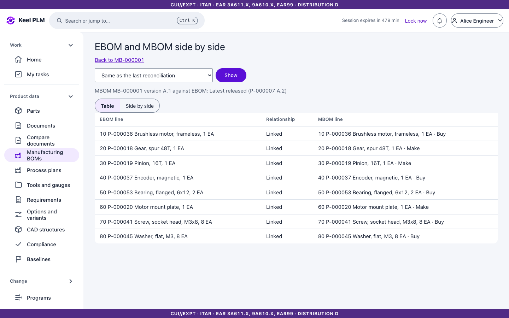

The routing for an MBOM is on its **Process plan** tab ([chapter 13](13-manufacturing-process.md)).
