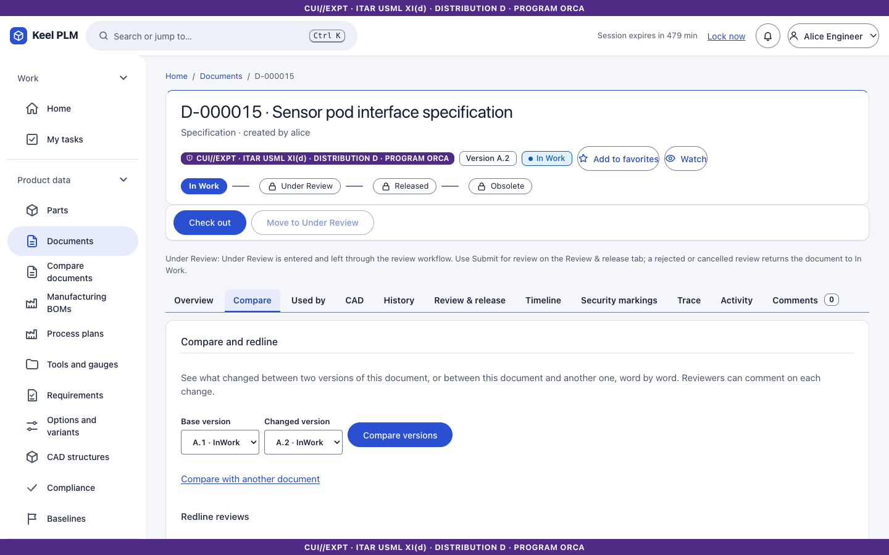
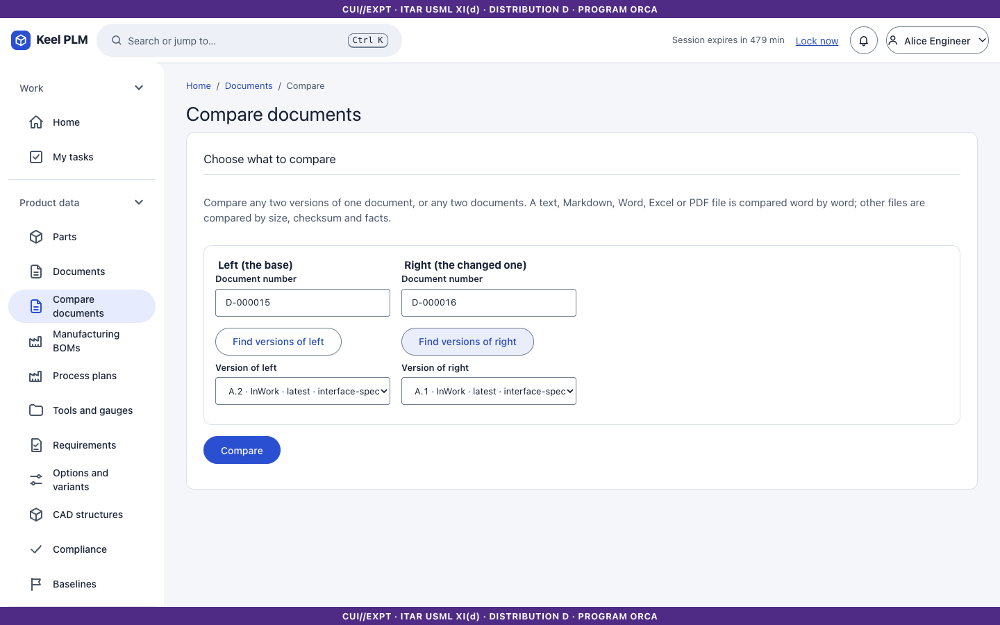
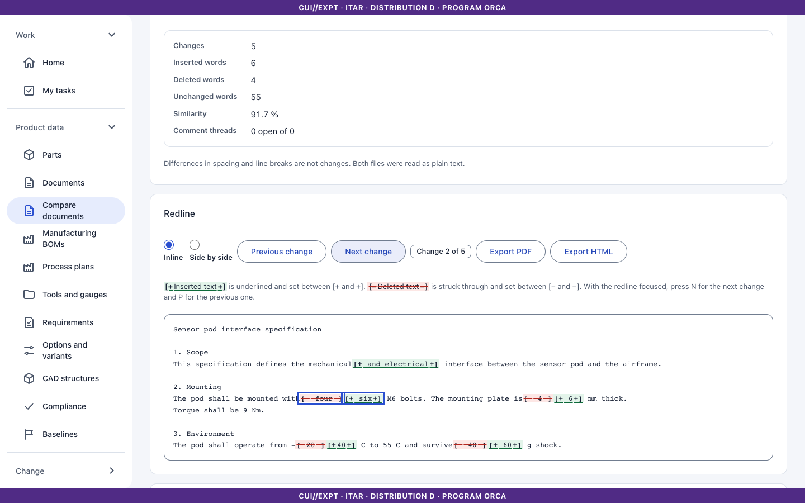
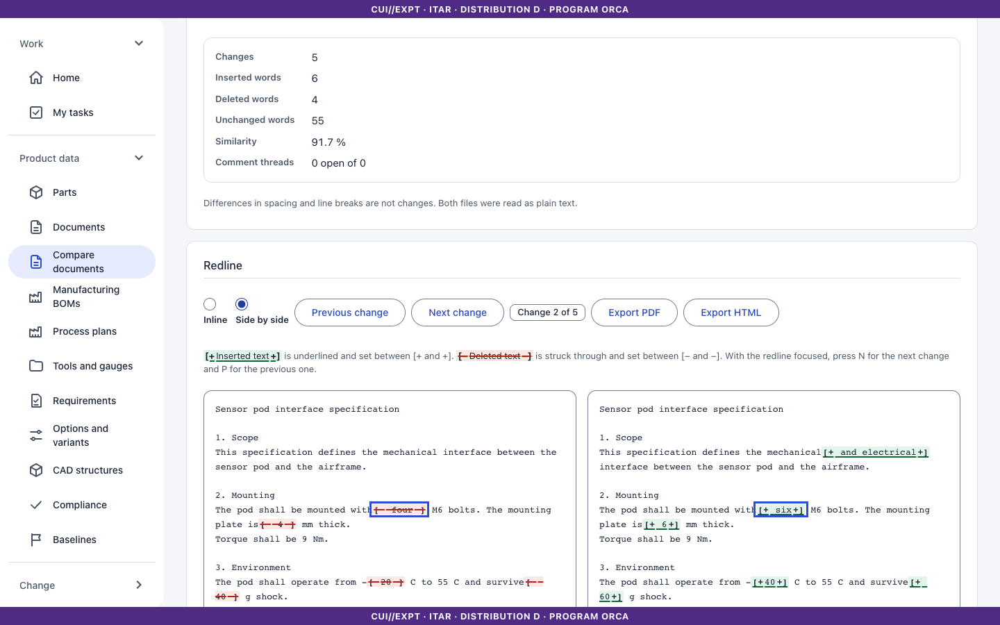
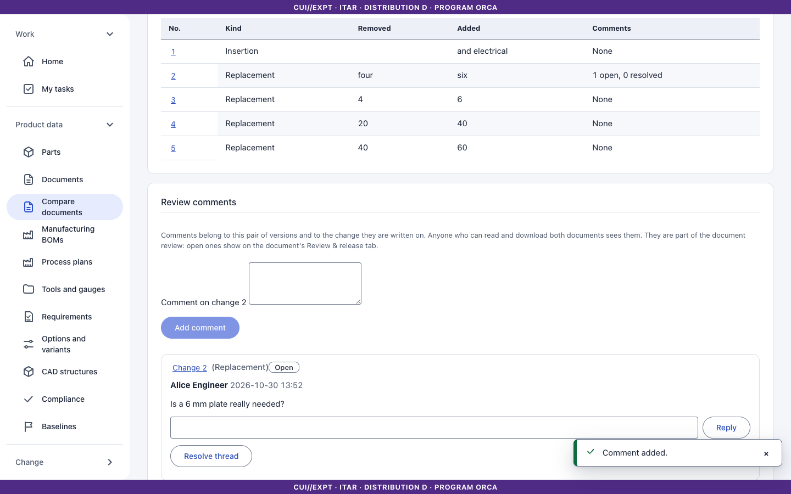
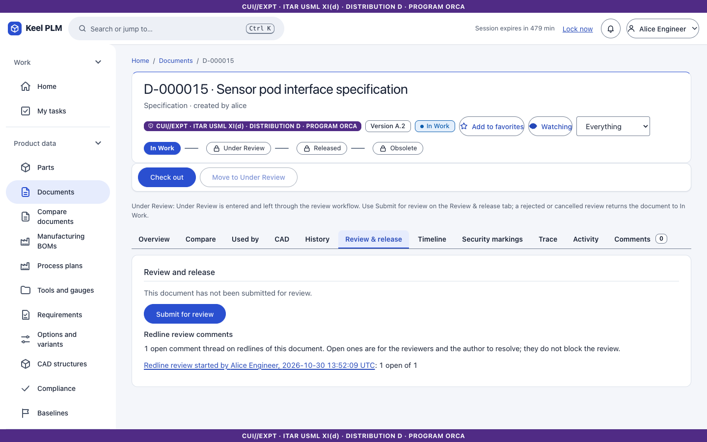
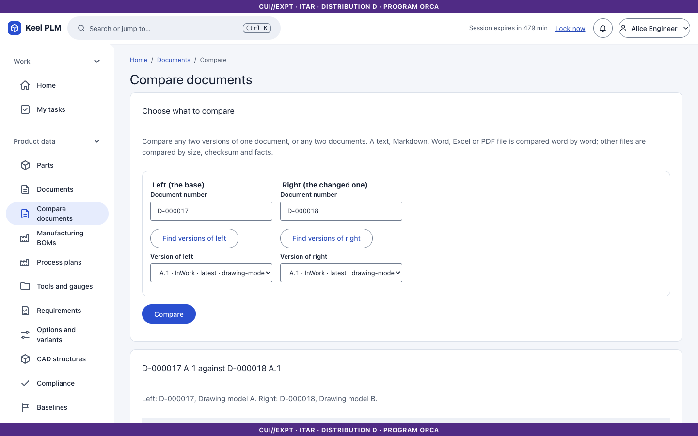

# 5. Documents and the vault

A **document** (`D-nnnnnn`) has the same master, revision and iteration model as a part. Its files live in the **vault**: content-addressed object storage, keyed by the SHA-256 of the bytes, encrypted at rest, verified again on every download.

## Find and create documents

1. Select **Documents** in the rail to search by number, name, type and state.
2. To create one select **New document**. Give a name, type (for example Drawing, Specification, CAD), description and **markings**, and optionally upload the first (primary) file.

Uploads are scanned for malware when scanning is on ([chapter 24](24-administrator-and-operator-guide.md)); a file the scanner refuses is rejected and the refusal is audited.

## The document page

Tabs: **Overview** (files, type badges, linked parts), **Versions**, **Used by**, **CAD**, **History**, **Review & release**, **Timeline**, **Security markings**, **Trace**, plus Activity and Comments.

### Work on files

1. **Check out**, then upload files. The primary file replaces the primary; other files are attachments. File names are unique within a document, ignoring case.
2. **Check in** creates the next iteration. Bytes are not copied: iterations point to the same vault objects.
3. **Undo check-out** discards your changes.

### View a file in the browser

Select **View** next to **Download** on a file. The viewer opens in its own page and supports:

- **3D**: STL, glTF/GLB, OBJ, STEP and IGES: orbit, fit, standard views, wireframe, bounding box, measure, section, explode, and a screenshot with the markings burned in.
- **PDF**: read in the page (no annotation or form support).
- **Images**: PNG, JPEG, GIF, WebP and SVG (SVG as an image only).
- Anything else shows facts and a download link.

Viewing needs read and download rights and is itself audited. Limits: 100 MiB for 3D, 50 MiB for PDF and images. A PDF that cannot be stamped is refused rather than shown unmarked.

### Download with markings

**Download (marked)** delivers the file with its markings: PDFs get the banner stamped on every page; other files come in a ZIP with a cover sheet and a markings text. Downloading is audited.

## Link documents to parts

On a part (checked out), open the **Documents** tab and add the document number under **Linked documents** with the relation *describes* (pinned to a revision) or *references*. Links belong to the part iteration. Linked documents offer **View** for the primary file, which is the quickest way to open a drawing.

## Model versions (CAD and mesh files)

For CAD documents and any document whose primary file is STL, OBJ, 3MF, STEP, glTF or IGES, the **Versions** tab lists every version.

1. Select **Upload new version**, choose a file and write a note. Keel measures STL, OBJ and 3MF files on the server (bounding box, area, volume, whether the mesh is watertight).
2. Pick two versions and select **Compare**: numbers with their deltas, a plain-language summary, and a visual compare (overlay, side by side or swipe).
3. **Restore** makes an older version the newest. If the revision is released, uploading offers to revise.
4. **Download versions** gives a ZIP of selected versions with a cover sheet.

## Compare and redline

Use the redline to see what changed between two versions of a document, or between two documents, and to talk about each change with your reviewers. Open **Compare** on a document, or choose **Compare documents** in the navigation (or press `Ctrl+K` and type `compare`).

1. On a document, open the **Compare** tab. Pick a **Base version** and a **Changed version** and select **Compare versions**. To compare with another document, select **Compare with another document**.
2. On the **Compare documents** page, type a document number for the left side and select **Find versions of left**, then the same for the right side with **Find versions of right**. Choose a version on each side and select **Compare**.
3. Keel reads both files. Plain text, Markdown, Word (`.docx`), Excel (`.xlsx`) and the text of PDFs are compared **word by word**. The page shows the **Summary** (changes, inserted words, deleted words, similarity) and the **Redline**.
4. In the redline, <ins>inserted text</ins> is underlined and set between `[+` and `+]`; <del>deleted text</del> is struck through and set between `[−` and `−]`. Colour is only a help: the marks and the underline or strike-through carry the meaning, and screen readers announce each insertion and deletion. Spacing and line breaks are not changes.
5. Select **Next change** and **Previous change** to step through the changes (the status says, for example, "Change 3 of 12"). With the redline focused you can press `N` for the next change and `P` for the previous one. Choose **Inline** for one text with both marks, or **Side by side** for the old text (deletions) beside the new text (insertions). The **Changes** table lists each change; select its number to jump to it.
6. To comment, select a change, write in **Comment on change 3** and select **Add comment**. A reviewer answers with **Reply**. When the change is settled, the author of the thread, or someone who can modify or sign the document, selects **Resolve thread** (**Reopen thread** undoes it). Comments belong to this pair of versions and to the change they are written on. Open ones are counted on the document's **Review & release** tab, and the people watching the document get a notification. They do not block a release: the reviewers and approvers of the workflow decide that.
7. Select **Export PDF** or **Export HTML** for a report with the summary, the redline, the change list and the comments. The marking banner of both documents is at the top and bottom of every page, with every distribution notice either document needs. The HTML is one self-contained file.

**When the content is not compared.** For other formats (drawings, CAD files, images, old `.doc` and `.xls` files), for two files of different kinds, for a scan with no text layer (Keel does not read images) or for a very large file, Keel does not guess. The page says **Content not comparable** and why, and compares what it can: size, SHA-256, version, state and who saved it. If the two files have the same bytes it says so.

**Who may compare.** You must be allowed to read **both** documents. If you cannot read one, Keel answers as if it did not exist, whichever side it is, and records the attempt. Reading the text of a comparison also needs permission to download both files (as for viewing); without it you get the facts table and a sentence saying why. The banner is the combination of both documents, so a comparison of an open note and an ITAR specification is marked ITAR. Comments need a viewer role or higher and can be read only by someone who can read and download both documents.

What is read: Word documents are read as the body text shows now (tracked insertions in, tracked deletions out; headers, footers, text boxes, footnotes and comments are not read). Excel workbooks list every filled cell as `Sheet!A1: value`, formulas with their cached result. PDFs are read in the order the file draws its text, one paragraph per page, so wrapping a line differently is not a change; the reading order of a multi-column PDF may differ from what you see.

## Review and release

The **Review & release** tab runs the document through the `document-release-review` workflow ([chapter 6](06-lifecycles-workflow-signatures.md)).

## Used by, history and security markings

## Retention

Records management can hold, archive or dispose of released documents; see [chapter 16](16-records.md).
