# 5. Documents and the vault

A **document** (`D-nnnnnn`) has the same master, revision and iteration model as a part. Its files live in the **vault**: content-addressed object storage, keyed by the SHA-256 of the bytes, encrypted at rest, verified again on every download.

## Find and create documents

1. Select **Documents** in the rail to search by number, name, type and state.
2. To create one select **Create document**. Give a name, choose the type (for example Drawing, Specification, CAD), and optionally upload the first (primary) file. The type starts from the one you chose last. The markings are one chip with a **Change** button, starting from your own program.
3. To attach it to a part at the same time, use **Link to a part (optional)**: type the part number or name, choose the part from the list, and keep or change how the document relates to the part (see below). The document is created and the part is saved with the link in one step; you do not check anything out. The list offers only parts you can see; parts you cannot change (released, under review, or outside your access) are listed with the reason and cannot be chosen.

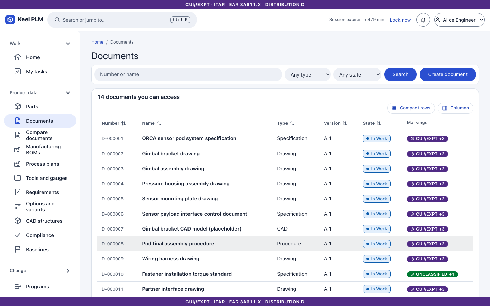
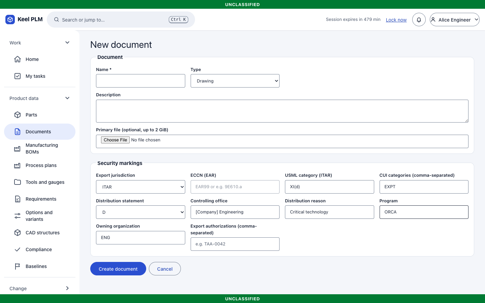

Uploads are scanned for malware when scanning is on ([chapter 24](24-administrator-and-operator-guide.md)); a file the scanner refuses is rejected and the refusal is audited.

## The document page

Tabs: **Overview** (files, type badges, linked parts), **Versions**, **Used by**, **CAD**, **History**, **Review & release**, **Timeline**, **Security markings**, **Trace**, plus Activity and Comments.

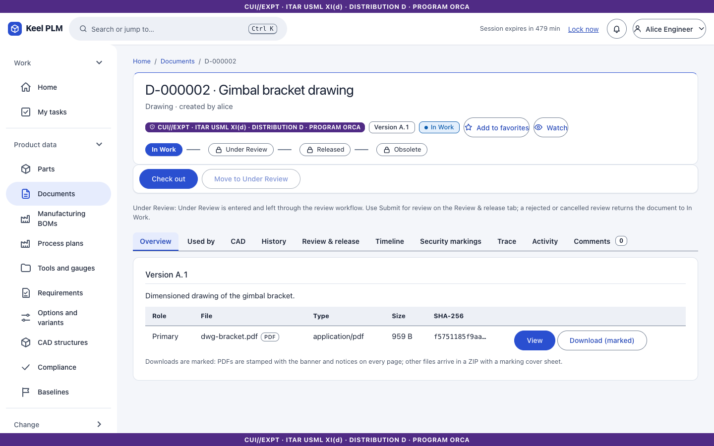

### Work on files

1. **Check out**, then upload files. The primary file replaces the primary; other files are attachments. File names are unique within a document, ignoring case.
2. **Check in** creates the next iteration. Bytes are not copied: iterations point to the same vault objects.
3. **Undo check-out** discards your changes.

### View a file in the browser

Select **View** next to **Download** on a file. The viewer opens in its own page and supports:

- **3D**: STL, glTF/GLB, OBJ, STEP and IGES: orbit, fit, standard views, wireframe, bounding box, measure, section, explode, and a screenshot with the markings burned in.
- **PDF**: read in the page (no annotation or form support).
- **Images**: PNG, JPEG, GIF, WebP and SVG (SVG as an image only).
- Anything else shows facts and a download link.

Viewing needs read and download rights and is itself audited. Limits: 100 MiB for 3D, 50 MiB for PDF and images. A PDF that cannot be stamped is refused rather than shown unmarked.

### Download with markings

**Download (marked)** delivers the file with its markings: PDFs get the banner stamped on every page; other files come in a ZIP with a cover sheet and a markings text. Downloading is audited.

## Link documents to parts

There are three ways, from simplest.

1. **When you create the document**: fill in **Link to a part** on the new document form (above).
2. **From the part page**: select **Add document** (action bar, or at the top of the **Documents** tab). One dialog does both jobs:
   - **Attach an existing document**: search by number or name, choose it, select **Add document**.
   - **Create a new document**: give it a name (and optionally a file), select **Create and add**. Its markings start as the part's markings.

   Choose how the document relates to the part: **Describes this part** (for example its drawing; the part points at one revision of the document) or **The part follows this document** (for example a specification; it always means the latest released revision). The dialog starts with the one you used last.

   If you are not editing the part, Keel saves a new version of the part with the link and a note naming the document ("Added document D-000012"); if the part is already open for your edit, the link joins your changes and is applied when you save. If it cannot be done, the dialog or page says exactly why: the part is released (use a change order), under review, being edited by someone else, or the document is outside your access.
3. **Step by step (advanced)**: check the part out, open the **Documents** tab, enter the document number under **Your draft**, add the link, and check in. Same rules and same audit entries as the others.

Links belong to the part version. Linked documents offer **View** for the primary file, which is the quickest way to open a drawing.

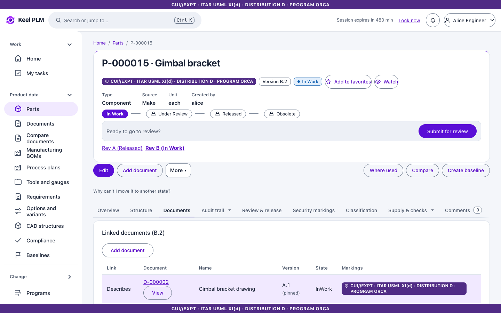
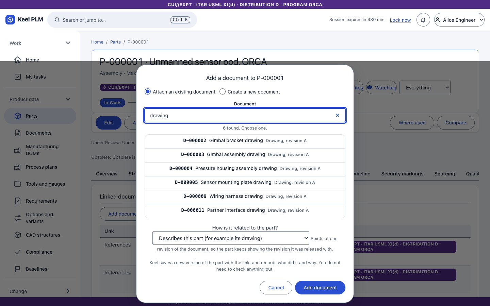

## Model versions (CAD and mesh files)

For CAD documents and any document whose primary file is STL, OBJ, 3MF, STEP, glTF or IGES, the **Versions** tab lists every version.

1. Select **Upload new version**, choose a file and write a note. Keel measures STL, OBJ and 3MF files on the server (bounding box, area, volume, whether the mesh is watertight).
2. Pick two versions and select **Compare**: numbers with their deltas, a plain-language summary, and a visual compare (overlay, side by side or swipe).
3. **Restore** makes an older version the newest. If the revision is released, uploading offers to revise.
4. **Download versions** gives a ZIP of selected versions with a cover sheet.

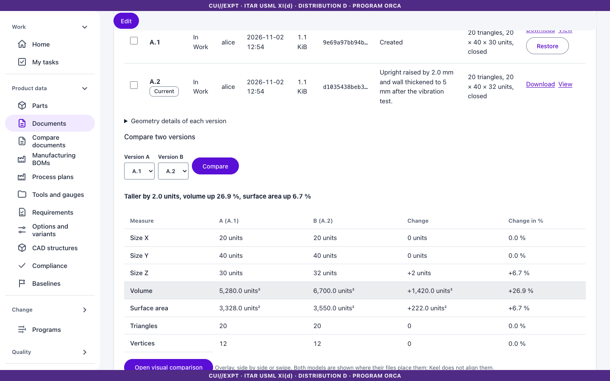
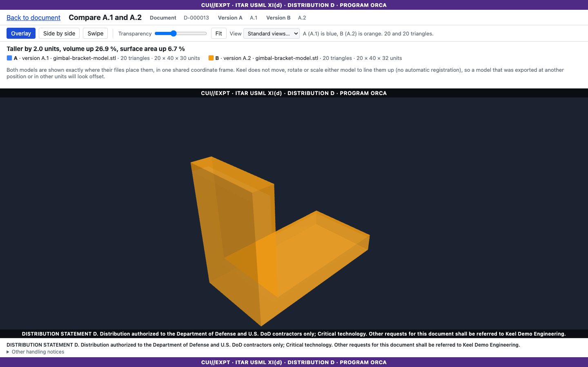
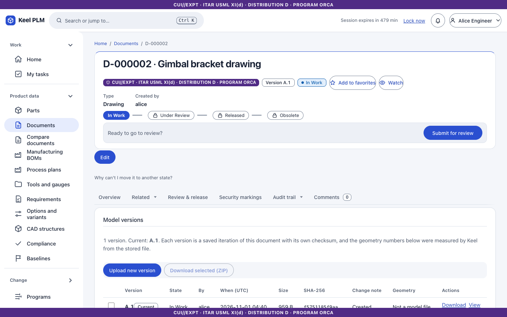
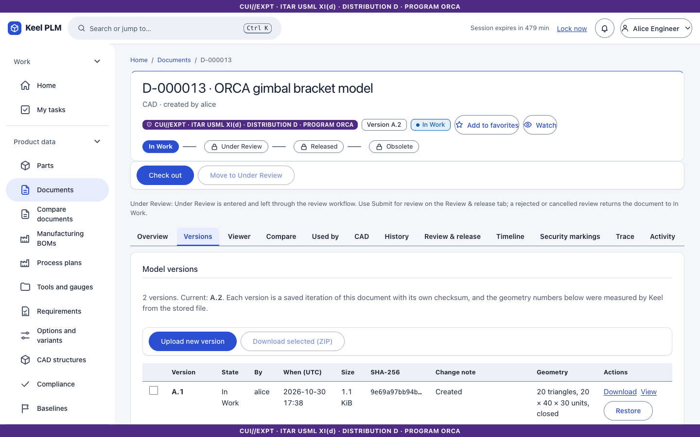

## Review and release

The **Review & release** tab runs the document through the `document-release-review` workflow ([chapter 6](06-lifecycles-workflow-signatures.md)).

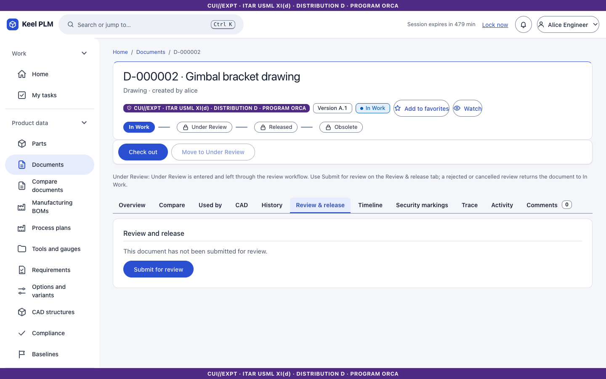

## Used by, history and security markings

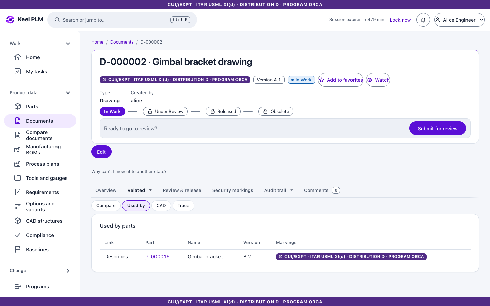
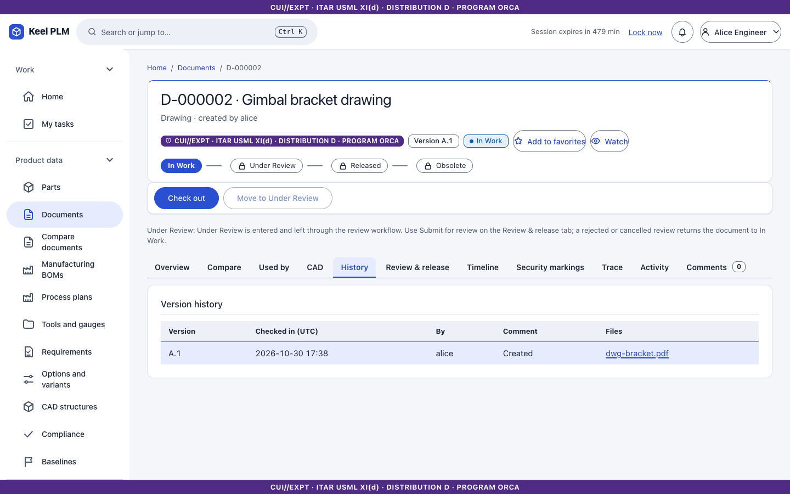
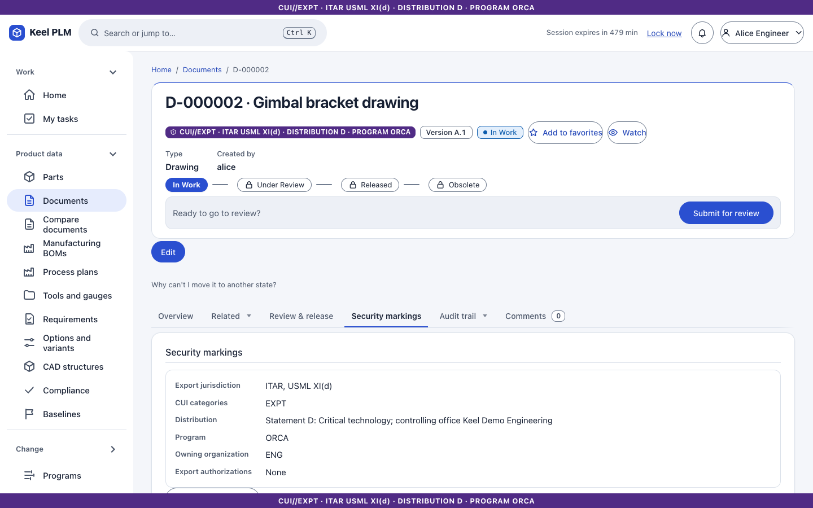

## Retention

Records management can hold, archive or dispose of released documents; see [chapter 16](16-records.md).
