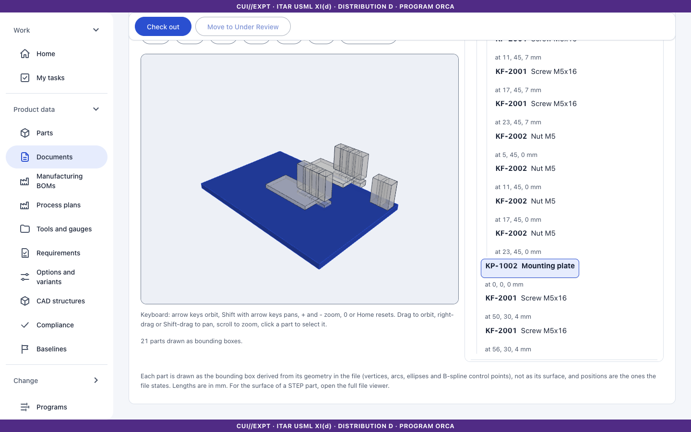
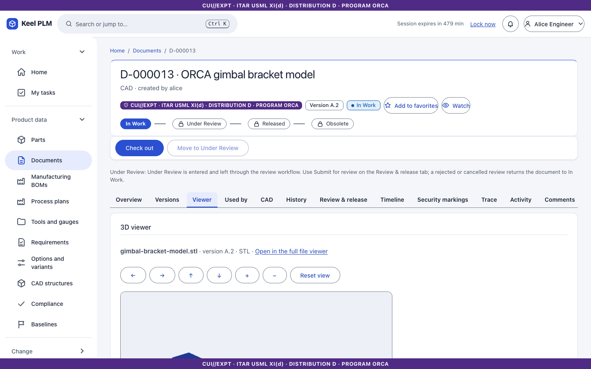

# 5. Documents and the vault

A **document** (`D-nnnnnn`) has the same master, revision and iteration model as a part. Its files live in the **vault**: content-addressed object storage, keyed by the SHA-256 of the bytes, encrypted at rest, verified again on every download.

## Find and create documents

1. Select **Documents** in the rail to search by number, name, type and state.
2. To create one select **New document**. Give a name, type (for example Drawing, Specification, CAD), description and **markings**, and optionally upload the first (primary) file.

Uploads are scanned for malware when scanning is on ([chapter 24](24-administrator-and-operator-guide.md)); a file the scanner refuses is rejected and the refusal is audited.

## The document page

Tabs: **Overview** (files, type badges, linked parts), **Versions**, **Used by**, **CAD**, **History**, **Review & release**, **Timeline**, **Security markings**, **Trace**, plus Activity and Comments.

### Work on files

1. **Check out**, then upload files. The primary file replaces the primary; other files are attachments. File names are unique within a document, ignoring case.
2. **Check in** creates the next iteration. Bytes are not copied: iterations point to the same vault objects.
3. **Undo check-out** discards your changes.

### View a file in the browser

Select **View** next to **Download** on a file. The viewer opens in its own page and supports:

- **3D**: STL, glTF/GLB, OBJ, STEP and IGES: orbit, fit, standard views, wireframe, bounding box, measure, section, explode, and a screenshot with the markings burned in.
- **PDF**: read in the page (no annotation or form support).
- **Images**: PNG, JPEG, GIF, WebP and SVG (SVG as an image only).
- Anything else shows facts and a download link.

Viewing needs read and download rights and is itself audited. Limits: 100 MiB for 3D, 50 MiB for PDF and images. A PDF that cannot be stamped is refused rather than shown unmarked.

### The Viewer tab (3D models on the page)

For CAD documents and any document whose primary file is a 3D model, the **Viewer** tab shows the model without leaving the page. It reads the file through the same checks as **View**: you need read and download rights, the page banner is the document's, and every view is audited.

1. Open the document and select the **Viewer** tab.
2. **A STEP assembly** is drawn as the structure the file places: every part as its bounding box at the position and orientation the file gives it. The list beside the picture is the same structure as text: every instance with its position. Select a name in the list (or click a box) to highlight that part, or the whole sub-assembly, and to see its path, placement, box size and 4 by 4 matrix.
3. **An STL, OBJ or 3MF model** is drawn as its triangles.
4. **glTF, GLB and IGES files** are not drawn in the tab; select **Open in the full file viewer** for them, and for the surface of a STEP part.
5. Move around with the keyboard: click the picture or tab to it, then use the arrow keys to orbit, **Shift** with the arrow keys to pan, **+** and **-** to zoom, **0** or **Home** to reset. The buttons above the picture do the same (**Orbit left**, **Orbit right**, **Orbit up**, **Orbit down**, **Zoom in**, **Zoom out**, **Reset view**). With a mouse: drag to orbit, right-drag or Shift-drag to pan, scroll to zoom.

What the boxes are: each is derived from the part's geometry in the STEP file (vertices, arcs, ellipses and spline control points), so it is a viewing aid, not a measurement. An occurrence the file gives no placement for is shown at its parent's origin and the list says "no placement". A file with several top-level products is refused with a message; send it as a structure with a root number instead ([chapter 11](11-cad-connector-and-freecad.md)). If you may not view the document, the tab shows nothing about it, not even a part name.

### Download with markings

**Download (marked)** delivers the file with its markings: PDFs get the banner stamped on every page; other files come in a ZIP with a cover sheet and a markings text. Downloading is audited.

## Link documents to parts

On a part (checked out), open the **Documents** tab and add the document number under **Linked documents** with the relation *describes* (pinned to a revision) or *references*. Links belong to the part iteration. Linked documents offer **View** for the primary file, which is the quickest way to open a drawing.

## Model versions (CAD and mesh files)

For CAD documents and any document whose primary file is STL, OBJ, 3MF, STEP, glTF or IGES, the **Versions** tab lists every version.

1. Select **Upload new version**, choose a file and write a note. Keel measures STL, OBJ and 3MF files on the server (bounding box, area, volume, whether the mesh is watertight).
2. Pick two versions and select **Compare**: numbers with their deltas, a plain-language summary, and a visual compare (overlay, side by side or swipe).
3. **Restore** makes an older version the newest. If the revision is released, uploading offers to revise.
4. **Download versions** gives a ZIP of selected versions with a cover sheet.

## Review and release

The **Review & release** tab runs the document through the `document-release-review` workflow ([chapter 6](06-lifecycles-workflow-signatures.md)).

## Used by, history and security markings

## Retention

Records management can hold, archive or dispose of released documents; see [chapter 16](16-records.md).
