# 6. Lifecycles, review workflow and e-signatures

## Lifecycles

Every kind of object has a **lifecycle**: a set of states and allowed transitions, defined as data by your administrator. Parts and documents use *In Work, Under Review, Released, Obsolete*. Each transition is tagged how it may happen:

| Tag | Meaning |
|---|---|
| manual | You can do it from the action bar (for example Under Review back to In Work) |
| workflow | Only an approved review does it (release) |
| change | Only a released change notice does it (obsolete) |

Locked states (Under Review, Released, Obsolete) cannot be edited. The page explains in a sentence why a move is unavailable. Administrators view and version lifecycles under **Configuration > Lifecycles** ([chapter 23](23-administration.md)).

## Submit an object for review

1. Open the part (or document, ECR, ECN, baseline, MBOM) and select the **Review & release** tab.
2. Select **Submit for review**.
3. In the dialog choose the participants for each step. For parts: a **reviewer** (for example ada) and an **approver** (for example bob). Type a name in the "Find" box, select **Search**, then **Add**. Only people who may read the object and hold the right role are eligible; the submitter cannot be a participant and cannot sign.
4. Select **Start review**.

The object becomes **Under Review** and locked, and the participants get tasks.

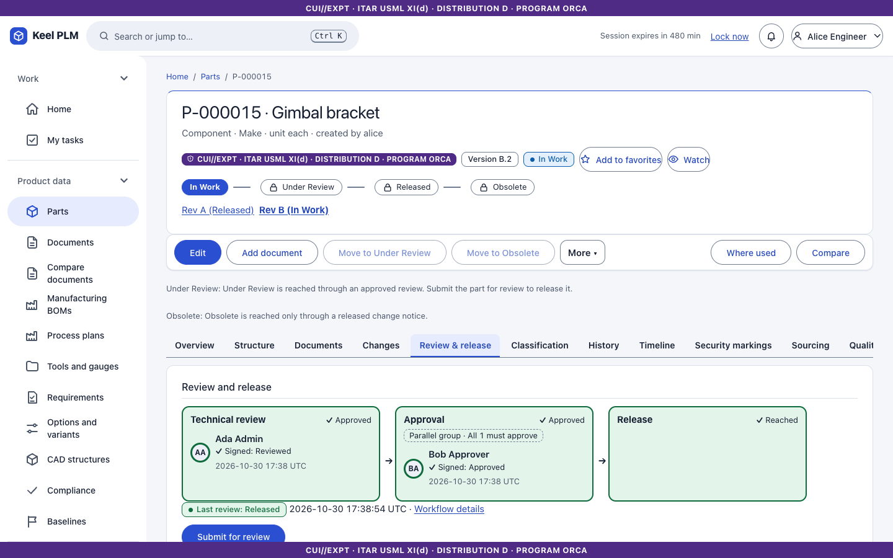
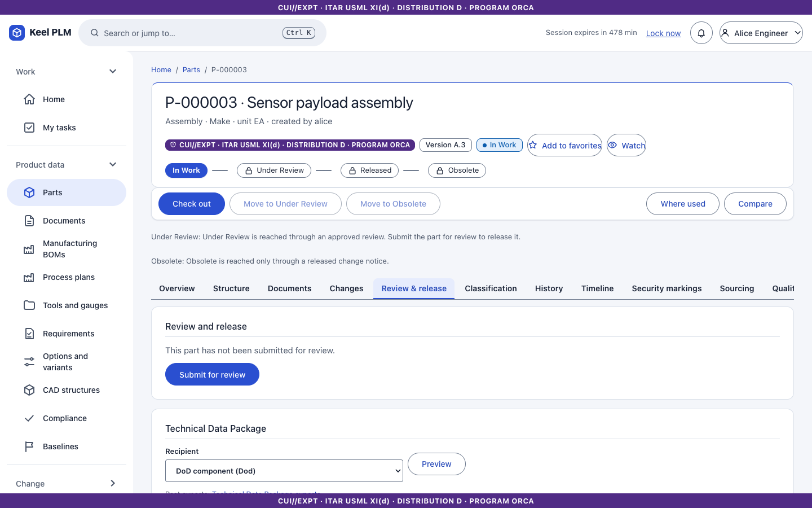

## My tasks

**My tasks** lists everything waiting for you (review, approval, change tasks, quality actions). Select the task's name to open it.

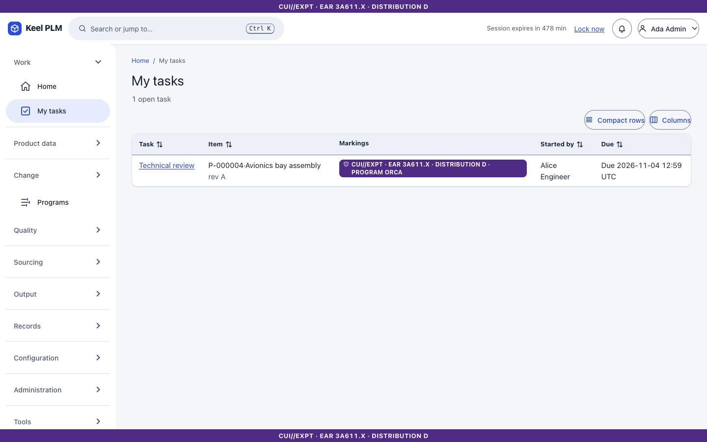

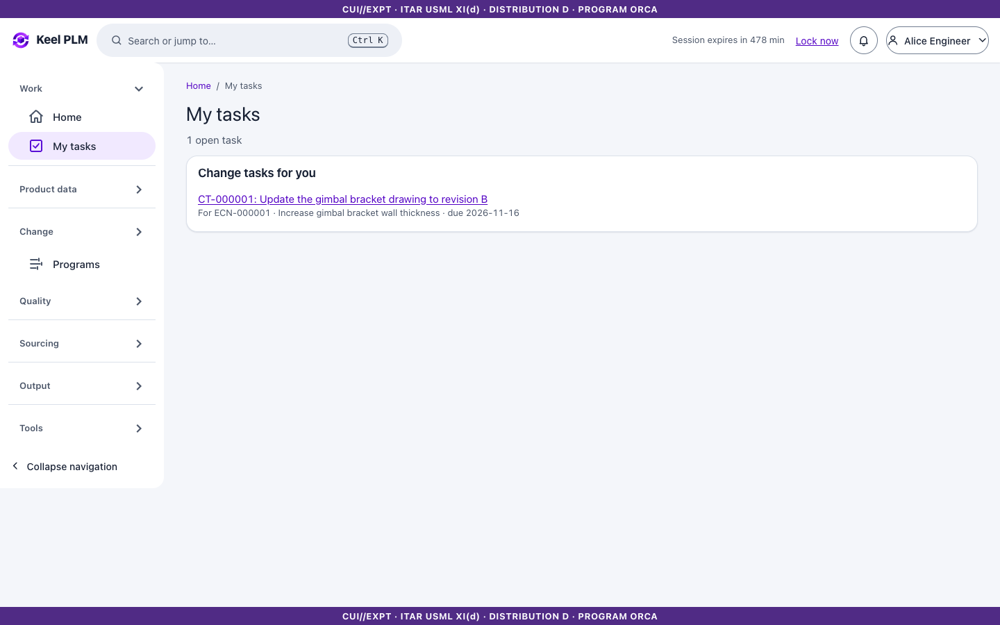

The task page shows what you are signing, the progress map of the workflow (steps, who is pending), and the history.

## Approve on a phone

There is one place for your decisions: **My tasks**. On a phone each waiting task is a card with the item, its markings, who started it and when it is due; on a desktop it is a table. Select **Review and decide** (or the task name). The old addresses `/approve` and `/approve/<id>` still work and lead here.

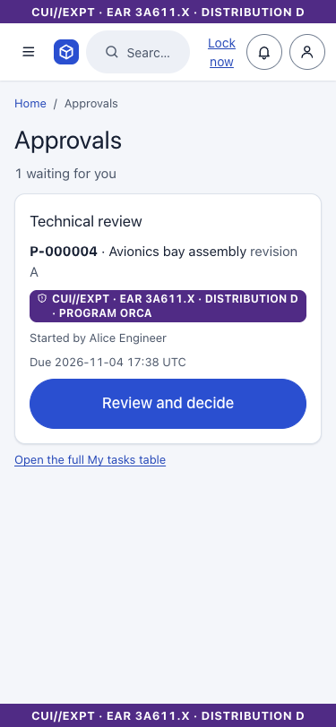

The task page starts with a summary of exactly what you are about to sign: the kind of item, number and name, revision and version, state, the markings, who started the review, the submitter's note, the description and attributes, and the content hash (SHA-256) your signature will record. Below it are the comment box and the decision buttons. On a phone each button is full width and at least 56 px high, at the bottom of the page.

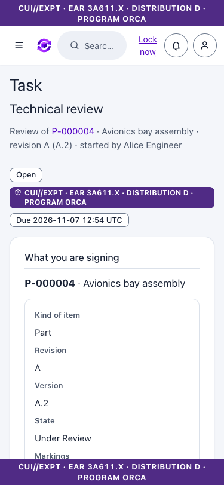
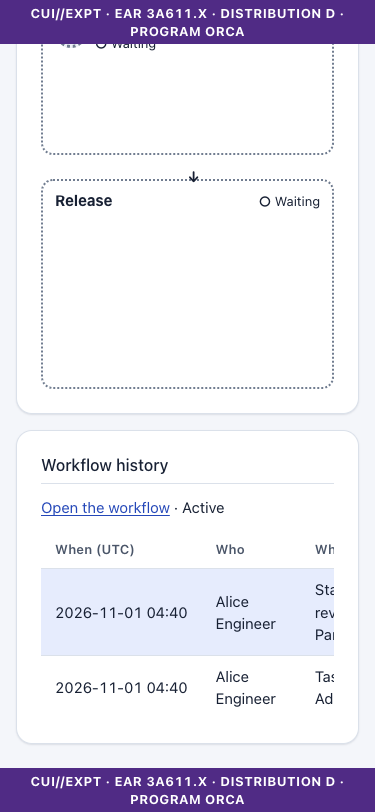

The rules are the same on every screen: **step-up** when your login is older than the allowed age (you return to the same page with your comment kept), the same audit entries. If you are no longer allowed to see the item, the card says so and the task cannot be signed.

## Sign a task (e-signature)

1. Open the task. Read **What you are signing**: the version and a note that the signature records a hash of this exact content.
2. Optionally write a comment.
3. Select your decision: for a review **Reviewed** or **Rejected**; for an approval **Approved** or **Rejected**.
4. If your login is older than the allowed age (default 5 minutes), the page says you will be asked to sign in again. Select the decision; the identity provider asks for your password again (**step-up**); then you return to the task and choose the decision again.

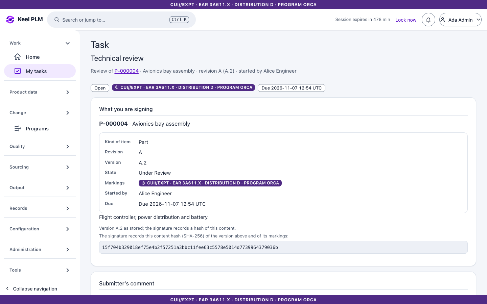
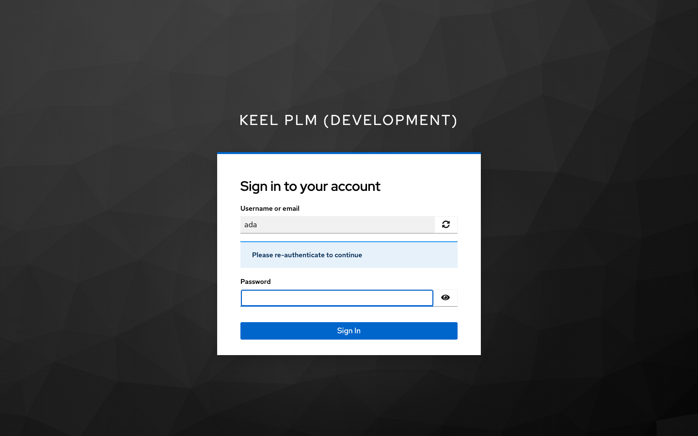

A signature records who, the meaning, the time and a hash of the content signed. The signing, the state change and the release happen in one transaction. Rejection returns the object to In Work with the reason.

Bob's view of a pending approval:

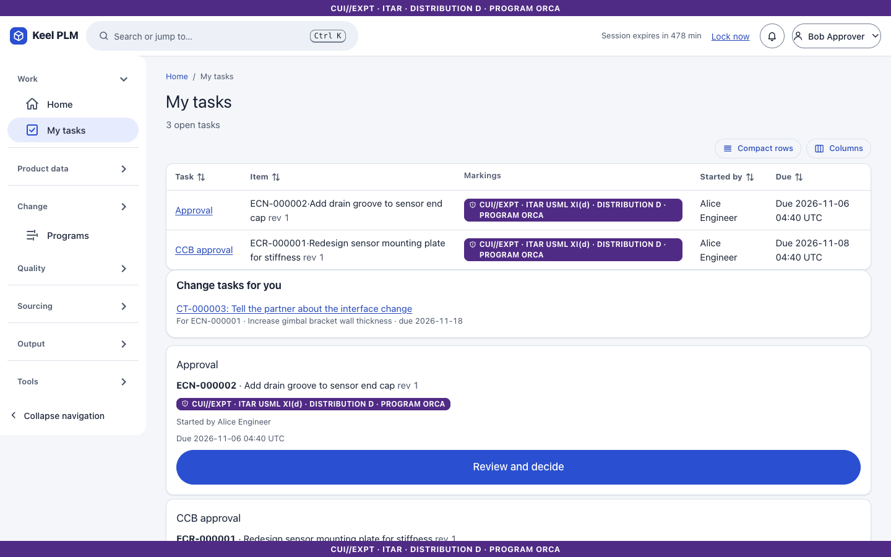

### Rules worth knowing

- **Separation of duties**: the submitter cannot sign; an administrator cannot reassign a task to the submitter.
- Role changes at the identity provider apply when you sign, not when you were chosen.
- With the seeded rule "all", one rejection rejects the review. Other templates can use any or N-of-M.
- Auditors never review or sign.

## Workflows and verification

Under **Configuration > Workflows** an administrator sees every workflow, can **reassign** a task, **cancel** a workflow, and **Verify signatures**, which recomputes each signature hash against the stored content. Workflow templates are versioned data ([chapter 23](23-administration.md)). A workflow orphaned by an administrator's state override can only be cancelled.

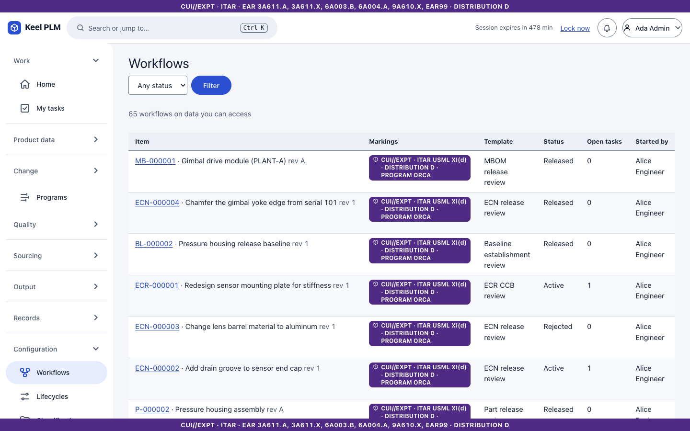
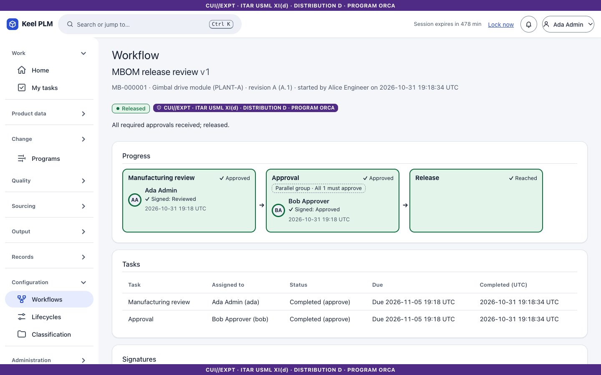

## Where e-signatures are used

Releasing parts, documents, ECRs and ECNs, baselines (Release and Product types), MBOMs, process plans, supplier approval, deviation approval, NCR dispositions, CAPA verification, requirement specifications, regulatory list versions, retention schedules and disposition and gate reviews. All use the same task and step-up flow.
