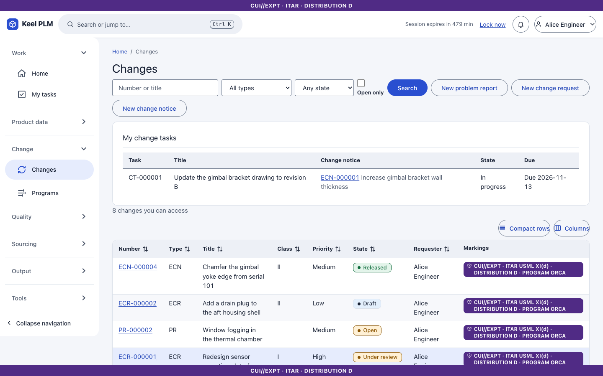
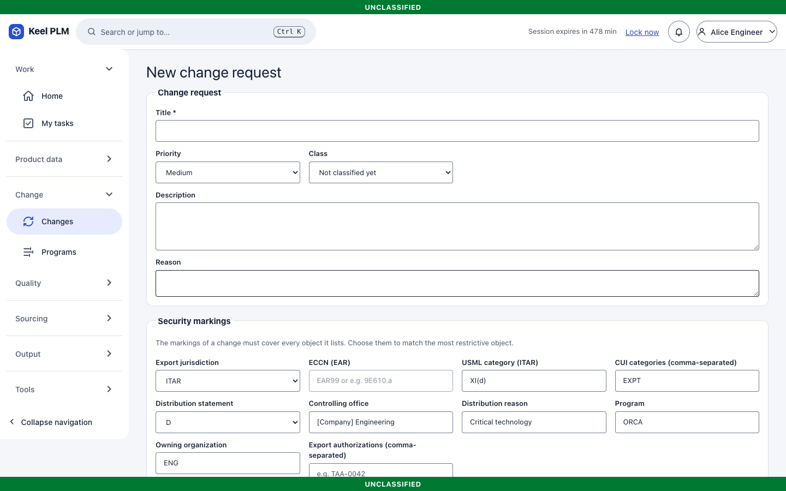
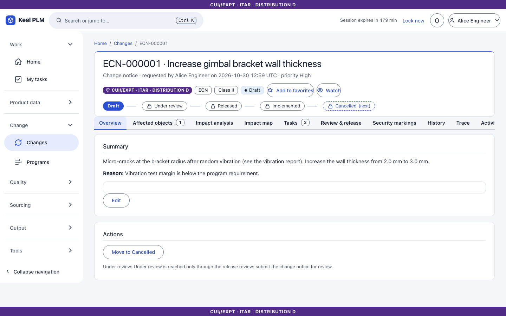
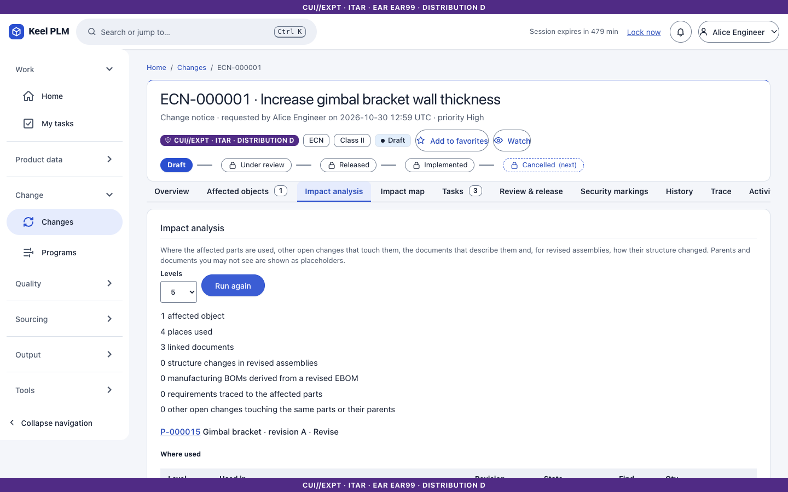
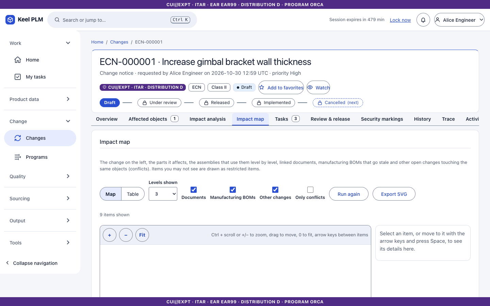
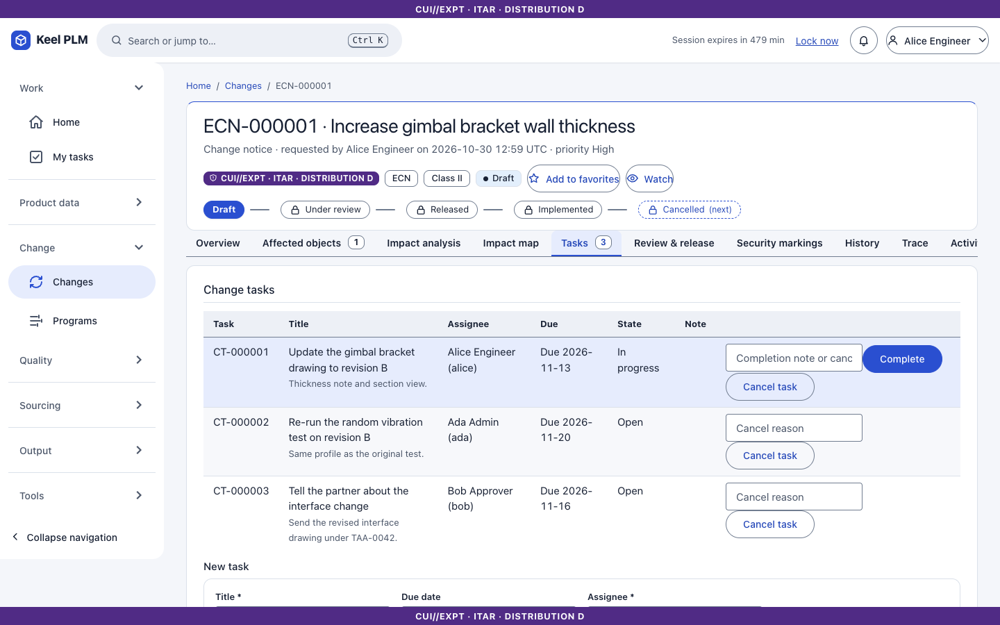
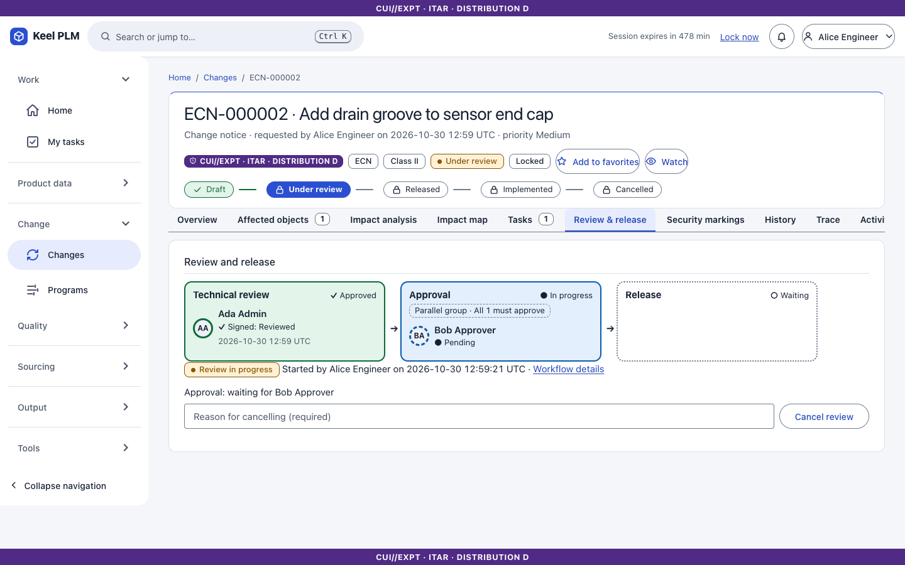
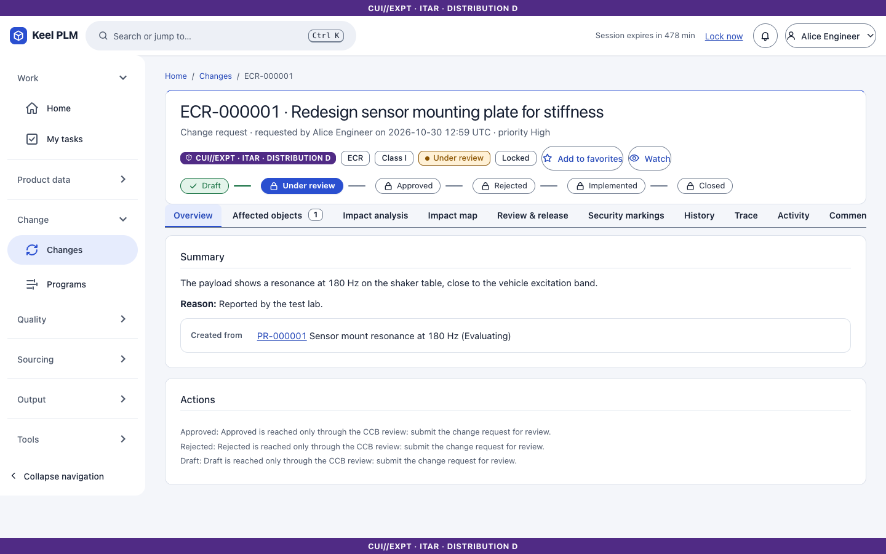
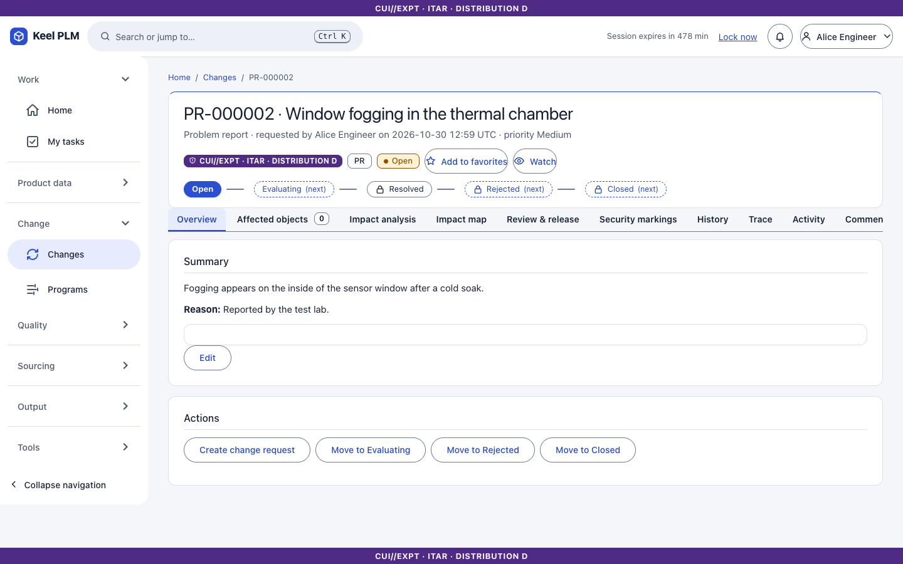

# 7. Change management

A **released** part or document changes only through a controlled change. Keel has four kinds of change object:

| Object | Number | Purpose |
|---|---|---|
| Problem report (PR) | `PR-nnnnnn` | Records a problem and its evaluation |
| Engineering change request (ECR) | `ECR-nnnnnn` | Asks for a change; a Class I ECR goes to the change control board (CCB) |
| Engineering change notice (ECN) | `ECN-nnnnnn` | Makes the change: lists affected objects and creates the resulting revisions |
| Change task (CT) | `CT-nnnnnn` | Work items inside an ECN |

## Create a change

1. Select **Changes**, then create a PR, ECR or ECN (an ECR can be created from a PR, and an ECN from an ECR).
2. Give a title, description, reason, priority and class. **Class I** is possible only through an approved Class I ECR; a direct ECN is Class II. An ECR is classified before submission.
3. Set the markings. The markings of the change must cover every affected object; if they do not, Keel refuses, or offers to raise the markings to the minimal cover (shown as a checkbox next to the part picker).

## Affected and resulting objects

On an ECN open the **Affected objects** tab and add parts (the picker lists parts you may modify). For each part Keel creates the **resulting revision** (for example B) right away, in work, so engineers can work on it. Optionally give an **effectivity** (for example "from serial 101") so the old revision stays valid for earlier units.

Removing an affected object is allowed until its resulting revision has been worked on.

## Impact analysis

1. Open the **Impact analysis** tab and select **Run impact analysis**.
2. Read: where each affected part is used up the tree, linked documents, other open changes, stale manufacturing BOMs per plant, and requirements allocated to the part.
3. Parts and documents you may not read appear as counted, unnamed entries.

The **Impact map** tab draws the same data: the notice at the left, affected parts, the assemblies that use them, and documents. Arrow keys follow connections, `Enter` opens an object, **Table** shows the same data, **Export SVG** saves the picture with its banner.

## Tasks

An ECN's **Tasks** tab holds change tasks, each with an assignee and status. Assignees are notified; open tasks show on **My tasks**.

## Review and release

1. On **Review & release** select **Submit for review** and choose the reviewer and approver. For a Class I ECR the approvers are CCB members.
2. While under review, the resulting revisions are locked (Under Review).
3. When all required signatures are in ([chapter 6](06-lifecycles-workflow-signatures.md)), the ECN releases: new revisions become Released and the old ones Obsolete (or stay valid by effectivity). Release is recorded as an event for ERP ([chapter 21](21-integration-and-tdp.md)).
4. A rejected ECN returns to Draft with the reason; a rejected ECR becomes Rejected and can be reworked.

The **workflow map** shows who has signed and who is pending:

An ECR awaiting the board:

When an ECR is approved, select **Open change notice** to create the ECN. An ECR becomes Implemented when its last open notice releases.

## Cancel a change

Only a Draft ECN can be cancelled (with a reason code). Its resulting revisions are abandoned; nothing is deleted and a revision label is never reused.

## Problem reports

A PR is never resolved automatically; move it by hand with a reason.

## Why a part says "bound to a change"

While a revision belongs to an ECN under review, a part workflow refuses to touch it and tells you only the ECN number.
