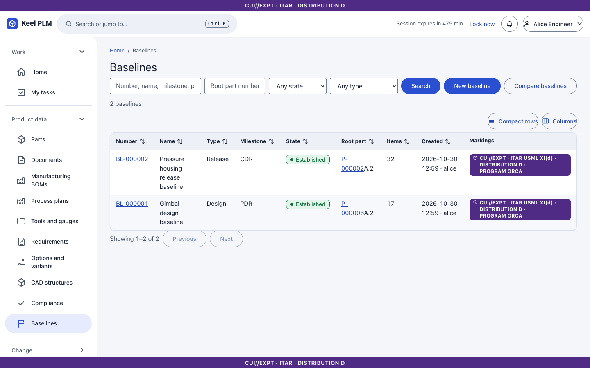
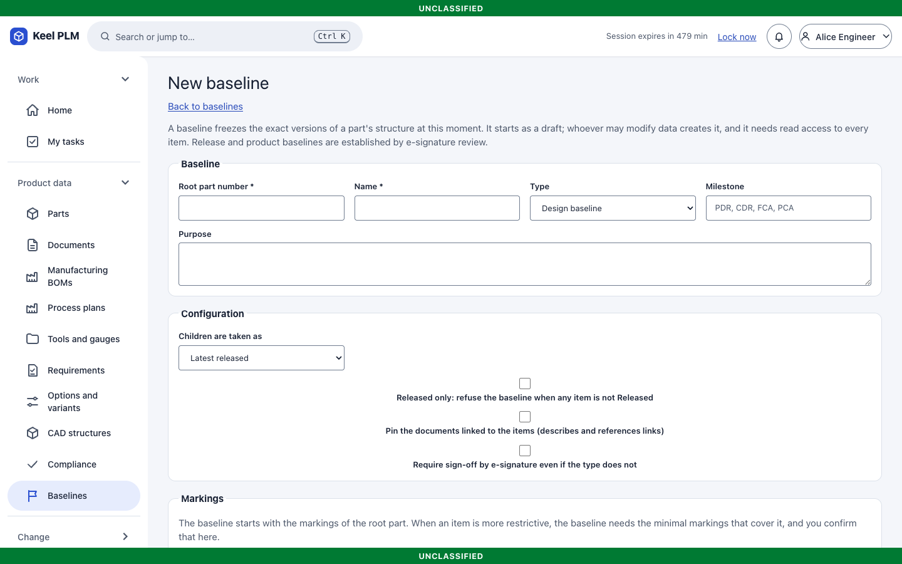
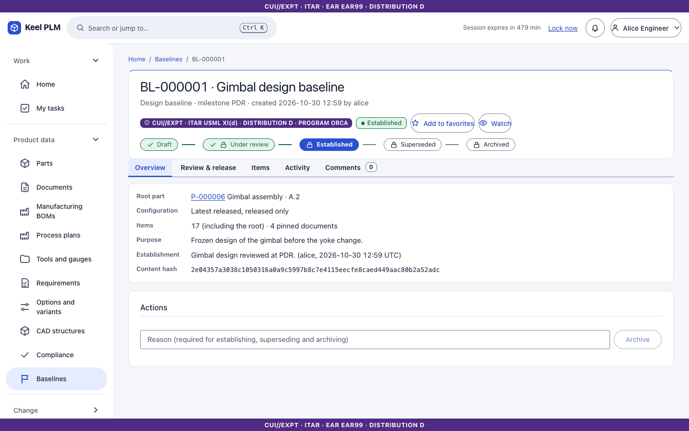
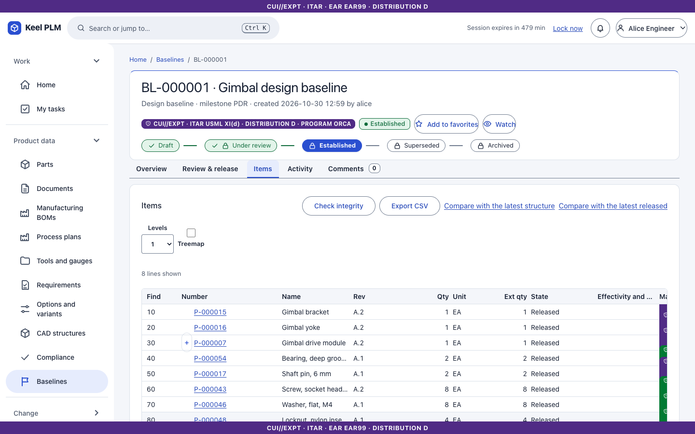
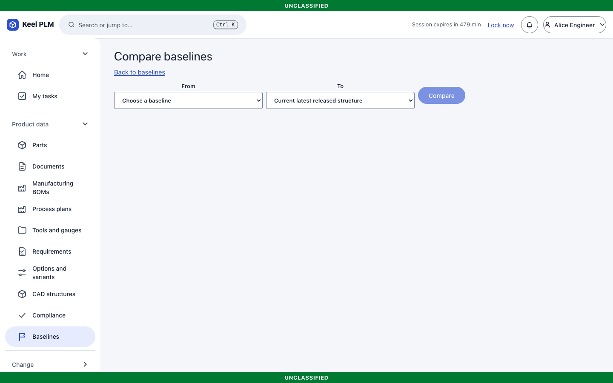

# 8. Baselines and effectivity

A **baseline** is a frozen set of specific versions (and pinned documents) of an assembly's structure, kept for audits and milestones. **Effectivity** says which serial numbers, lots or dates a revision or BOM line applies to.

## Baselines

Open **Baselines** in the rail.

### Types and sign-off

The type decides how a baseline is established:

- **Design** baselines are established directly by an author or administrator with a reason.
- **Release** and **Product** baselines (or any type that requires sign-off) are established only through a signed review ([chapter 6](06-lifecycles-workflow-signatures.md)); a database rule enforces this.

### Create a baseline

1. Select **New baseline** (or **Create baseline** on the Structure tab of an assembly).
2. Choose the root assembly, the type, a name and milestone, and how to resolve the structure: **Latest**, **Latest released**, or **as of** a serial, lot or date (an as-built baseline).
3. Check the markings: they start from the root's and must cover every item and pinned document. If you cannot read every item, creation is refused.
4. Save, then select **Establish** (Design) or **Submit for review** (Release).

### Read a baseline

The page has tabs **Overview, Review & release, Items** (one row per occurrence, plus the pinned documents), history and the TDP export panel. A baseline can be **superseded** or **archived**; **Verify** checks the stored content against its hash.

### Compare

Select **Baselines > Compare** to compare one baseline against another, or against the current structure. Restricted lines match only the same hidden part; a hidden revision change shows as "Restricted item changed".

You can also view any BOM as a baseline (Structure tab, **Baseline**), as a unit (**As of serial, lot or date**), or compare two units ([chapter 4](04-boms-variants-mbom.md)).

## Effectivity

**Effectivity contexts** (Administration, for example `ORCA-POD`) define serial or lot dimensions and named blocks (Block 1, Block 2). Effectivity appears in three places:

- **BOM lines**: alternates of one find number apply to different ranges.
- **Revisions**: an ECN can release revision B effective from serial 101 while revision A stays Released for serials up to 100. The part page shows this under its revisions, and the **Timeline** tab lists the ECN-000004 effectivity entry.
- **ECN affected objects**: set the effectivity when you add the object.

Rules to remember: serials and lots are whole numbers from 1 to 9,999,999,999; a unit may give serial, lot and date; a line whose effectivity is in a dimension you did not give is excluded; lines with no effectivity always apply. Even a restricted line shows its effectivity range.

Not shipped: effectivity text in migrated data stays in line notes unless the importer's `effectivity.load` mapping is on ([chapter 22](22-migration.md)).
