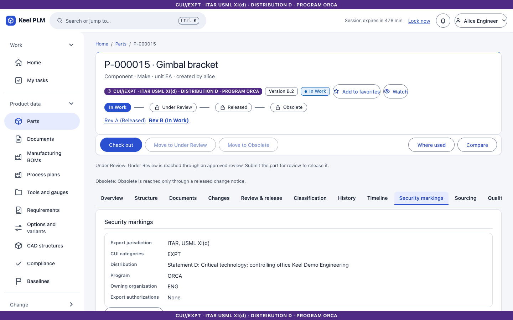
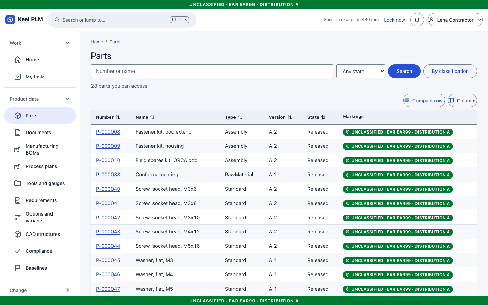
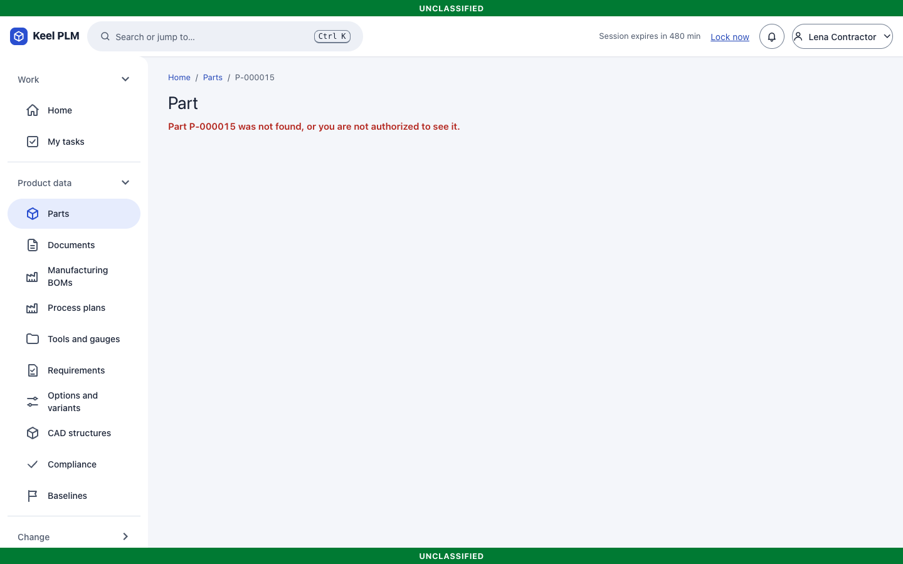
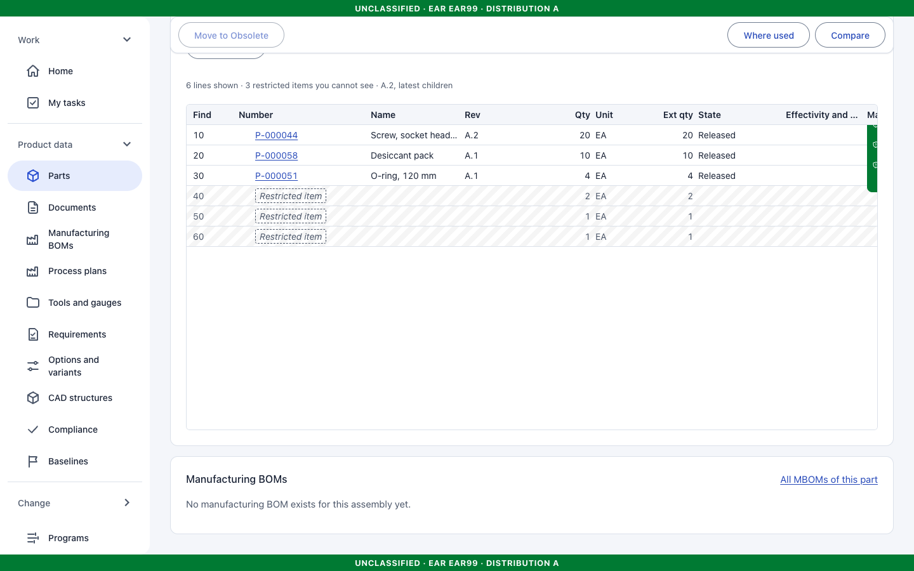
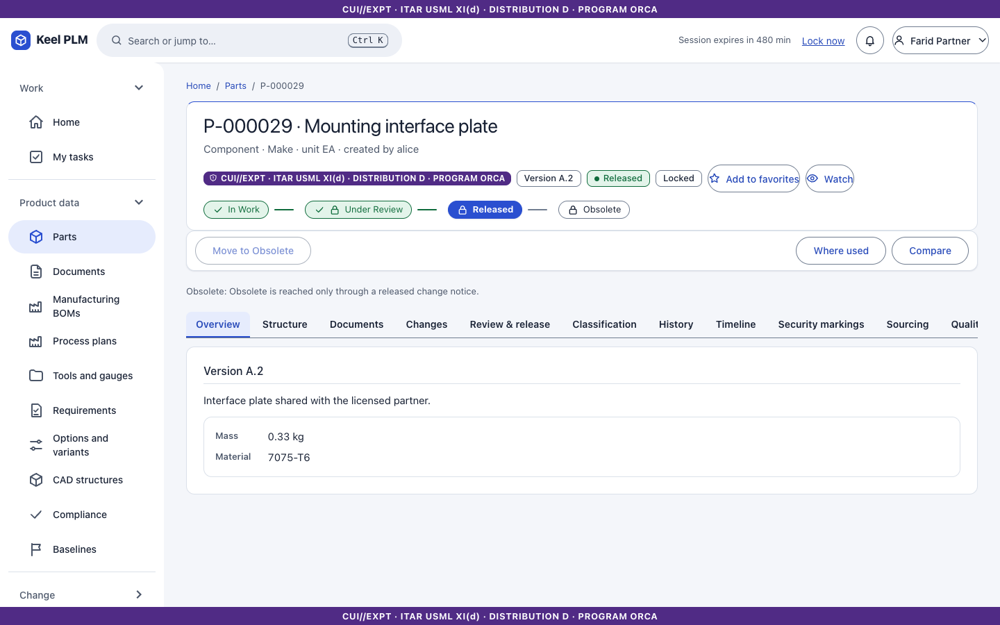
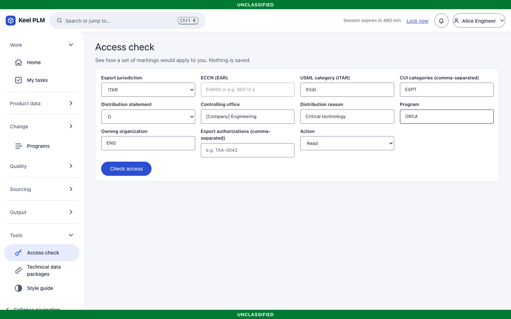

# 9. Markings, export control and the access check

Keel decides who may see or change each object from two things: the object's **markings** and the viewer's **attributes**. There is no override for administrators.

## Markings

| Marking | Meaning |
|---|---|
| Export jurisdiction | ITAR (with a USML category), EAR (with an ECCN) or EAR99, or none |
| CUI categories | for example EXPT (export controlled) and CTI |
| Distribution statement | A to F (DoDI 5230.24); more restrictive letters come later in the alphabet |
| Program | for example ORCA; only people on the program may read |
| Owning organization | for example ENG |
| Export authorizations | for example TAA-0042, which lets a licensed foreign person see the object |

The **banner** at the top and bottom of every page is the aggregate of the markings of everything on that page, for example `CUI//EXPT · ITAR USML XI(d) · DISTRIBUTION D · PROGRAM ORCA`. Lists show a chip per row. Downloads carry the markings: PDFs are stamped on each page, other files travel in a ZIP with a cover sheet.

Markings are mandatory and validated on creation: ITAR needs a USML category, export-controlled data must be CUI//EXPT, and it cannot have distribution A.

## Your attributes

Your attributes (U.S. person, citizenship, programs, export authorizations, CUI categories, organization, roles) come from your identity provider. See them under **My access** ([chapter 1](01-getting-started.md)).

## What a denial looks like

Keel answers "not found" for something you may not read, exactly as for something that does not exist, so the existence of a restricted object is never revealed. The attempt is audited.

Walkthrough with the dev accounts:

1. **lena** (not a U.S. person, no authorization) opens **Parts**. The ITAR gimbal bracket is not in her list.

   

2. She opens `/parts/P-000015` directly and gets the same page as for a part that does not exist.

   

3. She opens the open *Field spares kit* (P-000010), which she may read. Three lines are **Restricted item** placeholders showing only quantity and find number.

   

4. **farid** (GBR, authorization TAA-0042) opens the *Mounting interface plate* (P-000029), which lists TAA-0042, and its drawing. He still cannot open the bracket.

   

5. **carmen** (no ORCA program) cannot open ORCA parts either.

Restricted data never leaks through side doors: search, the palette, where-used, comparisons, impact analysis, notifications, comments and reports all apply the same filter, and a notification about something you can no longer read says only "A notification you can no longer view".

## Change markings

Authors change the markings of an In Work object on its **Security markings** tab with a reason; markings of locked revisions change only through change control ([chapter 7](07-change-management.md)). Keel will not let you remove your own access.

## The access check

**Tools > Access check** (`/access`) shows how a set of markings would apply **to you**. Nothing is saved.

1. Fill in the markings (jurisdiction, CUI categories, distribution statement, program, organization, authorizations).
2. Choose the **Action** (for example Read).
3. Select **Check access**. The page says "You would be permitted" or "You would be denied" and lists the reasons in words. It uses the same policy evaluator as every other page; to see the answer for another person, sign in as that person.

## What the rules guarantee

- Every list is filtered in the database query, not after the fact.
- Every single-object action evaluates the policy and writes an audit event, including denials.
- A change object's markings must cover its affected objects.
- A foreign supplier is never sent ITAR data ([chapter 12](12-sourcing-and-portal.md)); outbound ERP and TDP exports check clearance profiles ([chapter 21](21-integration-and-tdp.md)).

Export-control and legal review of these rules is still pending; see [docs/review](../review/README.md). It is not legal advice.
