# 10. Quality: NCRs, CAPAs, deviations and waivers

The **Quality** group holds three kinds of record. None has cost or price fields.

| Record | Number | Purpose |
|---|---|---|
| Nonconformance report (NCR) | `NCR-nnnnnn` | Something does not meet requirements: what, how many, which lot |
| Corrective and preventive action (CAPA) | `CAPA-nnnnnn` | Find the root cause and fix it for good |
| Deviation or waiver | `DEV-nnnnnn` | Permission to depart from a requirement for a defined scope and period |

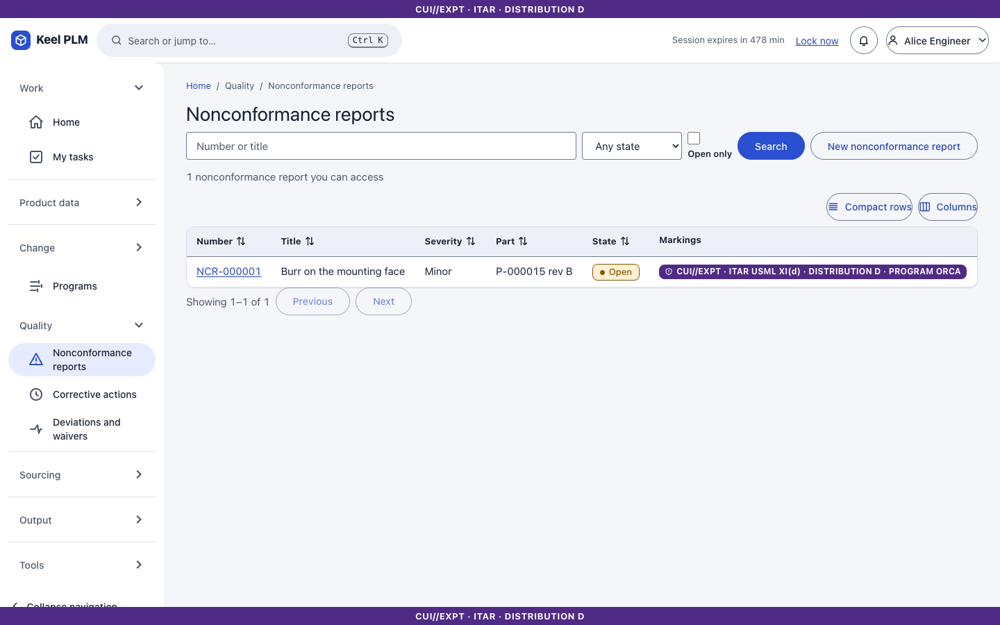

## Report a nonconformance

1. Select **Quality > Nonconformance reports**, then create a new one.
2. Fill in **Title**, **Part number** (the markings of the part are taken when the field loses focus), **Quantity affected**, lot and serial, severity, stage and defect description. A supplier can be referenced by name or number as text.
3. Select **Create**.

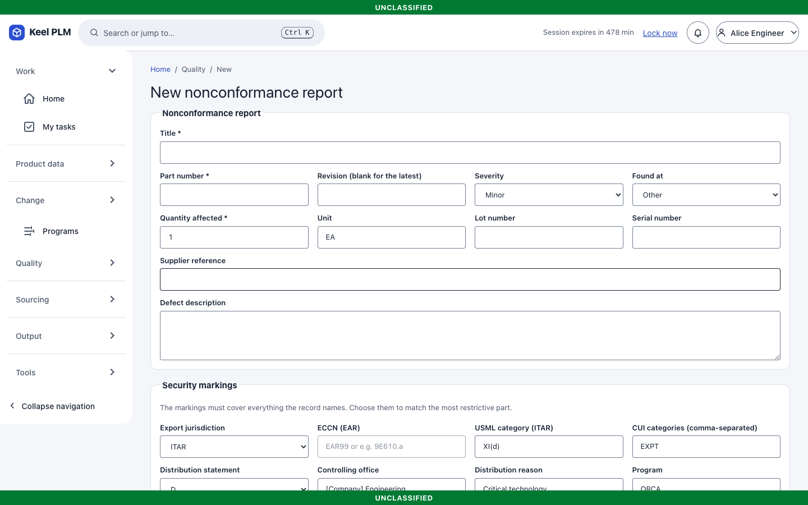

### Contain, dispose, close

- **Containment** tab: add action items with an owner, due date and what has to be done. Owners must be people who can read the record. Only the owner or an administrator completes an action, with a note.
- **Disposition** tab: choose *use as is, rework, repair, scrap* or *return to supplier* and write the rationale, then **Save proposal**.
- **Review** tab: **Submit to the review board**, choose the quality reviewer and the MRB members, and **Start review**. Each signs ([chapter 6](06-lifecycles-workflow-signatures.md)). When everyone has signed, the NCR is **Dispositioned**; you then close it with a note on how it was carried out. An open NCR can be cancelled.

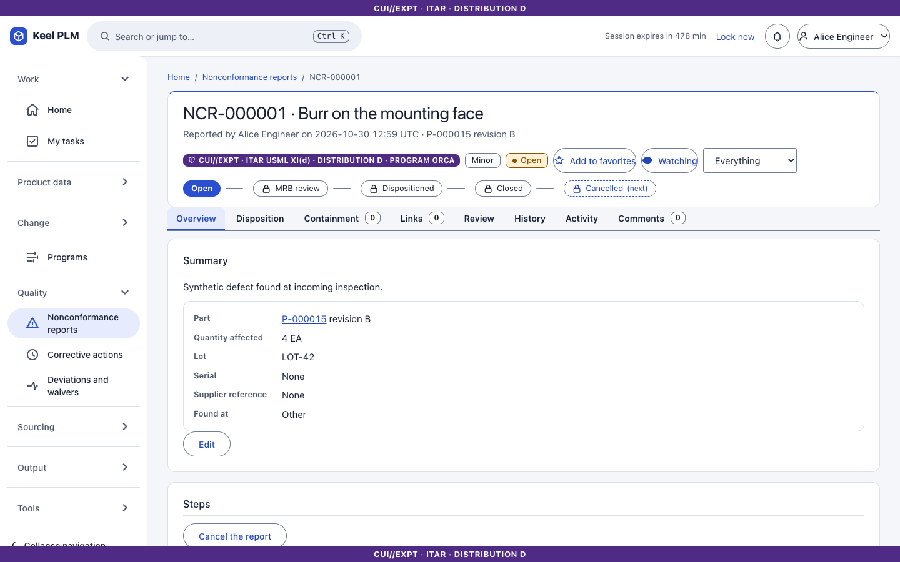
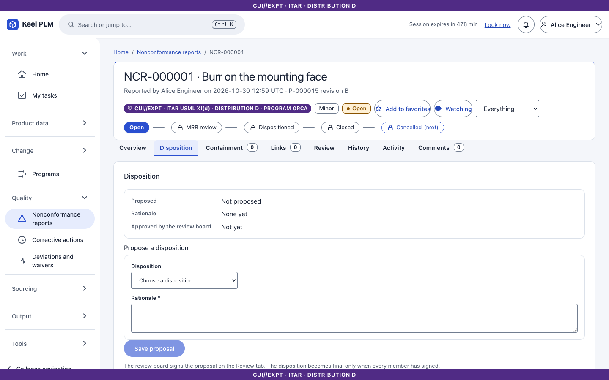
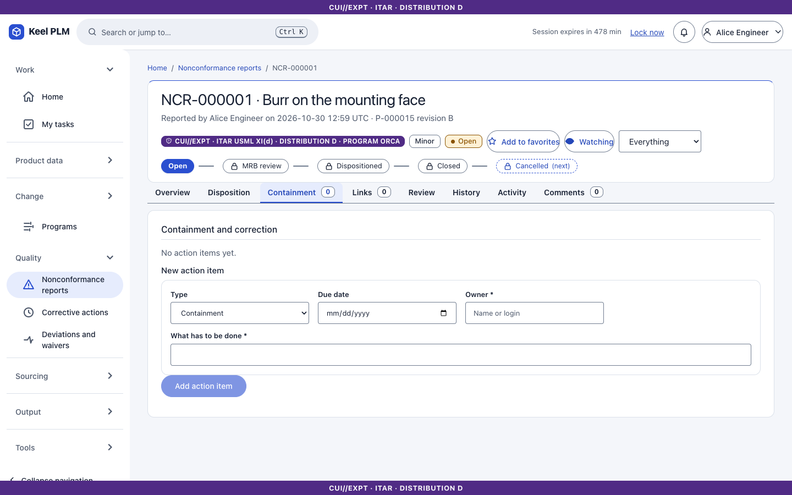

## CAPAs

Create one under **Corrective actions**: title, type (corrective or preventive), source, priority, owner, target date and problem statement.

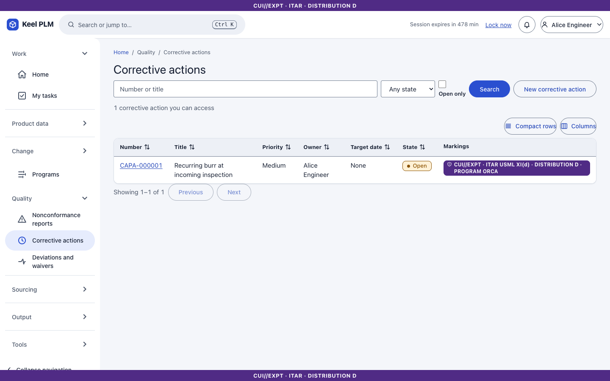

1. **Analysis**: record "whys" (1 to 8) with evidence, tick the cause categories (six), and write the root cause statement.
2. **Actions**: add and complete action items.
3. **Verification**: describe the effectiveness check, then record the result.
4. **Review**: a CAPA goes to review only with a root cause, at least one done action and none open, a verification plan and an effective result. It is closed only through the signed verification review.
5. **Links** to NCRs, changes, parts and deviations.

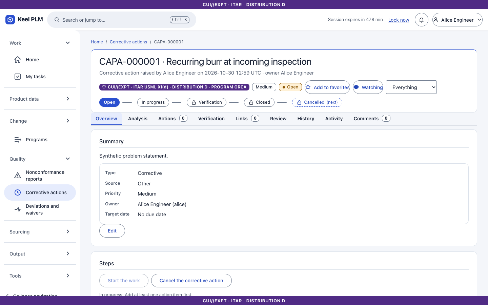
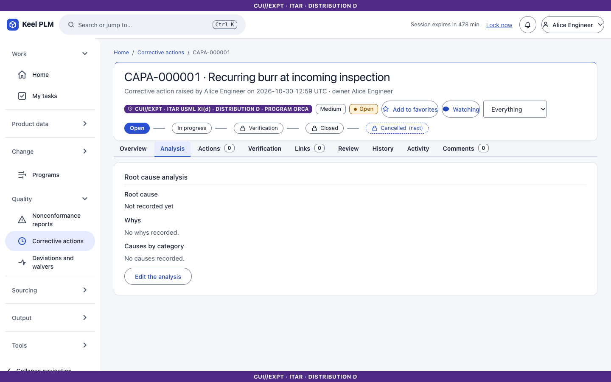
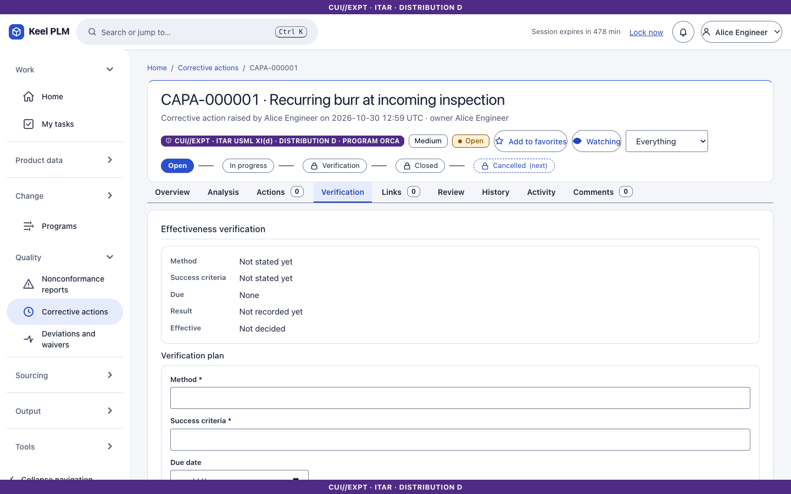

## Deviations and waivers

1. Create under **Deviations and waivers**: title, kind, requirement reference, justification and a **window** (two dates, UTC days, inclusive). Optionally require **customer approval**.
2. On the **Scope** tab add the parts the deviation covers (part number, optional revision, serial range or list, lots, quantity ceiling), then **Add to the scope**.
3. **Review**: submit for approval. With customer approval required, the internal approval leads to *Awaiting customer*; recording the customer's reference and date makes it Approved.
4. An approved deviation can be **revoked** or **withdrawn**, and expires on its own when its window ends (with notices before it).

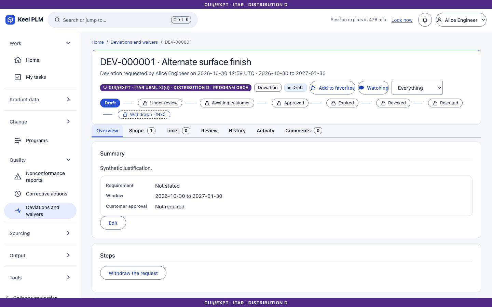
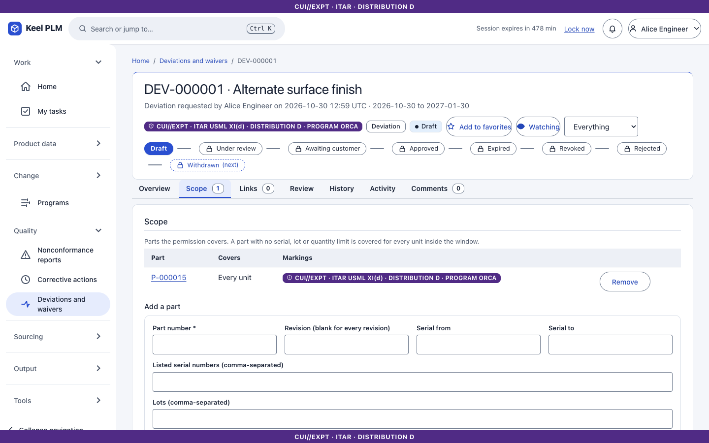
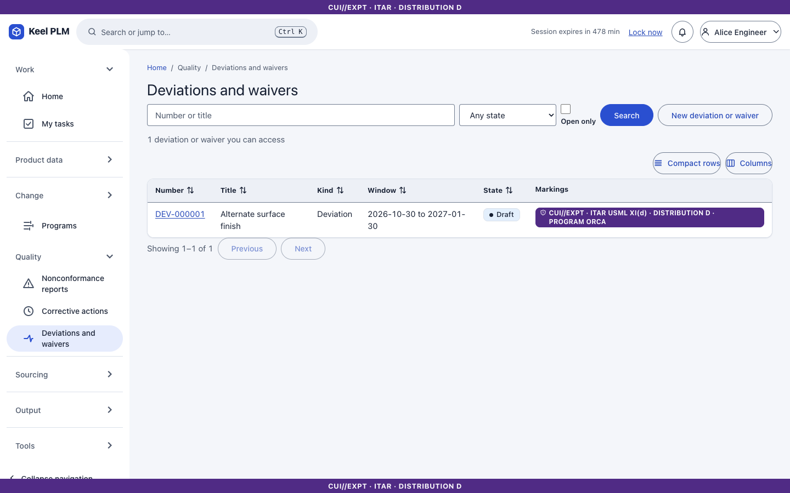

## On the part

A part's **Quality** tab lists its NCRs and the deviations that apply to a unit and date.

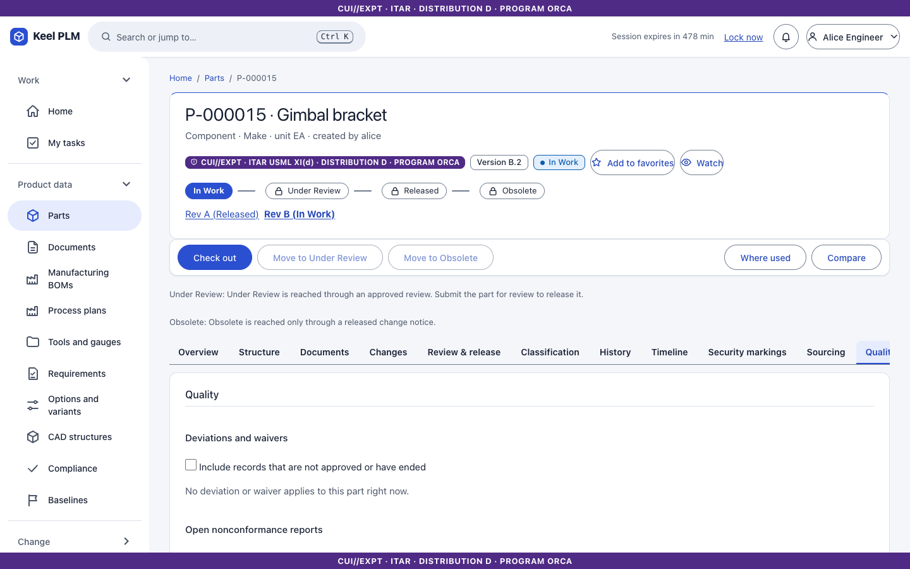

## Good to know

- Markings of a record must cover its part, its scoped parts and the records it links to.
- Closing, dispositioning and approving are reachable only through an approved review (a database rule).
- Quality records are not sent to the ERP outbox in this release.
- A supplier page lists quality records that point at it ([chapter 12](12-sourcing-and-portal.md)).
