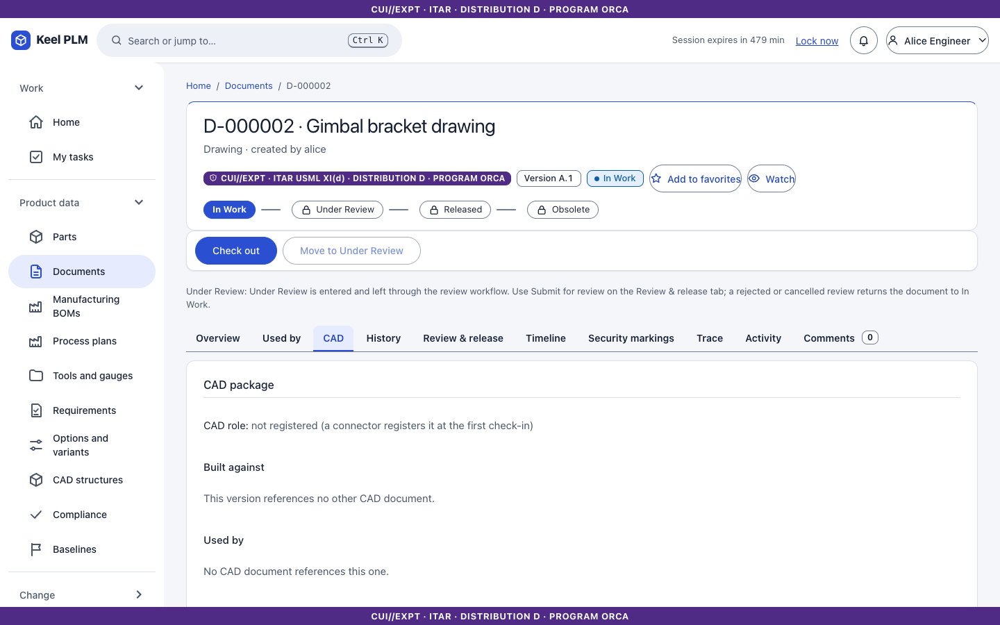
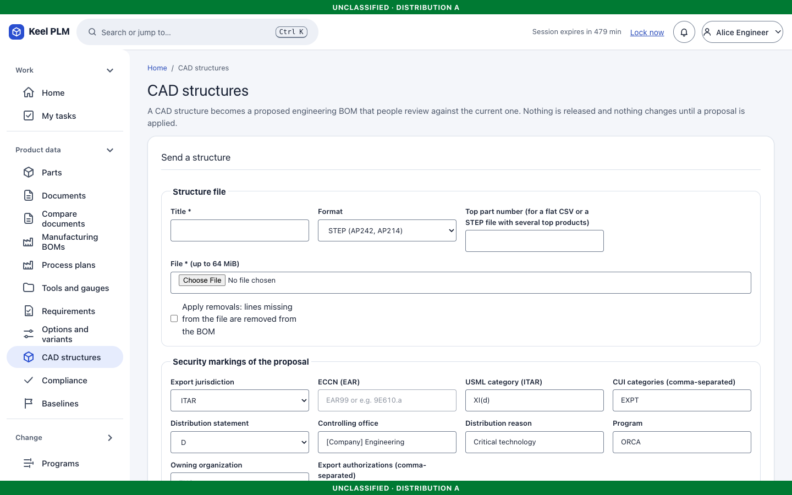
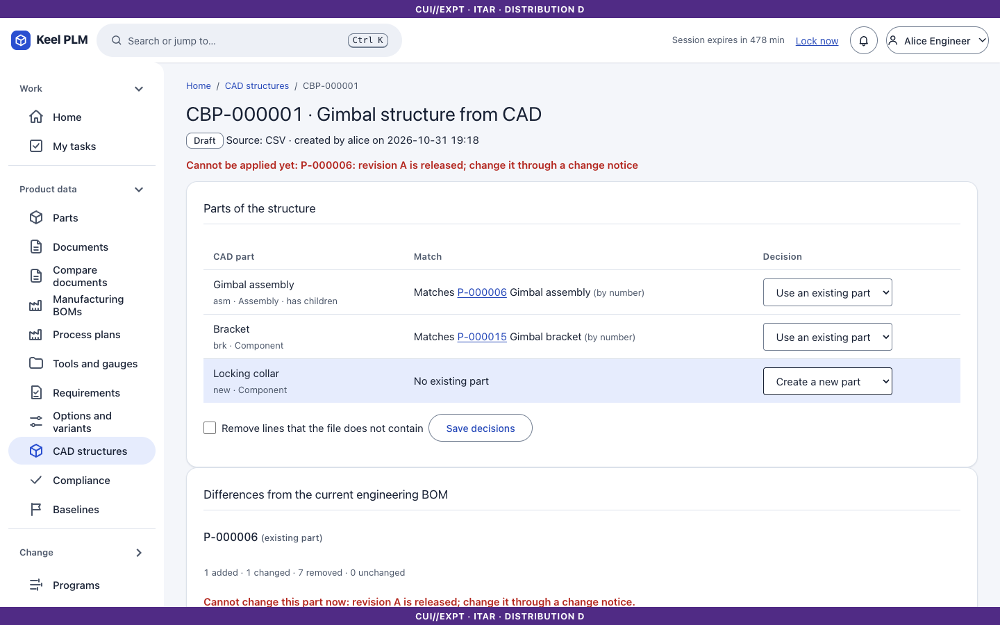

# 11. CAD: connector, structure proposals and the FreeCAD add-on

Keel does not open native CAD files. It stores them in the vault, hashes them, scans them, locks them, and tracks which file was built against which. All meaning (references between files, the part structure) is declared by a **connector**: the `keel-cad` command-line tool, the FreeCAD add-on, or a script.

## What is and is not shipped

| Shipped | Not shipped |
|---|---|
| REST API `/api/v1/cad` (package check-out and check-in, dependencies, stale detection, associations, structure proposals) | Plug-ins for NX, Creo, SolidWorks, CATIA or any commercial system; nothing was run against one |
| Importers for STEP product structure (AP203, AP214, AP242), CSV, XML and neutral JSON | Reading of native CAD files, or colours and PMI from STEP |
| Placements of every occurrence and bounding boxes of the parts of a STEP assembly, stored with the structure proposal and served by the API and `keel-cad` | Surfaces of STEP parts in the Viewer tab (the file viewer draws them); placements through mapped items |
| `keel-cad` reference tool, a watch-folder mode and recipes | Automatic release or signing from CAD |
| FreeCAD add-on (verified in real FreeCAD 1.1.4 and against the real server) | |

Developer documentation: [integration/cad-connector.md](../integration/cad-connector.md), [freecad-addon.md](../integration/freecad-addon.md), [cad-plugins.md](../integration/cad-plugins.md), [watch-folder-recipes.md](../integration/watch-folder-recipes.md).

## Concepts

- A **package** is the top document, everything it references, and the derived drawings, PDFs and STEP files. Check-out locks **all** members in one step: all or none.
- A document is **stale** when something it was built against has a later iteration. Stale drawings are flagged.
- An **association** says a document is the *model-of* or *drawing-of* a part.
- A **structure proposal** is a proposed EBOM made from a CAD structure; nothing changes in Keel's BOM until a person reviews and applies it.

## In the browser

### The CAD tab of a document

Open a CAD document and select the **CAD** tab: the package, its dependency tree, the lock holders, stale members and associations.



### CAD structures

**Product data > CAD structures** lists proposals and lets you send a file (CSV, XML, STEP or JSON) as a new one.



To review a proposal:

1. Open it. Each CAD part is matched to a Keel part by number; unmatched parts are marked *create*.
2. For each part and line, accept or change the **decision** (match, create, skip). The diff shows how the proposed BOM differs from the current one.
3. Choose whether **removals** are applied (off by default), then **Apply**. The change goes through the normal part and BOM services: working copy, check-in, release locks, audit. **Discard** drops the proposal.



### Placements and the Viewer tab

When a STEP file is sent as a structure, Keel also keeps where each occurrence sits (a 4 by 4 matrix from parent to child, in the file's length unit) and the box of each part. The proposal page and the proposal's JSON show how many occurrences have a placement. The **Viewer** tab of the model's document and of the part draws them ([chapter 5](05-documents-and-vault.md#the-viewer-tab-3d-models-on-the-page)).

To read them from a script or the command line:

```
keel-cad bom placements CBP-000007          # the placements stored with a proposal, as a table
keel-cad placements D-000123 [--json]       # the placed structure of a document's STEP file, derived on request
```

Each line is an instance: indentation shows the level, then number, name, path, position of the part's origin and its world-space box. Both commands need the same access as reading the proposal or viewing the document, and say "no placement" for an occurrence the file gives none for.

## The FreeCAD add-on

### Install

1. Copy or symlink `tools/freecad-keel` into FreeCAD's `Mod` folder as `Keel` (Linux `~/.local/share/FreeCAD/Mod/Keel`, Windows `%APPDATA%\FreeCAD\Mod\Keel`, macOS `~/Library/Application Support/FreeCAD/Mod/Keel`), or install from your internal add-on repository.
2. Restart FreeCAD (1.0 or newer) and choose the **Keel PLM** workbench.
3. Open the Keel settings: the server URL (`https://`; plain `http` only to `localhost`), the work folder, and where your token comes from.

The add-on uses only the Python that ships with FreeCAD; no internet.

### Sign in

There are no passwords. The add-on reads a bearer token issued by your identity provider from, in order: the `KEEL_CAD_TOKEN` environment variable, the **token file** (mode 600 on Linux and macOS), or the **token command** (a program that prints a token). The token is read again for each request. For a private certificate authority set the **CA file** in the settings. Redirects from the server are refused.

### Mark parts

Give each part a custom property `KeelPartNumber` (command **Set Keel part number**). Optional properties: `KeelPartName`, `KeelUnit`, `KeelSource` (Make or Buy), `KeelAttr_<attribute>`, and on links `KeelFindNumber`, `KeelRefDes`, `KeelExclude`. Quantity is the count of usages (a link array counts its `ElementCount`).

### Commands

| Command | Does |
|---|---|
| **Check out package** | Asks for the top document number; locks the whole package; writes files to `<work folder>/<number>`, verifying every SHA-256; opens the FreeCAD files |
| **Check in** | Saves the documents you changed, asks for a comment, and checks the set in atomically, declaring references from external links and TechDraw sources |
| **Undo check-out** | Releases every lock; local files stay |
| **Push BOM to Keel** | Walks the selected part, shows counts and warnings, and creates a structure proposal marked like the package's top document |
| **Keel status** | Local changes, lock holders and stale drawings |
| **Mark model-of / drawing-of** | Records the associations |

Typical session: **Check out package** `D-000007`, work, **Keel status**, **Check in**, then **Push BOM to Keel**, and review the proposal in the browser as above. If a lock conflict exists, nothing is taken; a refused request is shown in words with its `cad.*` code and is not retried.

Tips from the real runs: keep work folders off symlinked paths (on macOS, `/var` is a symlink); a TechDraw page in its own file needs an external `App::Link` to the part.

### `keel-cad`

The command-line tool (`checkout`, `add`, `push`, `checkin`, `undo`, `watch`, `bom push`, `bom placements`, `placements`) shares its work folder format with the add-on. Watch-folder recipes for other tools (for example KiCad) are in [watch-folder-recipes.md](../integration/watch-folder-recipes.md).

### Screenshots of the FreeCAD interface

Not included: the add-on's own windows are FreeCAD's, not Keel's, and screenshots in this manual are captured from the Keel web app only.

## Model versions

CAD and mesh models also have a version history with measurements and visual compare; see [chapter 5](05-documents-and-vault.md#model-versions-cad-and-mesh-files).
