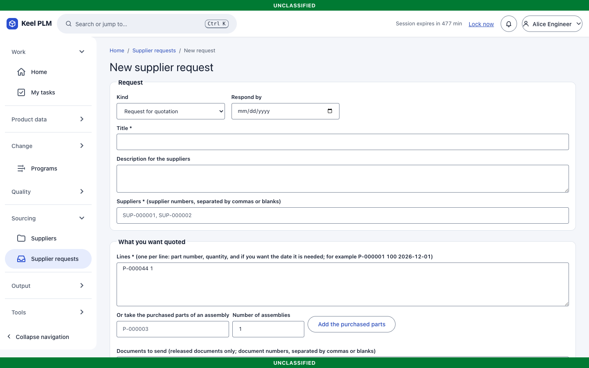
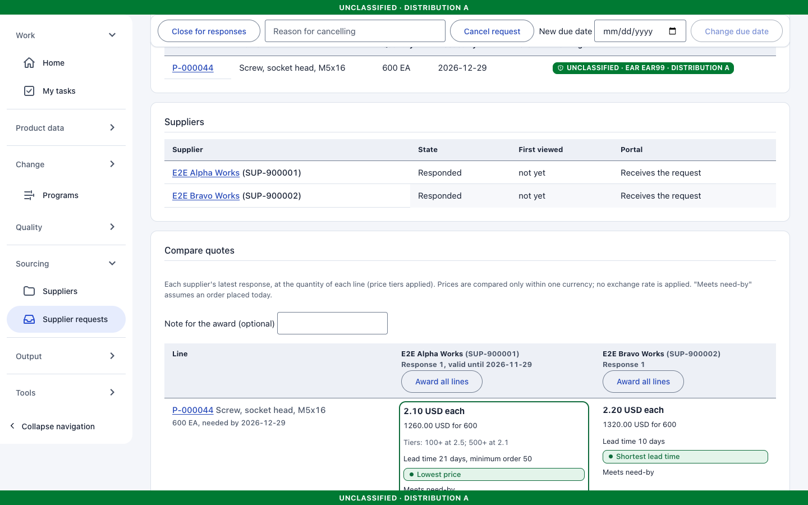
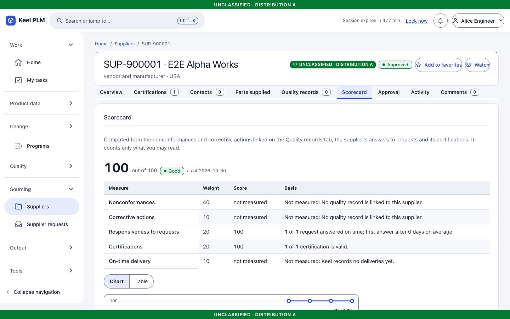
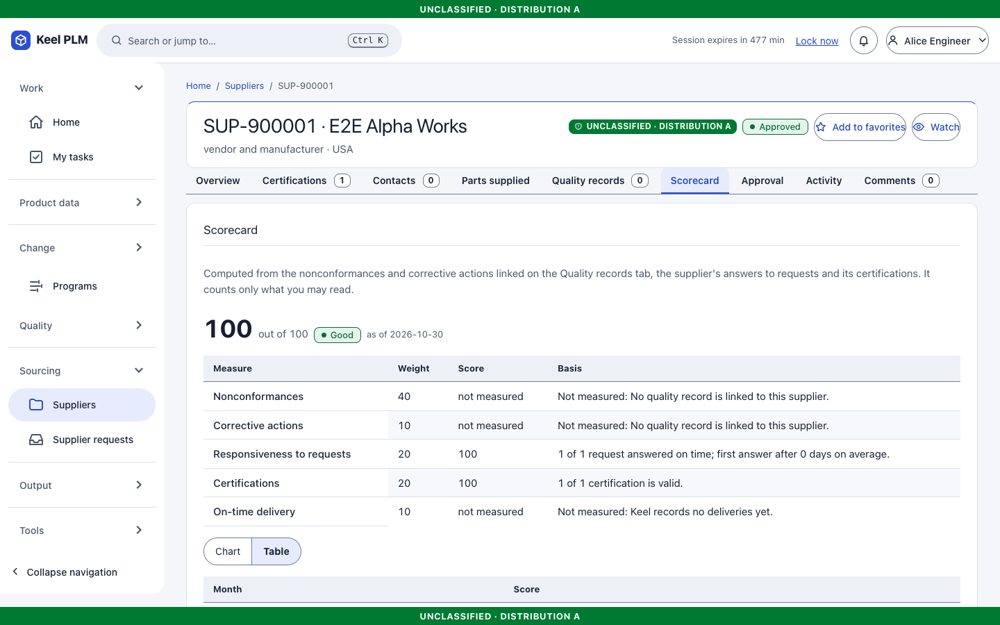
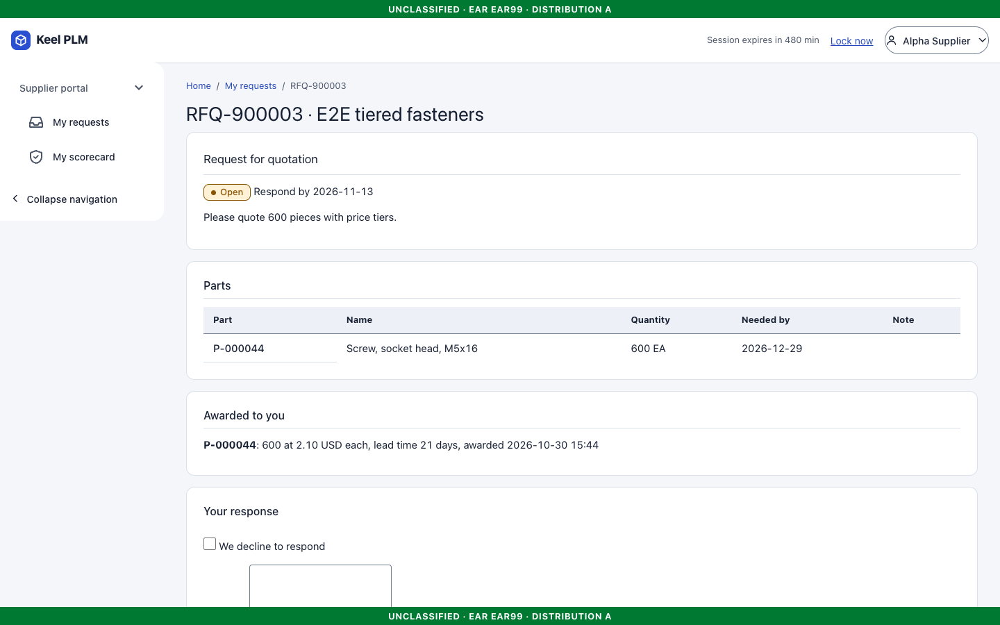
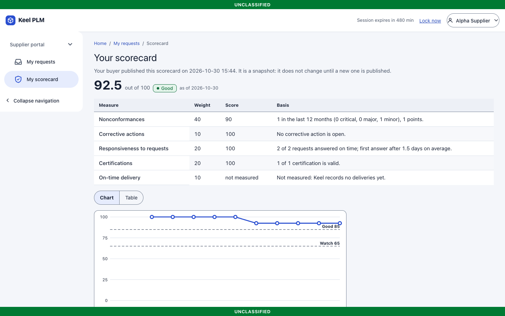

# 12. Suppliers, sourcing and the supplier portal

## Suppliers

**Sourcing > Suppliers** lists suppliers (`SUP-nnnnnn`). A supplier has a status (*prospective, approved, conditional, disapproved, obsolete*), roles (vendor, manufacturer), a country, a **foreign** flag, a clearance profile and markings.

### Add a supplier

1. Select **New supplier**, enter name, country, roles, markings and the clearance profile. A country other than USA forces the foreign flag.
2. Open the new supplier and fill in the tabs: **Overview, Certifications, Contacts, Parts supplied, Quality records, Scorecard, Portal access** (administrators) and **Approval**.

### Certifications and approval

Add certifications (type, number, issuer, dates). Notices go out at 60, 30 and 7 days before expiry and on expiry; an expired certification makes the supplier a *conditional* source in coverage.

**Approved** and **conditional** come only from a signed review ([chapter 6](06-lifecycles-workflow-signatures.md)) and need one valid certification. Disapproved and obsolete are set directly with a reason.

**A foreign supplier is never selected for or sent ITAR data.** This is enforced in the services, in database triggers and at read time ([chapter 9](09-markings-and-access.md)).

## Approved manufacturer and vendor lists

A **list entry** (`SRC-nnnnnn`) ties a part to a manufacturer part number (AML) or a vendor (AVL), with status (preferred, approved, alternate, disapproved), approval state (Draft, Under review, Active, Withdrawn), vendor part number, lead time, price breaks and dates. An Active entry changes only by end date or withdrawal.

On a part, the **Sourcing** tab shows its entries and relations (alternate, replaces).

## Where sourced and coverage

- **Where sourced** (`/sourcing/where-sourced?supplier=...`) lists parts a supplier supplies.
- **Coverage** (`/sourcing/coverage`) reports, for a structure, which Buy lines have no effective preferred or approved entry from an approved supplier.

## Supplier requests (RFQ)

A request asks suppliers for a quote (or for information). It lists what you want, says when you need it, sends the released drawings and specifications the supplier must quote against, and collects the answers so you can compare them and award the work.

### Start a request

Three ways in, from the least typing to the most:

1. **From a part.** On the part's **Sourcing** tab select **Request a quote for this part**. The form opens with the part already on its first line.
2. **From an assembly.** On **Sourcing > Sourcing coverage**, check a bill of materials and select **Request quotes for these parts**. Every purchased part of the assembly is added, with its quantity for one assembly. On the form you can change the **Number of assemblies**, or type another assembly number and select **Add the purchased parts**.
3. **From a blank form:** **Sourcing > Supplier requests > New request**.

Fill in only what you need: a **Title**, the **Suppliers** (their numbers, separated by commas) and the **Lines**. Write one line per part: the part number, the quantity and, if you want, the date it is needed, for example `P-000001 600 2027-03-01`. **Respond by** is the due date: after it the portal takes no more answers (you can move it with **Change due date**).

To send drawings and specifications, type their document numbers under **Documents to send**, or tick **Also send the released documents linked to the parts above**. Only a **released** document version can be sent, and the request's markings must cover every part and document it lists (the form tells you what to raise). Select **Create draft request**, check the page, then **Issue to suppliers**.

The parts, lines, documents and suppliers are fixed once the request exists; to change them, cancel it and create a new one.

> **Documents are sent whole or not at all.** A supplier receives a document only if its clearance profile allows the document's own markings. If not, the document is not listed for that supplier at all, and asking for its file gets the same "not found" as for a file that does not exist: nothing is blacked out or watered down. On the request page the **Documents sent with the request** table shows, per document, **Not sent to** which suppliers. A foreign supplier never receives ITAR data.

### Compare the quotes and award

When suppliers answer, the request page shows **Compare quotes**: one row per line, one column per supplier.

Each cell shows the unit price **at the line's quantity** (a supplier's price tiers are applied: the tier with the largest quantity not above yours), the price for the whole line, the lead time and minimum order, the supplier's note and **Exception** (what it cannot meet), and flags: **Lowest price**, **Shortest lead time** and **Meets need-by** or **Misses need-by** (assuming an order placed today). The last row adds up each supplier's priced lines and says when lines are missing. Prices are compared only within one currency: Keel applies no exchange rate, so quotes in different currencies are shown but not ranked.

Only each supplier's latest response counts, and a later decline withdraws an earlier quote. A quote that has passed its **valid until** date cannot be awarded.

To award, select **Award line** in the cell you choose, or **Award all lines** under a supplier's name (it needs a priced quote for every line). You can add a **Note for the award**. Each line has one winner. An award:

- records the supplier against the part: it adds, or links to, the part's **approved vendor list** entry (`SRC-nnnnnn`) with the quoted lead time, minimum order and price breaks. A new entry is a **draft**: it becomes a source only after its normal approval, on the part's **Sourcing** tab;
- closes the request when every line has an award;
- is shown to that supplier alone in its portal.

A mistaken award is undone with **Withdraw** (give a reason); the draft entry it created is withdrawn with it, and the line can be awarded again.

## Supplier scorecards

Open a supplier and select the **Scorecard** tab. It shows a score from 0 to 100, how each measure contributes, and a trend.

| Measure | Weight | How it is measured |
|---|---|---|
| Nonconformances | 40 | Points for the nonconformance reports linked on the **Quality records** tab and opened in the last 12 months: minor 1, major 3, critical 8; each point takes 10 off. |
| Corrective actions | 10 | 25 off for each linked corrective action that is open. |
| Responsiveness to requests | 20 | The share of requests (issued in the last 12 months, due or answered) that the supplier answered on or before the due date. A decline is an answer. |
| Certifications | 20 | The share of the supplier's certifications that are valid on the date. |
| On-time delivery | 10 | Not measured: Keel records no deliveries yet. |

The score is the weighted average of the measures that can be measured. A measure with nothing to measure (no linked quality record, no request yet) is shown as **Not measured** and left out; it is never counted as perfect. **How the score is calculated** opens the formula in words, the same on the page as here. The scorecard counts only the records **you may read**; the page tells you how many linked records were not counted (cancelled, or hidden from you).

The trend shows the same score at the end of each of the last 12 months. The **Chart** has a **Table** next to it with the same numbers.

### Share it with the supplier

Nothing reaches the supplier until you select **Publish to supplier**. It publishes a snapshot: it does not change until you publish again (**Publish again**), and **Withdraw from supplier** takes it away at once. The supplier's copy counts only records and requests that may be released to that supplier (the same check as for documents), and it never shows a record's number or title. If a quality record linked to the supplier is hidden from you, you cannot publish (your card would understate it): ask someone who may read it.

## The supplier portal

Supplier users (dev accounts `sup-alpha` and `sup-bravo`) have a separate, minimal interface.

1. Sign in. Their navigation has two entries: **My requests** and **My scorecard**.
2. Open a request: description, lines with the quantity and the date each is needed, and the documents shared with them (download links).
3. Quote. For each line enter a **Unit price**, **Currency**, **Lead time (days)** and **Minimum order**; add **Price tiers** written as quantity:price (`100:2.50, 500:2.10` means from 100 pieces 2.50 each, from 500 pieces 2.10), an **Exception** for what you cannot meet, and a **Note**. Say how long the quote holds in **Quote valid until**. Add files if needed and select **Send response**. A later response replaces an earlier one for the buyer; the earlier ones stay in your history.
4. After the buyer awards a line to you, **Awarded to you** shows the line, quantity and price.

A supplier sees only requests addressed to their own supplier, only the parts and documents its clearance profile allows (a document it may not have is not listed), and nothing internal; opening another supplier's request, or any internal page, returns the "not found" answer. After the due date the request takes no more responses.

**My scorecard** shows the scorecard the buyer published, if any; otherwise it says the buyer has not shared one.

Administrators link portal users to a supplier on the **Portal access** tab.

## What is not shipped

- No on-time delivery measure: Keel records no purchase orders, deliveries or receipts, so that part of the scorecard is shown as not measured.
- No split awards (one line shared by two suppliers), no purchase orders and no currency conversion between quotes.
- A quote is compared at the quantity of the line; Keel does not search for the best split between price tiers.
