# 12. Suppliers, sourcing and the supplier portal

## Suppliers

**Sourcing > Suppliers** lists suppliers (`SUP-nnnnnn`). A supplier has a status (*prospective, approved, conditional, disapproved, obsolete*), roles (vendor, manufacturer), a country, a **foreign** flag, a clearance profile and markings.

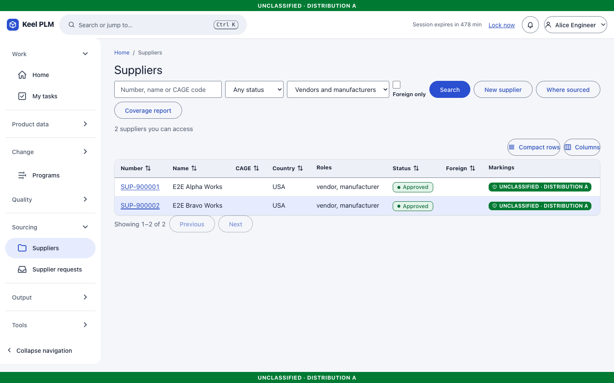

### Add a supplier

1. Select **New supplier**, enter name, country, roles, markings and the clearance profile. A country other than USA forces the foreign flag.
2. Open the new supplier and fill in the tabs: **Overview, Certifications, Contacts, Parts supplied, Quality records, Portal access** (administrators) and **Approval**.

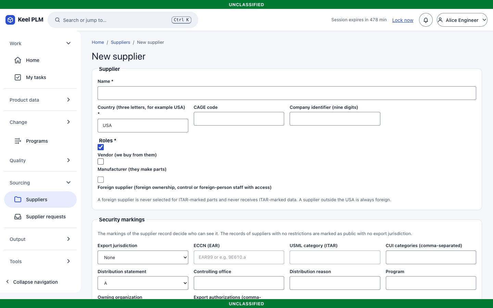
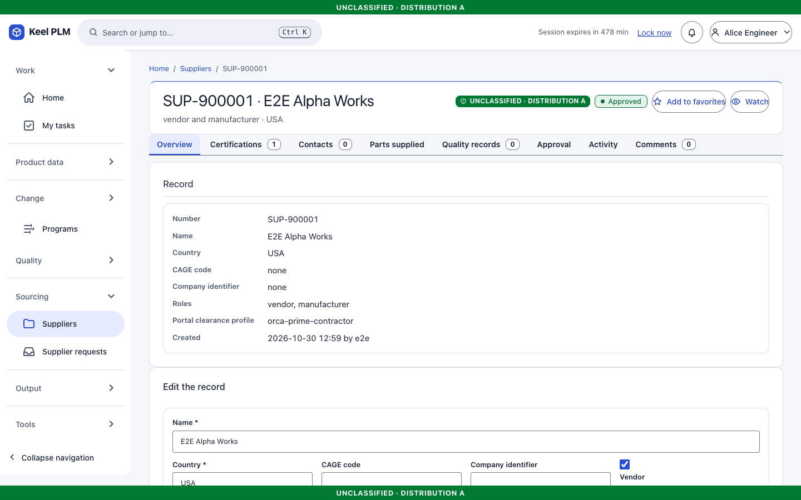

### Certifications and approval

Add certifications (type, number, issuer, dates). Notices go out at 60, 30 and 7 days before expiry and on expiry; an expired certification makes the supplier a *conditional* source in coverage.

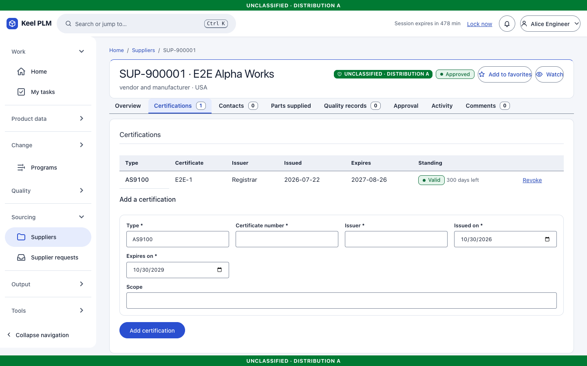

**Approved** and **conditional** come only from a signed review ([chapter 6](06-lifecycles-workflow-signatures.md)) and need one valid certification. Disapproved and obsolete are set directly with a reason.

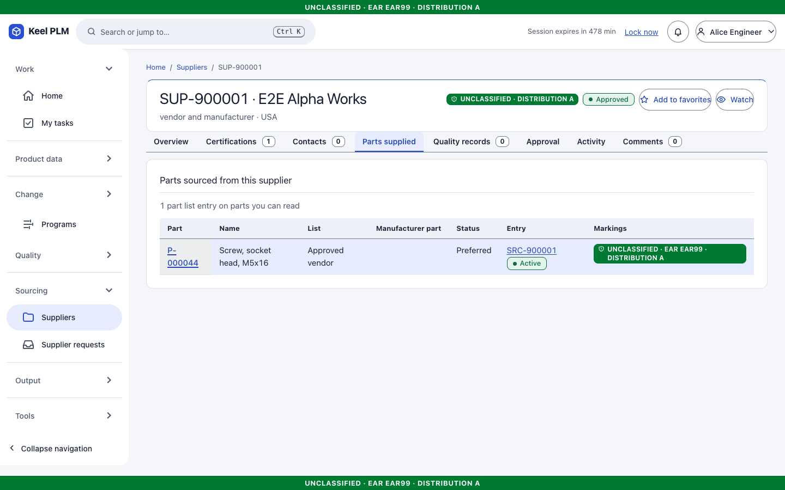

**A foreign supplier is never selected for or sent ITAR data.** This is enforced in the services, in database triggers and at read time ([chapter 9](09-markings-and-access.md)).

## Approved manufacturer and vendor lists

A **list entry** (`SRC-nnnnnn`) ties a part to a manufacturer part number (AML) or a vendor (AVL), with status (preferred, approved, alternate, disapproved), approval state (Draft, Under review, Active, Withdrawn), vendor part number, lead time, price breaks and dates. An Active entry changes only by end date or withdrawal.

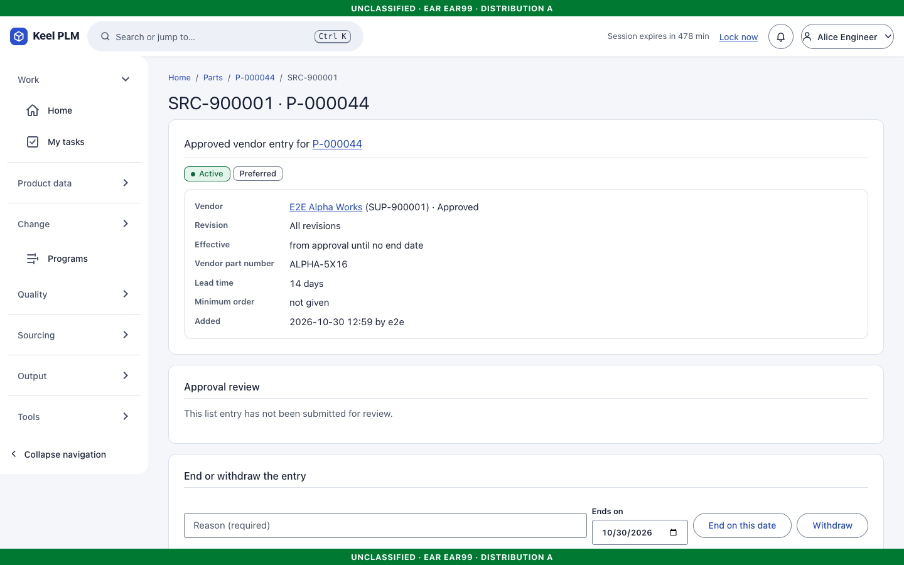

On a part, the **Sourcing** tab shows its entries and relations (alternate, replaces).

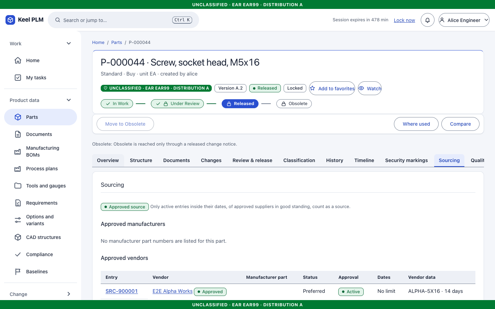

## Where sourced and coverage

- **Where sourced** (`/sourcing/where-sourced?supplier=...`) lists parts a supplier supplies.
- **Coverage** (`/sourcing/coverage`) reports, for a structure, which Buy lines have no effective preferred or approved entry from an approved supplier.

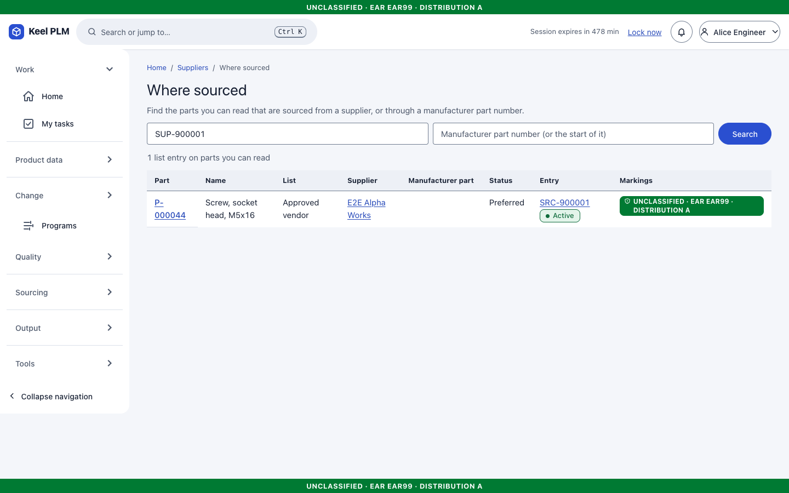
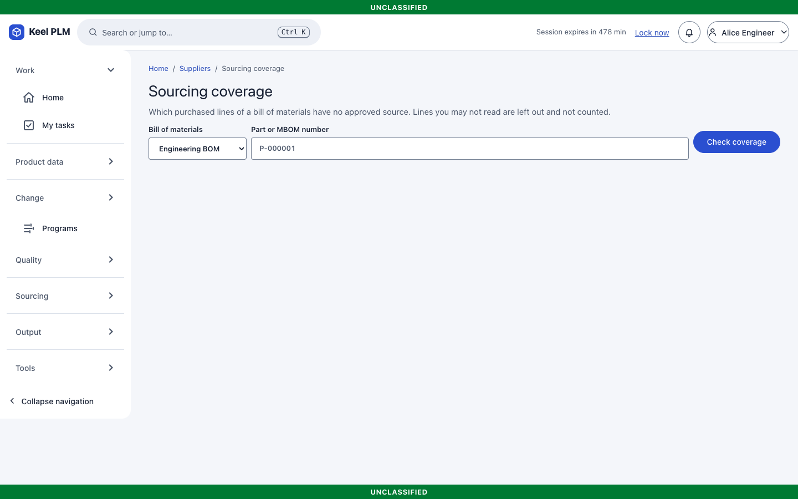

## Supplier requests (RFQ)

1. **Sourcing > Supplier requests > New request**: kind, title, description, the parts and quantities, and the recipients. The parts and recipients are fixed once created. The markings must cover every part.
2. **Issue** the request. Each recipient is notified and sees it in their portal.
3. Responses arrive as immutable records with files; compare them on the request page.

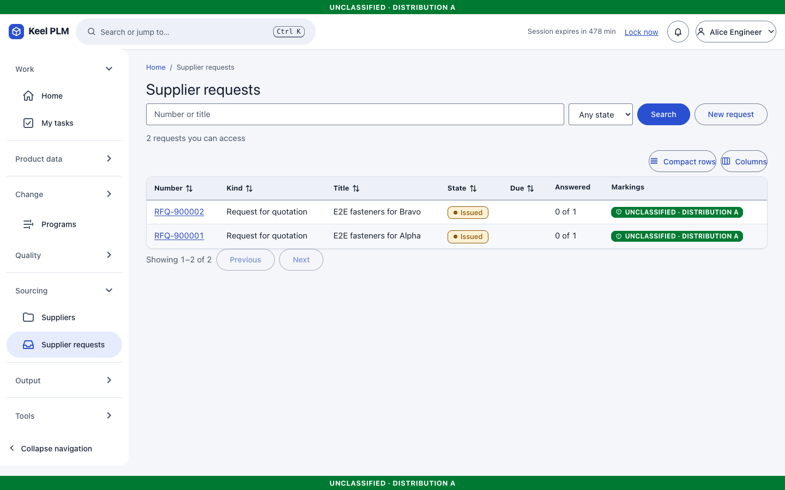
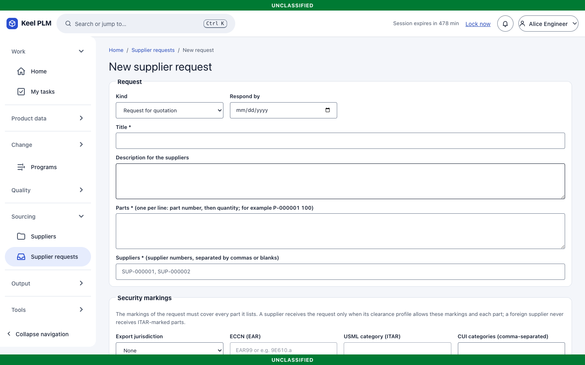
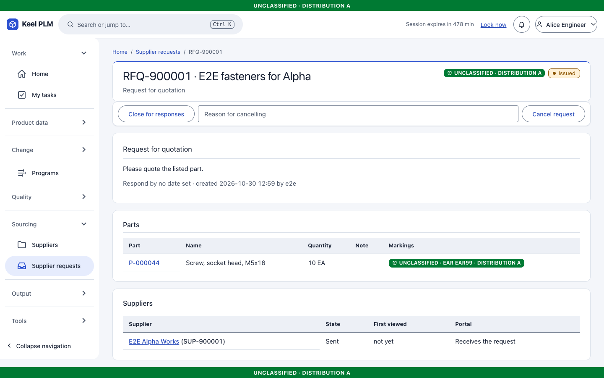

## The supplier portal

Supplier users (dev accounts `sup-alpha` and `sup-bravo`) have a separate, minimal interface.

1. Sign in. Their only navigation entry is **My requests**.
2. Open a request: description, parts and quantities, and what has been shared with them.
3. Upload a response and files.

A supplier sees only requests addressed to their own supplier, and nothing internal; opening another supplier's request, or any internal page, returns the "not found" answer.

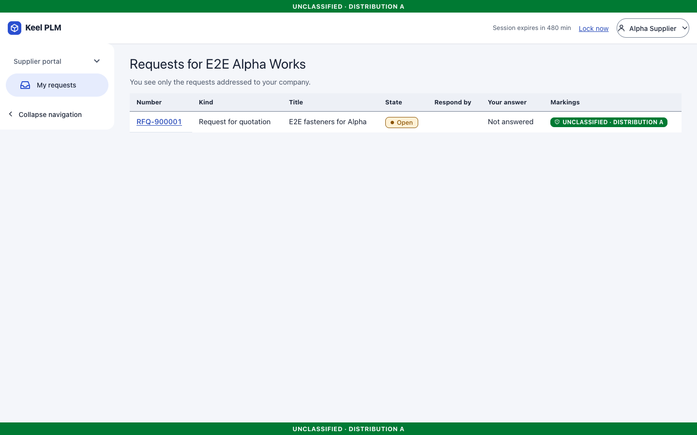
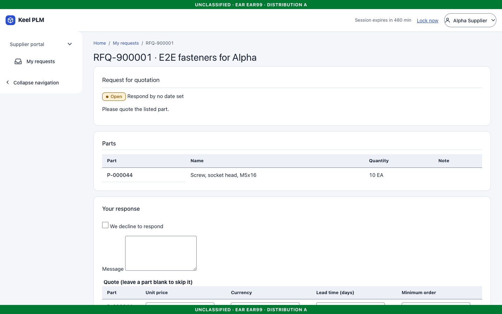

Administrators link portal users to a supplier on the **Portal access** tab.
