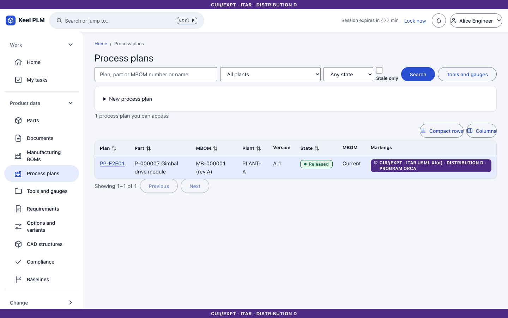
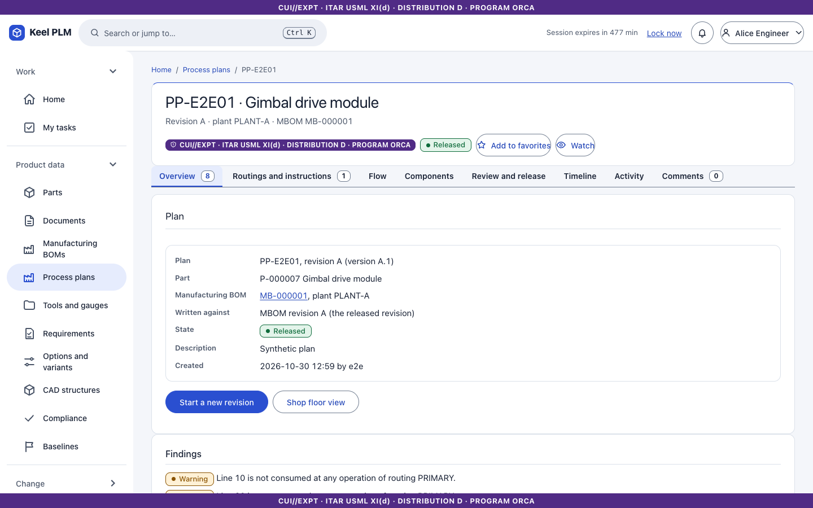
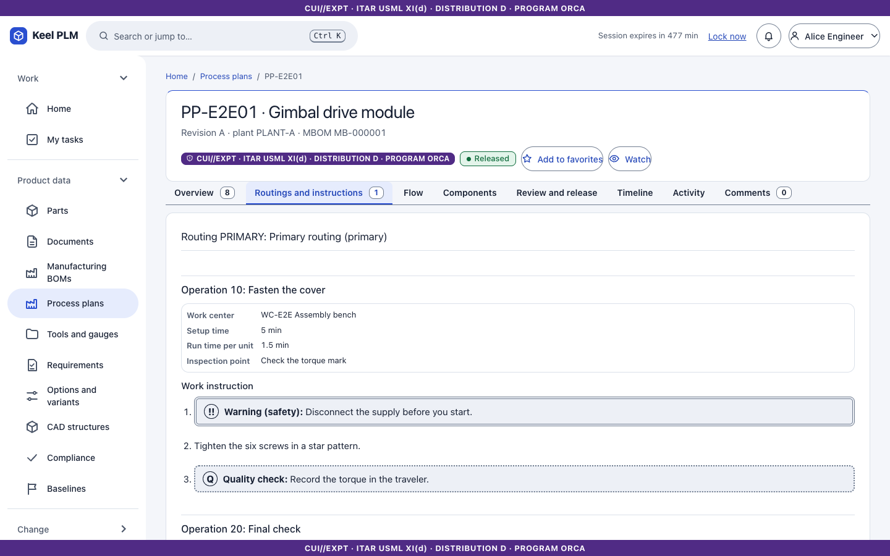
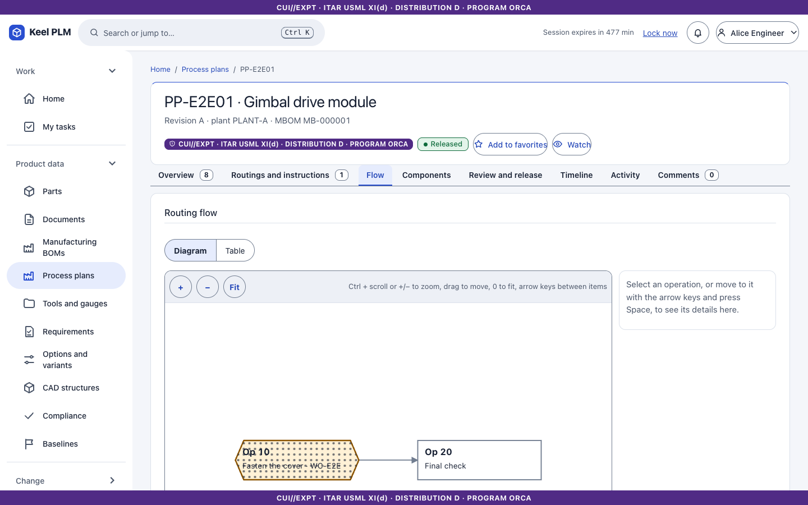
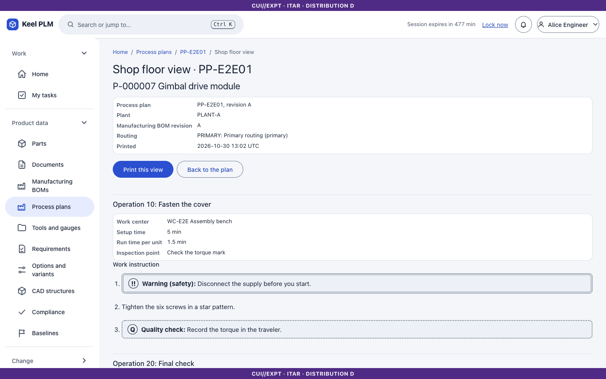
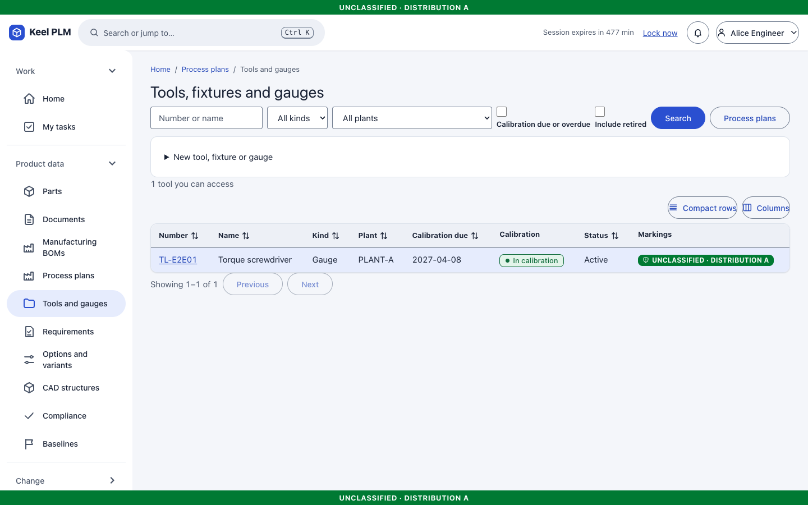
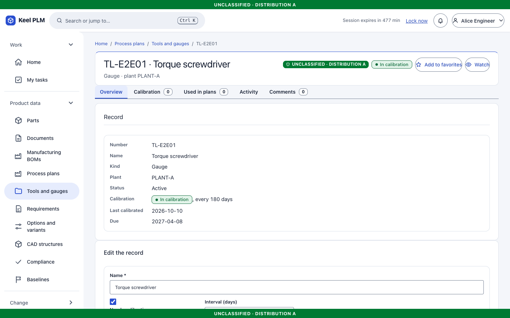
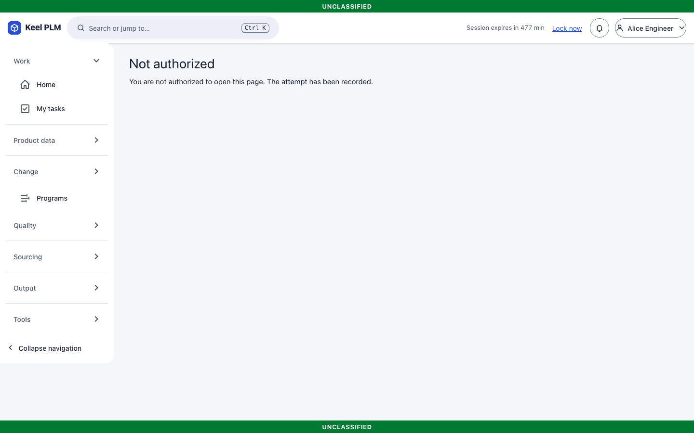

# 13. Manufacturing process data

Keel holds routings, work instructions and tooling next to the MBOM. It does not run a shop floor, execute work orders or talk to machines.

## Process plans

A **process plan** (`PP-...`) belongs to one released MBOM, so it is for one part in one plant. Open **Product data > Process plans**.

### Create and edit

1. Create a plan from a **Released** MBOM revision. It starts In work with its first iteration checked out.
2. Edit the **Routings and instructions** tab: operations in order, each with a work center, setup and run times, tooling, the components it consumes, and instruction text.
3. **Check in** to save an iteration.

### Check coverage

The **Overview** tab lists findings (for example BOM lines not assigned to any operation, or over-assigned). The **Components** tab is the matrix of components against operations. The **Flow** tab draws the routing as a diagram, with a table alternative.

### Release and staleness

Release goes through the review workflow with signatures ([chapter 6](06-lifecycles-workflow-signatures.md)). If the MBOM revision moves on, the plan shows it is stale; **rebind** points it at the new MBOM revision.

### Shop-floor view

**Shop floor** (`/process/plans/<number>/shop-floor`) shows the released plan as a read-only, print-friendly view for people on the floor.

## Tools and gauges

**Tools and gauges** lists tools with their calibration. Each tool page has **Overview, Calibration** (an append-only history) and **Used in plans**. Calibration notices go out ahead of expiry; tools can be retired and restored.

## Work centers

Administrators maintain work centers under `/process/work-centers`.

## Not shipped

No manufacturing execution: no work orders, machine data, or operator sign-off of operations. The routing is reference data for the MBOM, and the operation reference in an MBOM is a free-text key.
