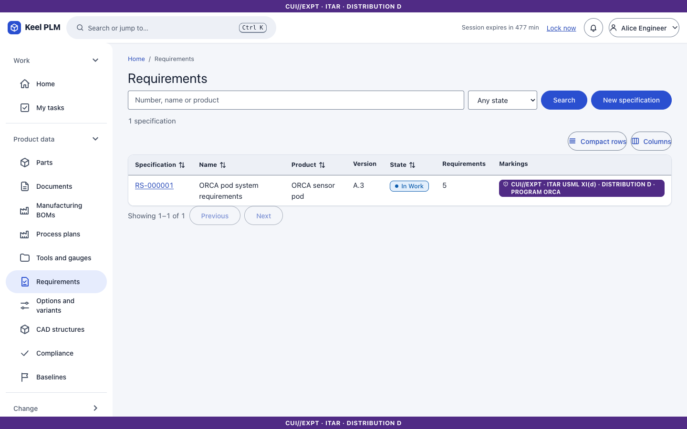
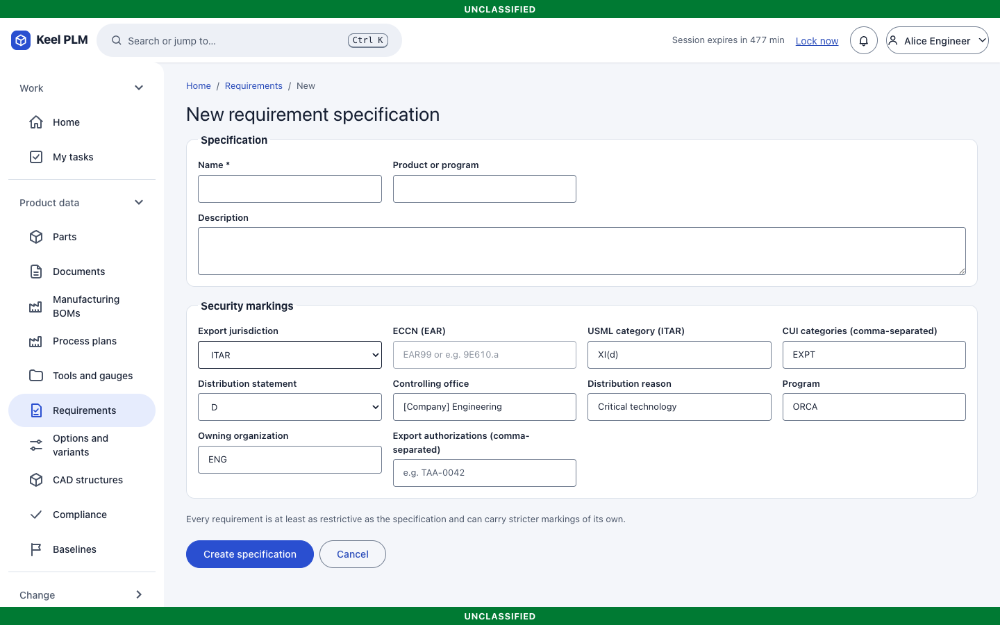
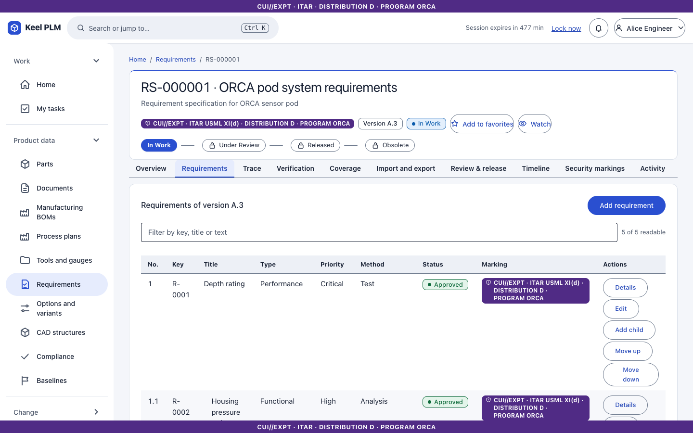
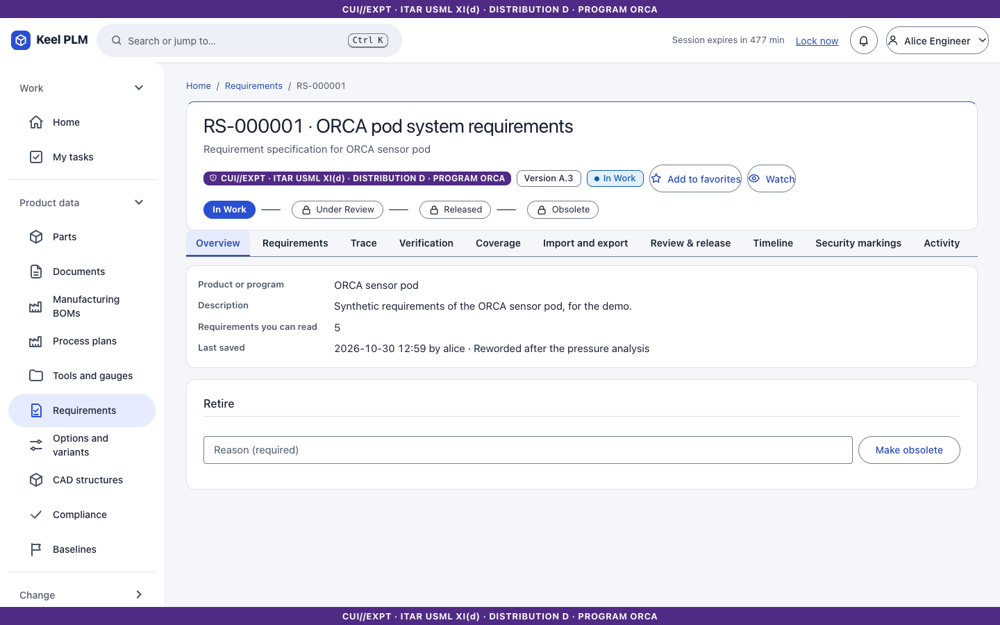
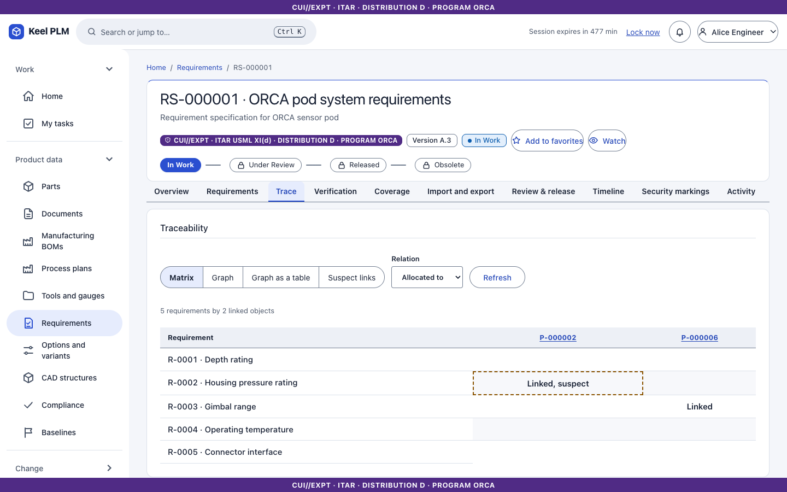
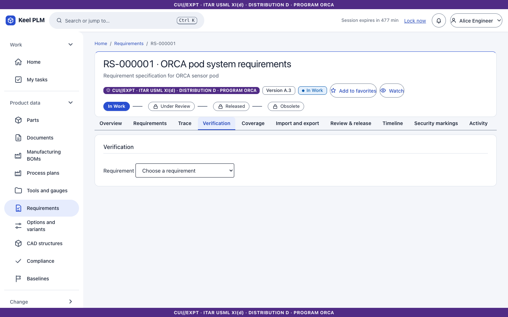
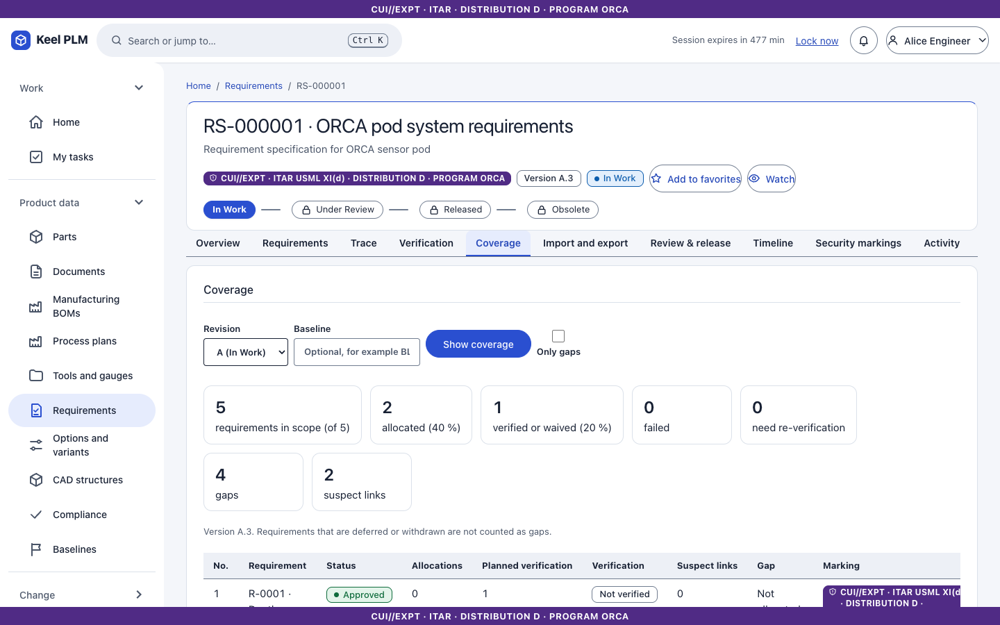

# 14. Requirements and traceability

A **requirement specification** (`RS-nnnnnn`) is a versioned document of requirements with its own lifecycle, markings and review. Requirements keep a permanent identity (`R-0001`) across revisions and can be **linked** to parts, documents and changes to form the digital thread.

## Create a specification

1. Open **Product data > Requirements**, then **New specification**.
2. Enter a name and markings, then **Create specification**.

## Write requirements

On the **Requirements** tab:

1. Select **Add requirement**. Give a **Title**, the **Requirement text** (what must be true: "The housing shall be rated to 6000 m."), and a status (for example approved).
2. Select **Save**. It gets an identity such as `R-0001`.
3. Use **Add child of R-0001** for sub-requirements (numbered 1.1, 1.2...). You can edit, move and reorder requirements; the outline shows the hierarchy.

## Link requirements to the product

1. Open **Details** of a requirement.
2. Under links choose a link type (administrators define types under **Administration > Requirement link types**; five are built in), enter the **Target number** (a part, document or change), and **Add link**.
3. A link records which version of the requirement it was reviewed against. If you **edit** the requirement afterwards, the link turns **Suspect**; read it, then **Mark reviewed** to make it Current again.

## Trace

The **Trace** tab shows the **matrix** of requirements against linked objects, a **graph** and **Graph as a table**, and the list of suspect links. Parts, documents and changes also have a **Trace** tab listing the requirements allocated to them, and an ECN's impact analysis lists the requirements of its affected parts.

## Verification and coverage

1. On **Verification**, choose the requirement, the **Result** (pass, fail...) and evidence, then **Record verification**. Records are immutable; a formal verification carries a signature.
2. **Coverage** summarizes how many requirements are linked, verified and suspect.

## Import, export, review

The **Import and export** tab moves requirements to and from files. **Review & release** uses the signed review ([chapter 6](06-lifecycles-workflow-signatures.md)); a released specification is revised to change it. A restricted specification is "not found" to a reader without its program.
