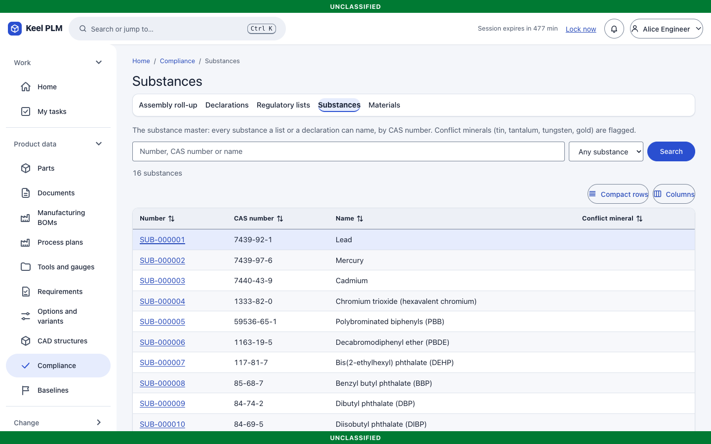
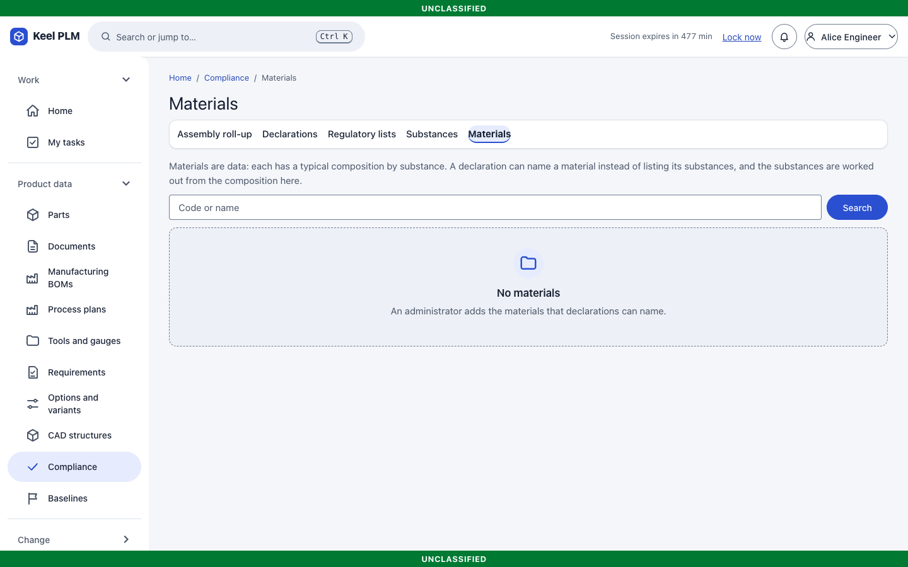
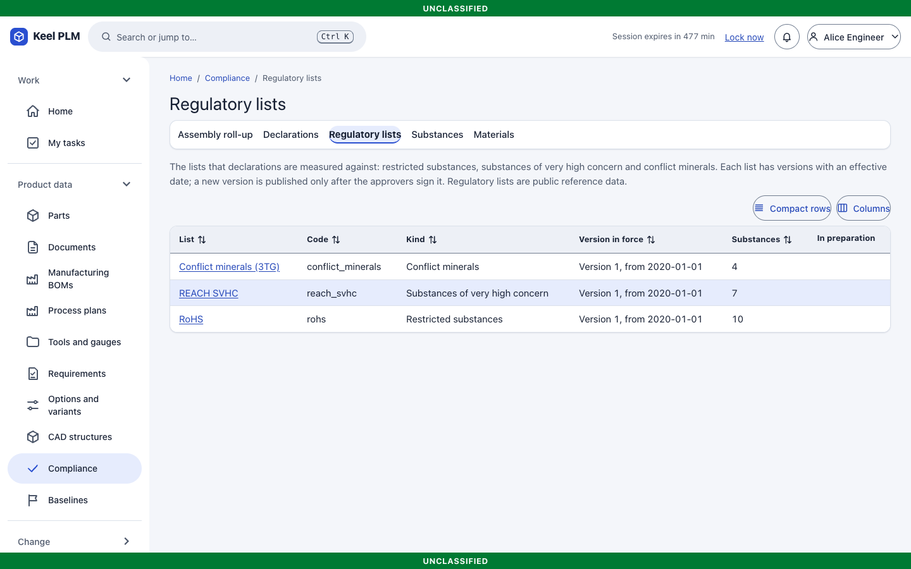
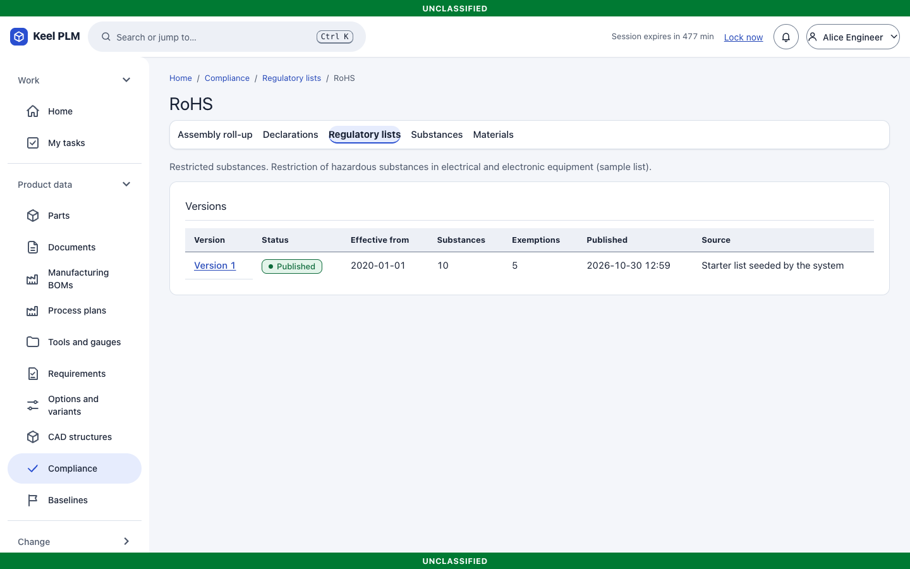
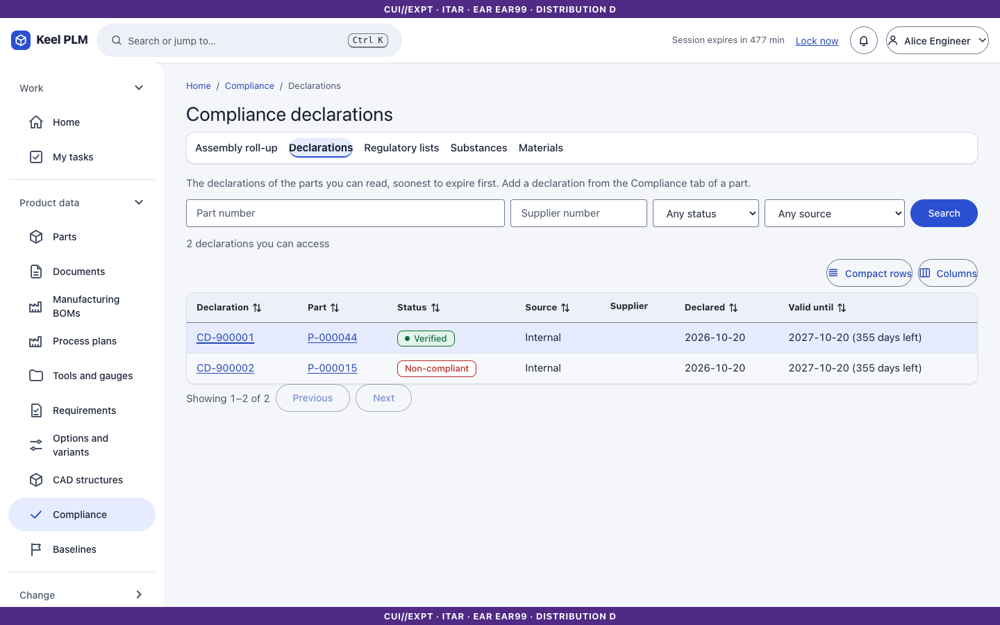
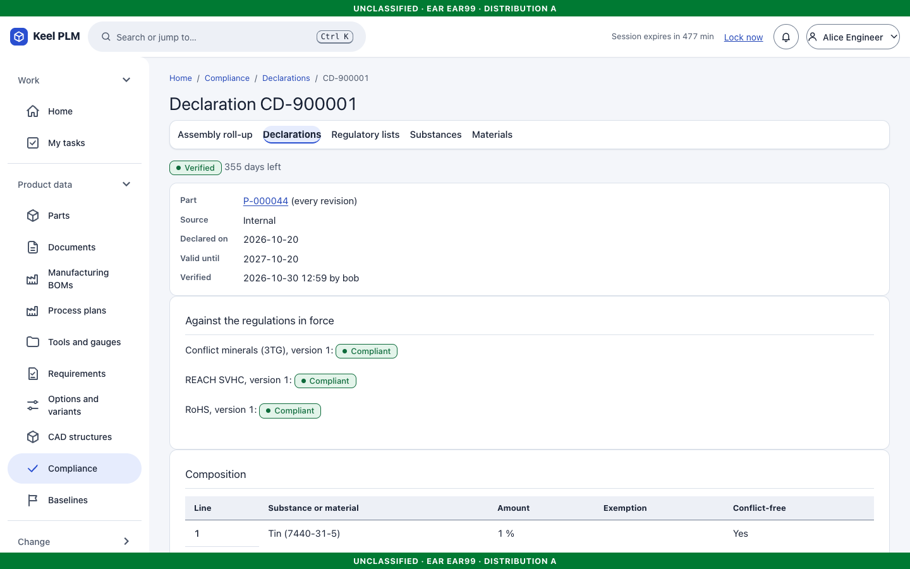
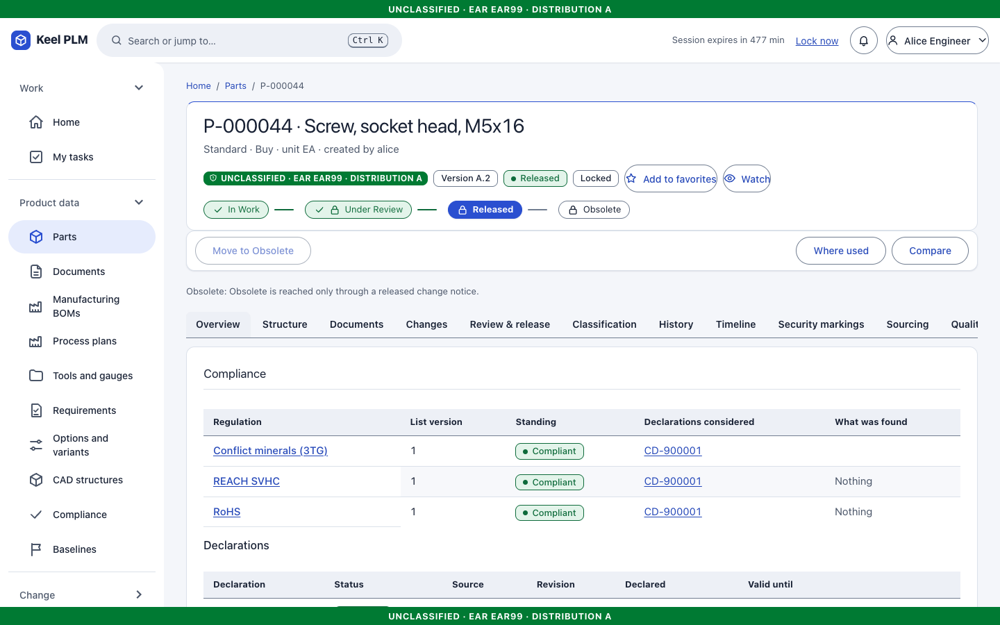
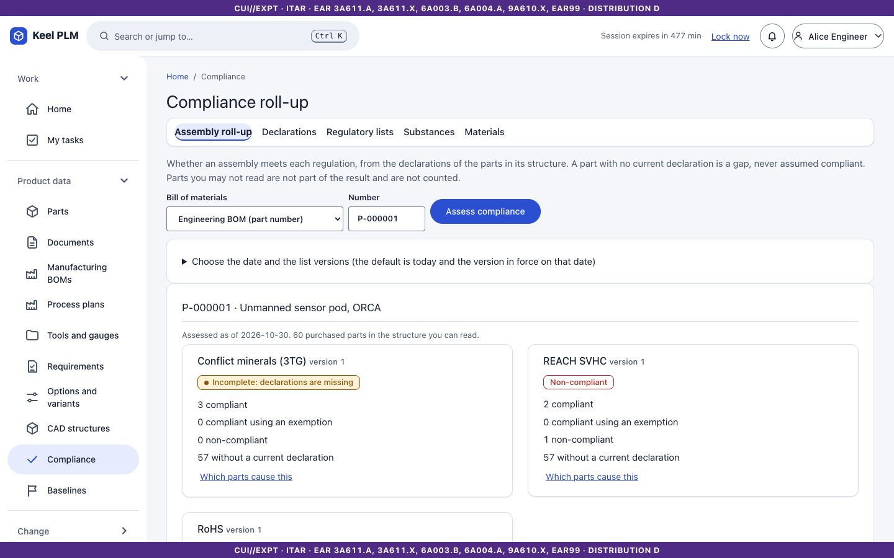

# 15. Product compliance data

Keel keeps the data to answer "does this product meet RoHS, REACH, conflict-minerals and similar rules?": substances, materials, regulatory lists and supplier **declarations**, rolled up through the BOM.

## Reference data

Open **Product data > Compliance**. The starter set holds RoHS, a REACH SVHC sample and 3TG with 16 substances. Substances, materials and lists are reference data readable by every internal role and maintained by administrators.

### Regulatory lists

**Lists** shows each list and its **versions**. A version is immutable once published; publishing a new version goes through a signed review ([chapter 6](06-lifecycles-workflow-signatures.md)). Open a version to see its entries and exemptions.

## Declarations

A **declaration** (`CD-nnnnnn`) states the substance content of one part: source, date, expiry, status and one line per substance with a mass percent (each line is its own homogeneous material) and a conflict-free flag. Statuses include verified and non-compliant. Verification and expiry notices are recorded.

## On a part

The part's **Compliance** tab evaluates its declarations against the lists and shows the result with the causes.

## Roll-up through the BOM

1. Open **Compliance**, choose the mode (for example EBOM) and enter the assembly number (the page opens as `/compliance?mode=ebom&number=P-000001`).
2. Read the result per part with its **cause** (for example an undeclared part, a banned substance, an expired declaration), as a **table** or a **treemap** that drills down.
3. Export the result from the page; formats are described in [compliance/exports.md](../compliance/exports.md).

Declarations carry no markings and are read through the part; if you cannot read the part, you see nothing about its declaration.

## Not shipped

Keel does not fetch regulatory lists from the internet (air-gapped); an administrator maintains list versions. Mass-based rules need the item's mass.
