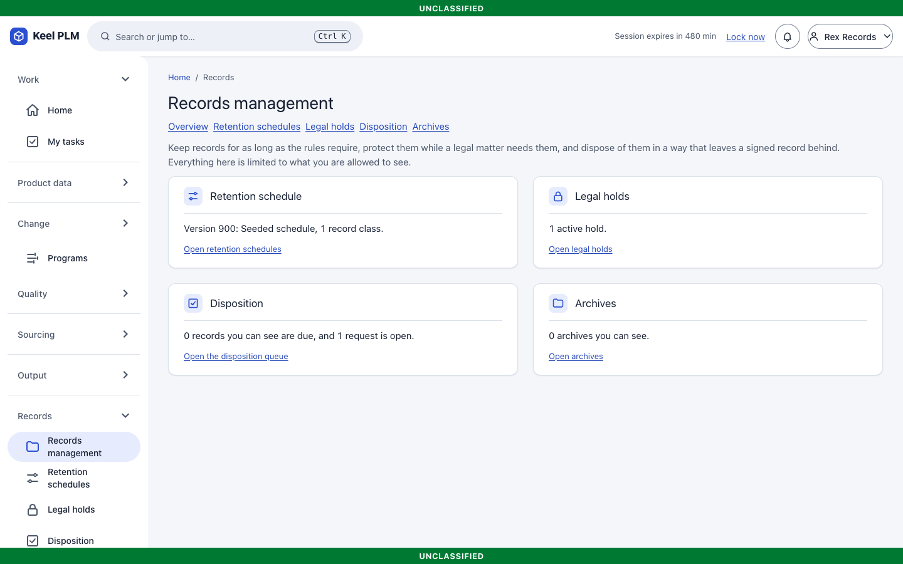
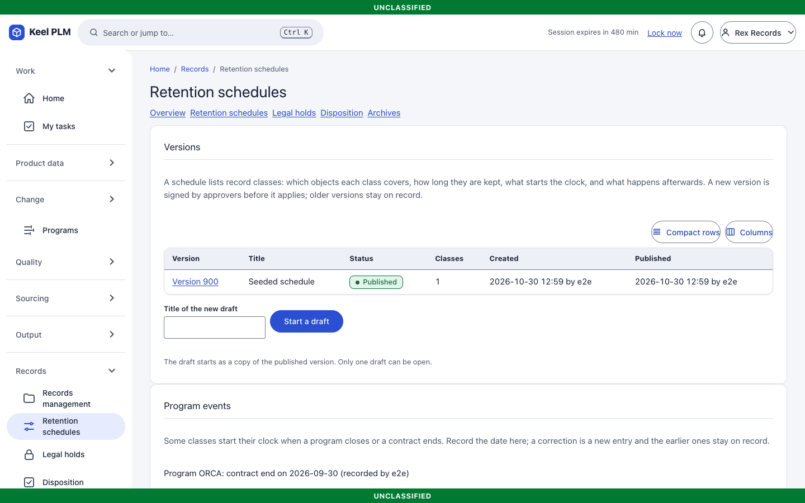
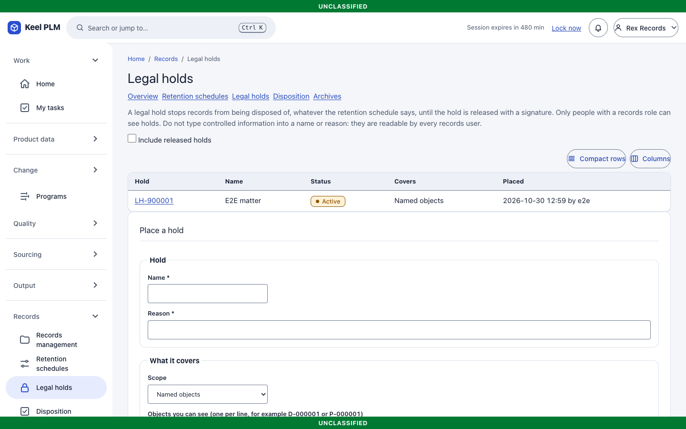
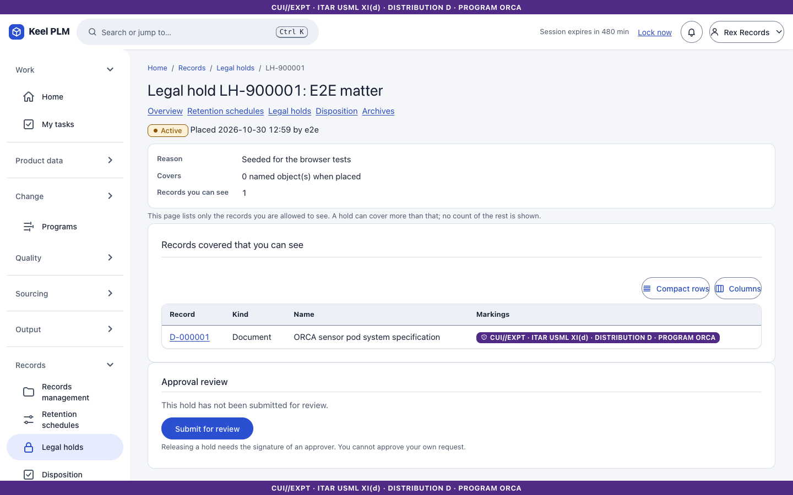
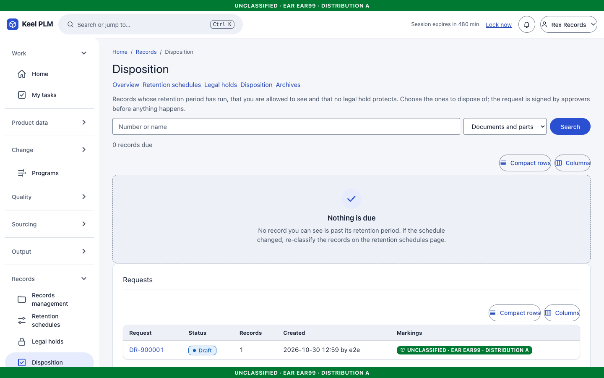
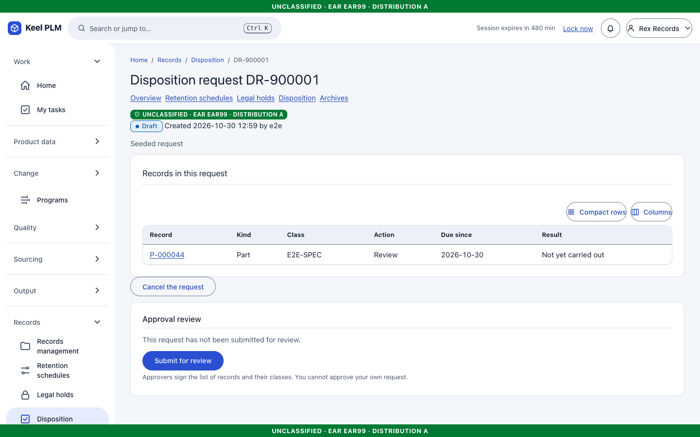
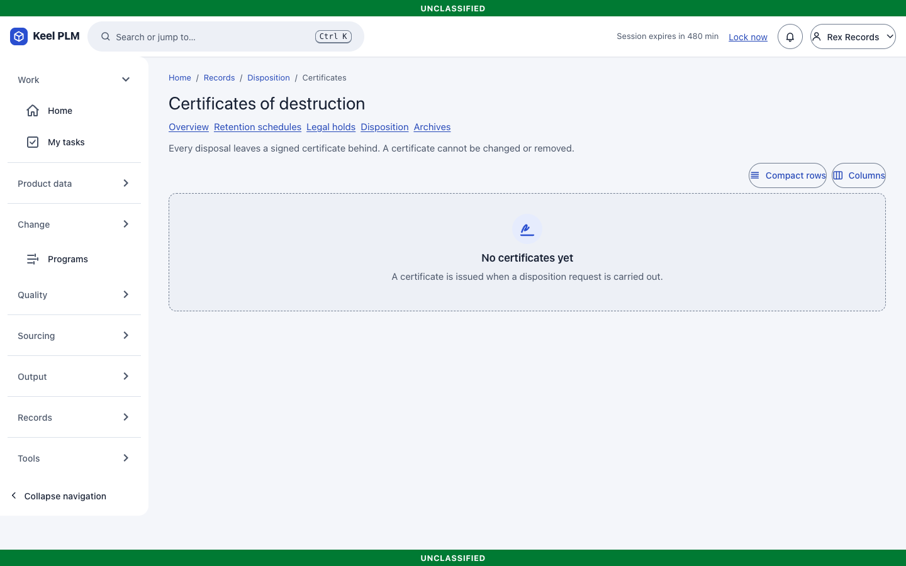
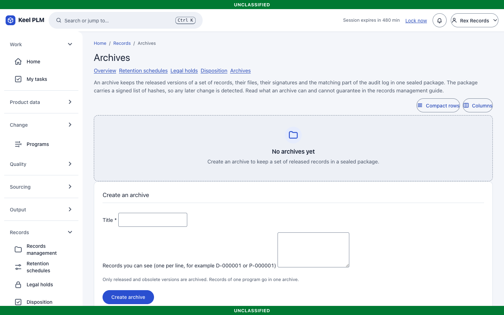

# 16. Records management: retention, legal holds, disposition and archives

Records management is for **records managers** (role `plm-records`, dev user **rex**). Administrators can manage but not execute; auditors can read. The role gives no access to objects: markings still decide what a person sees, and a records manager also needs the viewer role.

Records are **documents and parts**. An object with a revision still in work or review is never due.

## Overview

**Records > Records management** shows what is due, what is held and recent activity.

## Retention schedules

A **schedule** is a versioned set of record classes, each with a trigger (Released or Obsolete, or a program event), a retention period and a disposition action. The first matching class by priority, then code, applies; a class without a trigger date means "not due".

1. Open **Retention schedules**. Draft a new version, edit classes, and submit.
2. Reviewers and approvers sign ([chapter 6](06-lifecycles-workflow-signatures.md)); the version publishes and supersedes the previous one.
3. Use **Re-classify** to refresh the queue.

Part and document headers show a records chip with the object's class and status.

## Legal holds

A **hold** (`LH-nnnnnn`) freezes objects against disposition.

1. **Legal holds > New hold**: name, reason, then add the objects (by number).
2. While held, an object cannot be disposed of.
3. Release the hold when counsel says so.

## Disposition

1. **Disposition** lists readable, due, unheld objects.
2. Create a **request** (one program at a time) and submit it; the approvers sign.
3. A records manager (not the requester, for marked data) **carries it out**. Items under hold, no longer due or still in use are left alone and reported.
4. A signed **certificate** is issued. Disposal keeps the object's identity (number, name, revisions, links, signatures, markings, audit); stored files are released to the vault sweeper and removed after the grace period (at least one day). On the certificate, **Check the vault now** records signed confirmations.

## Archives

An **archive** packages objects as a signed, offline-verifiable package (verify with `keel-vault verify-archive`). When the bucket supports S3 Object Lock, archives are locked for the configured period.

Operations and settings: [ops/records-management.md](../ops/records-management.md). Signing needs the audit checkpoint key; without it these actions answer "unavailable" and nothing is disposed of.
