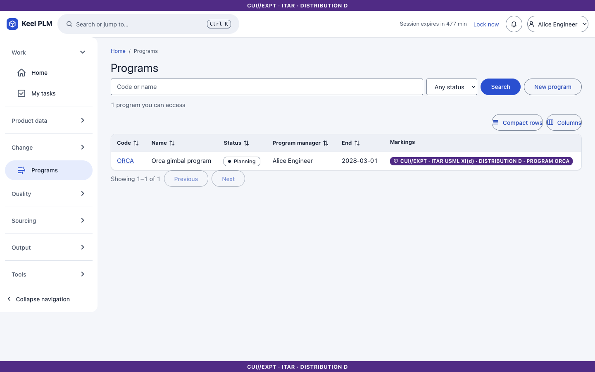
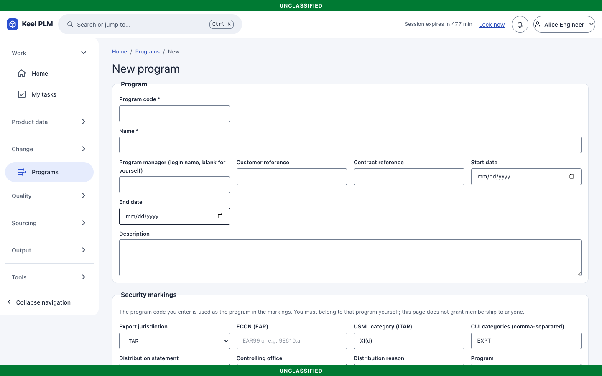
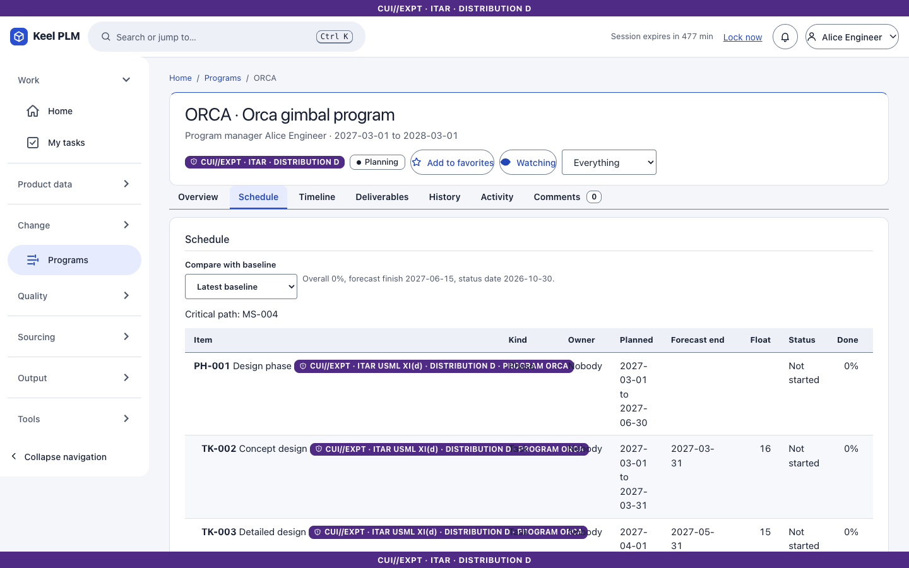
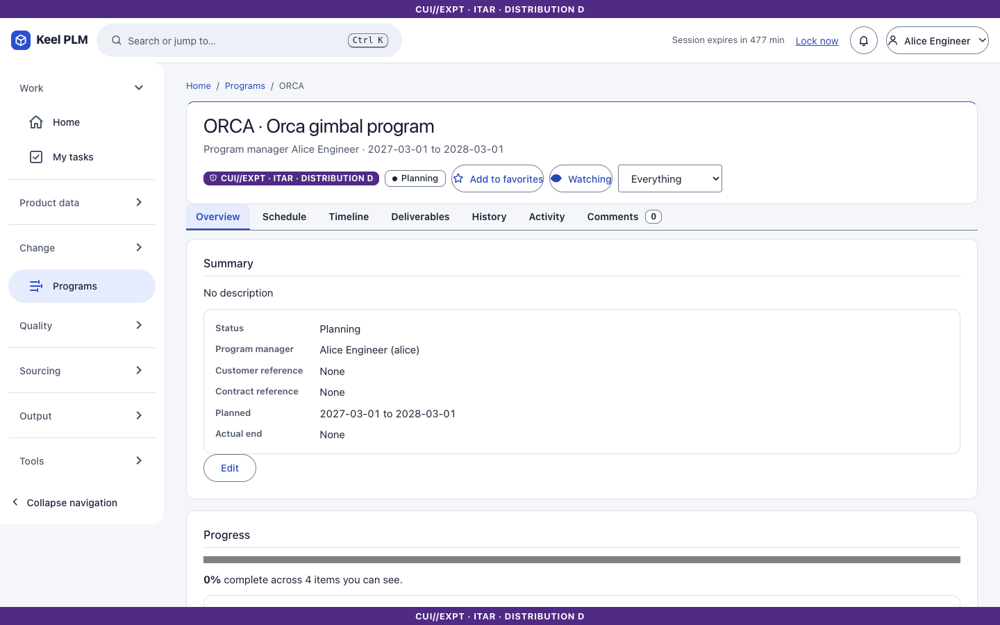
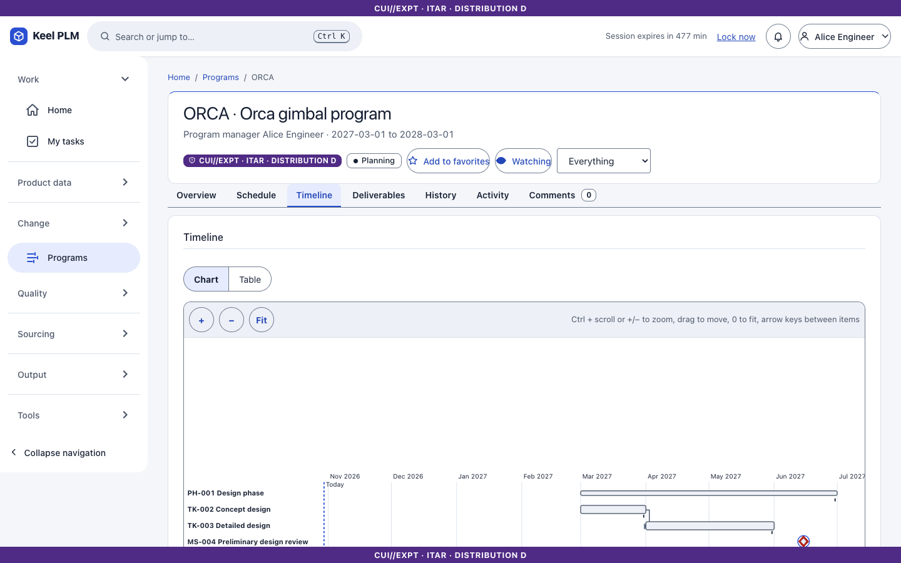
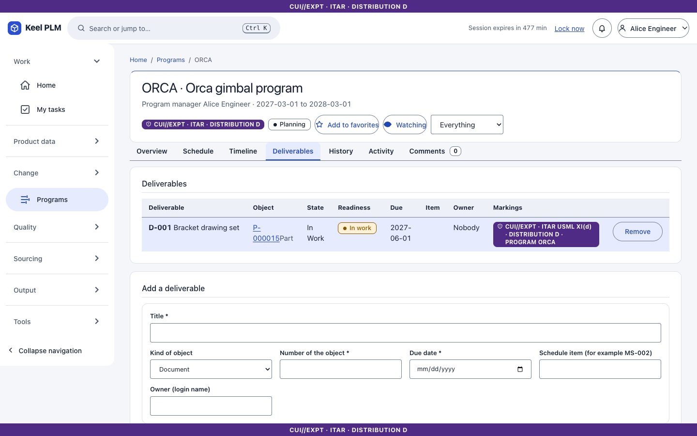
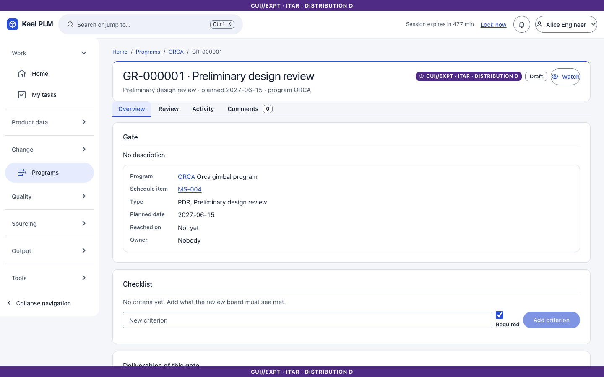

# 17. Programs and schedules

A **program** is a code (for example ORCA, the same code as the program marking), a schedule of phases, tasks and milestones, deliverables, and gate reviews.

## Create a program

1. Open **Programs > New program**.
2. Enter **Program code**, **Name**, start and end dates, then **Create program**.

## Plan the schedule

On the **Schedule** tab add items:

1. Choose the kind (**Phase**, **Task** or **Milestone**), an optional phase, a title and dates. A milestone can be a **gate** (for example PDR).
2. Select **Add item**.
3. Under dependencies pick a predecessor and a successor and **Add dependency** (finish-to-start; cycles are refused).
4. **Take baseline** with a name to freeze the plan; later slips are logged against it.

Keel computes the critical path and float, and rolls progress up from tasks to phases.

## Read the dashboard and timeline

The **Overview** tab is the dashboard: progress, upcoming and overdue items, slips, gates. **Timeline** draws a Gantt chart (with a table alternative).

## Deliverables

On **Deliverables** enter a **Title**, the kind of object (part, document and so on), its number and a due date, and **Add deliverable**. Its readiness comes from the object's lifecycle state, so a deliverable turns ready when the bracket is Released.

## Gate reviews

Open a gate from the schedule. The page lists its **criteria**, the readiness of deliverables, and the review. Submit for review; the reviewers sign ([chapter 6](06-lifecycles-workflow-signatures.md)). A signature is required for the gate to be Approved. Reaching a milestone emits the event `program.milestone_reached` for integrations.

## Home

The Home card **My work in programs** lists your tasks and upcoming milestones. Due and overdue notices are sent to the owners.
