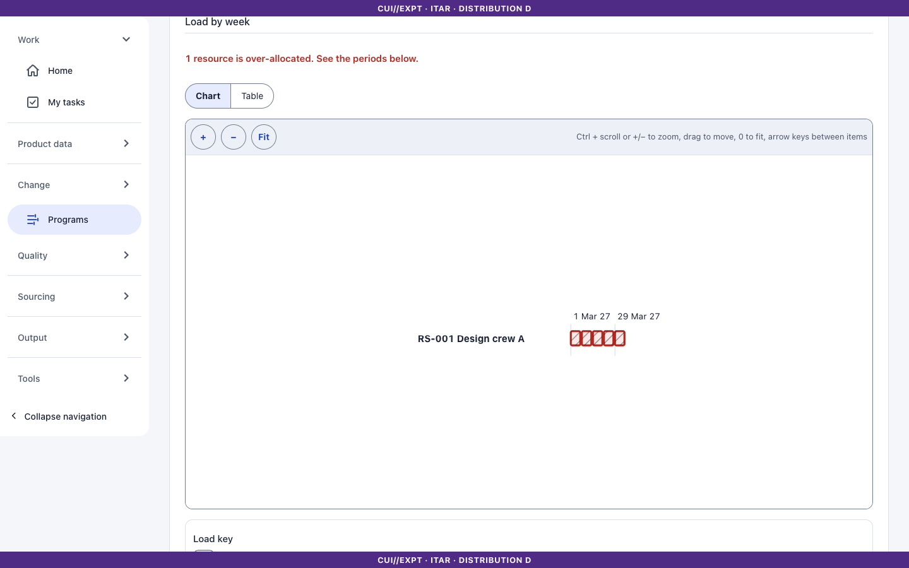
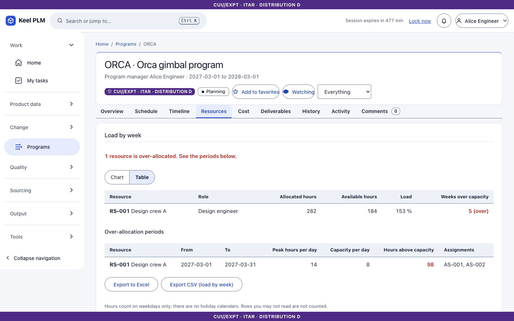
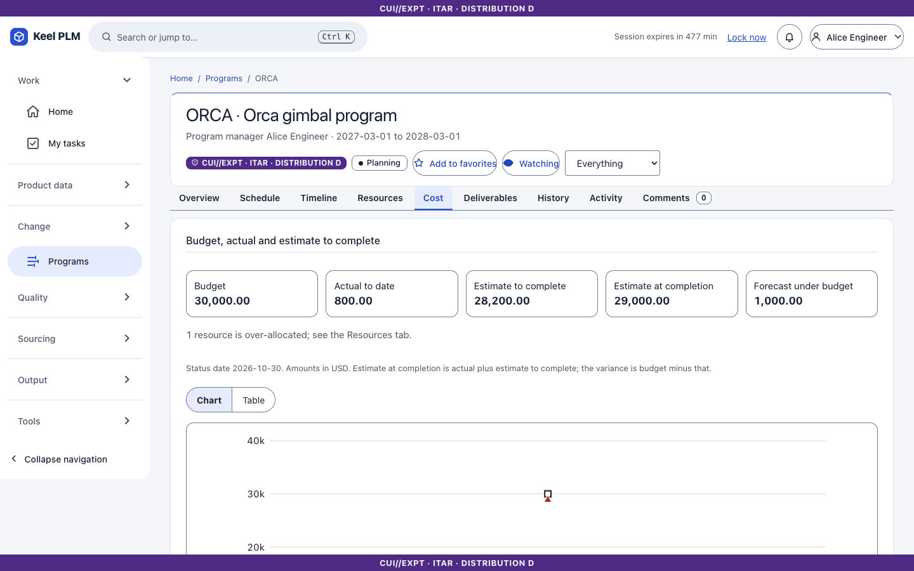
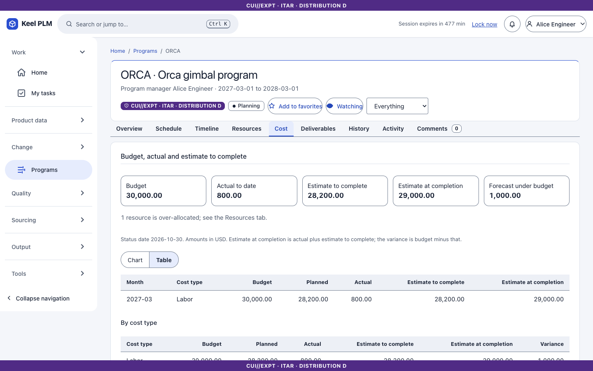

# 17. Programs and schedules

A **program** is a code (for example ORCA, the same code as the program marking), a schedule of phases, tasks and milestones, deliverables, and gate reviews.

## Create a program

1. Open **Programs > New program**.
2. Enter **Program code**, **Name**, start and end dates, then **Create program**.

## Plan the schedule

On the **Schedule** tab add items:

1. Choose the kind (**Phase**, **Task** or **Milestone**), an optional phase, a title and dates. A milestone can be a **gate** (for example PDR).
2. Select **Add item**.
3. Under dependencies pick a predecessor and a successor and **Add dependency** (finish-to-start; cycles are refused).
4. **Take baseline** with a name to freeze the plan; later slips are logged against it.

Keel computes the critical path and float, and rolls progress up from tasks to phases.

## Read the dashboard and timeline

The **Overview** tab is the dashboard: progress, upcoming and overdue items, slips, gates. **Timeline** draws a Gantt chart (with a table alternative).

## Deliverables

On **Deliverables** enter a **Title**, the kind of object (part, document and so on), its number and a due date, and **Add deliverable**. Its readiness comes from the object's lifecycle state, so a deliverable turns ready when the bracket is Released.

## Gate reviews

Open a gate from the schedule. The page lists its **criteria**, the readiness of deliverables, and the review. Submit for review; the reviewers sign ([chapter 6](06-lifecycles-workflow-signatures.md)). A signature is required for the gate to be Approved. Reaching a milestone emits the event `program.milestone_reached` for integrations.

## Resources and load

The **Resources** tab shows who works on the program and whether anyone is booked beyond what they can do. It shows hours only. Rates and money are on the **Cost** tab.

1. Under **Add a pool** enter a **Pool name** (for example Mechanical engineering) and select **Add pool**.
2. Under **Add a role** choose the **Pool**, enter a **Role name** and select **Add role**. If you hold the program cost permission you can also enter a **Rate per hour**.
3. Under **Add a resource** choose the **Role**, enter a **Resource name** and the **Hours per day** the resource can work, and select **Add resource**. A resource is a name and a capacity, not a user: adding one gives nobody access to anything.
4. Under **Assign a resource to a task** enter the **Task** key (for example TK-002), choose the **Resource**, the **Start** and **End** dates and the **Hours per day**, and select **Assign resource**. Only open tasks take assignments. To change the hours over time, add several assignments for the same resource.

Hours count on weekdays only; there are no holiday calendars.

**Load by week** draws one row per resource and one cell per week: empty for no allocation, light up to half of what the resource can work, solid up to full capacity, and **hatched with a heavy outline when the assigned hours exceed capacity**. Click into the picture and use the arrow keys to move between resources; each row reads its summary aloud. Select **Table** for the same facts as a table, and the **Over-allocation periods** table lists each resource, the dates, the peak hours per day and the hours above capacity.

You only see resources and assignments you may read, and over-allocation is judged over those. A person who is booked in two programs is not combined across them.

## Cost: budget, actual and estimate to complete

The **Cost** tab appears only if you hold the program cost permission (the role `plm-program-cost`, granted by your identity provider) in addition to being able to read the program. Without it the tab is absent, rates are hidden on the Resources tab, and asking the API for cost answers 403.

1. Under **Set a budget** choose the **Cost type** (Labor, Material or Other), the **Month** and the **Amount**, and select **Set budget**. Every change of an amount is kept in a log that cannot be edited.
2. Under **Record an actual cost** choose the **Date**. For **Labor** enter the **Resource** key and the **Hours**: Keel prices them at the rate of the resource's role on that date and refuses the entry when the role has no rate. For other types enter the **Amount**. Select **Record cost**.
3. A recorded cost is never changed. To correct one select **Reverse** on its row; Keel books the opposite amount once.
4. Under **Add a material line** enter the **End item (part number)**, the **Quantity** and **Needed on**, and select **Add material line**. Keel estimates the cost live from the released bill of materials and the preferred or approved prices in the sourcing lists. Parts without a usable price, and structure lines you may not read, are listed or counted and are in no total.

The tiles show the **Budget**, **Actual to date**, **Estimate to complete**, **Estimate at completion** (actual plus estimate to complete) and the forecast overrun or margin (budget minus estimate at completion). **Estimate to complete** for labor is the share of the assigned hours not yet done, spread over the working days after the status date; for material it is the estimate of lines needed after the status date. Amounts are in USD. The curves show the cumulative budget (dashed line, squares), actual (solid line, circles) and estimate at completion (dotted line, triangles); select **Table** for every month and cost type, and read **By cost type** and **Labor by role** below.

## Export

**Export to Excel** downloads every table of the program (summary, by month, roles, budget, actuals, material, resources, assignments, load by week and over-allocation) in one workbook; **Export CSV** downloads one table. The first lines of every file hold the marking banner of what it contains and the currency. Without the program cost permission the file holds the hours tables only. Each export is recorded in the audit log.

## Not shipped

Actual costs are entered by hand: there is no timesheet or ERP feed. There is one currency (USD), no holiday calendars, no leveling and no portfolio view across programs.

## Home

The Home card **My work in programs** lists your tasks and upcoming milestones. Due and overdue notices are sent to the owners.
