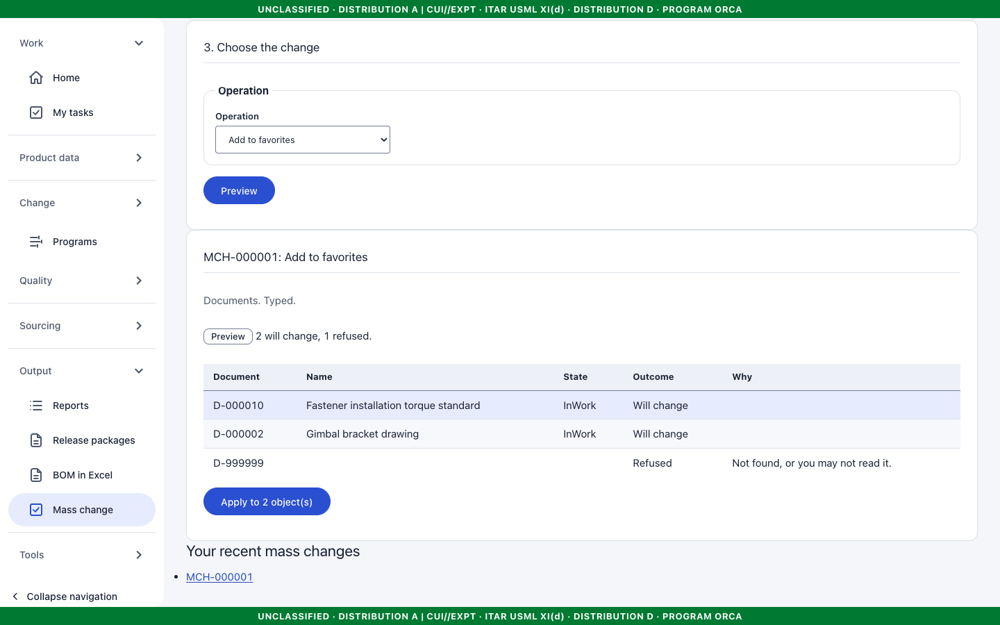
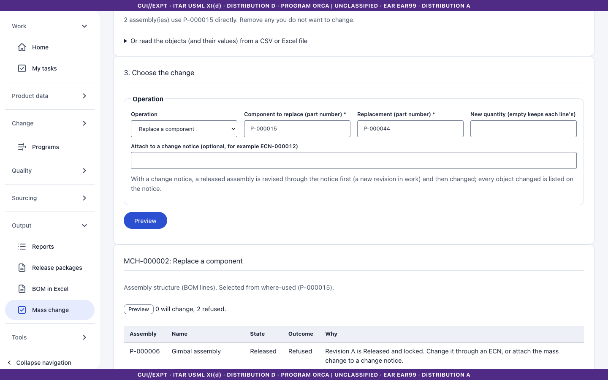
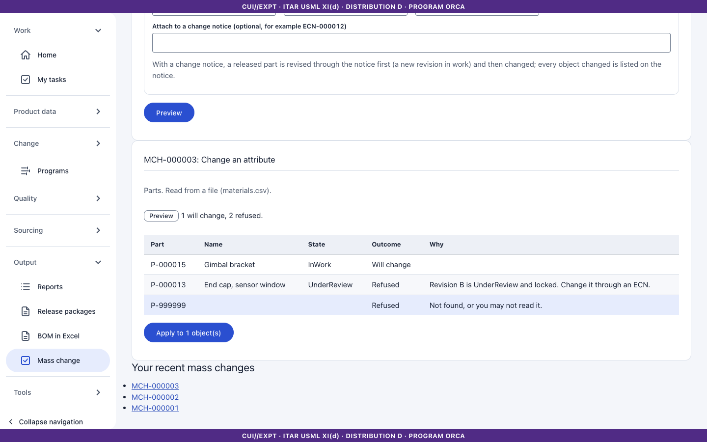

# 18. Reports, release packages, Excel BOM and mass change

The **Output** group holds four tools.

## Report builder

**Output > Reports** builds a report over one of eight datasets: parts, bill of materials, changes, baselines, quality records, requirement sets, compliance declarations and retention schedules.

1. Choose the **dataset**.
2. Tick the **columns** you want (at least one).
3. Add a **filter** (column, value), a **sort**, and optionally **group by** a column; groups show counts.
4. Select **Run**. The banner is the aggregate of the rows shown: a filter that matches nothing leaves no marked row and the banner drops to unclassified.
5. Export as **CSV**, **.xlsx** or **PDF**. Definitions can be saved and shared.

## Release packages (PDF)

For a released part or assembly, an ECN or an established baseline, **Output > Release packages** produces a PDF with: a cover sheet, the BOM report, the document list with file SHA-256, a signature page (signer, meaning, decision, UTC time, comment) and the change summary.

- The aggregate banner and every distribution notice are on the top and bottom of every page.
- If any included object is unreadable to you, the package is **refused**, never redacted.
- The result is stored in the vault, listed with its hash, and downloadable only while you may read every included object. Creating and downloading is audited.

## BOM in Excel

**Output > BOM in Excel** exchanges the bill of materials with spreadsheets.

1. **Export**: choose the part, the EBOM (latest, released, or as designed for one unit) or MBOM, and optionally a variant. The workbook has banner rows on top, find numbers, effectivity, option conditions and a markings column. Cells starting with a formula character are neutralized.
2. **Template**: download an empty import template.
3. **Import**: upload the filled workbook. Keel shows a reviewable proposal with a row-level dry run. **Apply** goes through the normal BOM working copy and check-in; you can apply repeatedly.
4. A bad workbook is reported in words (size and ZIP/XML-bomb limits apply).

## Mass change

**Output > Mass change** applies one operation to many objects. Choose the **Kind of object**:

| Kind | Operations |
|---|---|
| Parts | Change an attribute, change markings (within your authority), add to a baseline proposal, submit for review, watch, add to favorites |
| Documents | Change the description, change markings, submit for review, watch, add to favorites |
| Assembly structure (BOM lines) | Add, replace or remove one component on many assemblies |
| Requirements | Change one field (priority, verification method, status, type, rationale), change markings |

1. **Choose the objects.** Type numbers, one per line (at most 500), or use **Add up to 200 results** after typing search text. Requirements are written as the specification number, a slash and the requirement key (for example `SPEC-000001/R-0001`).
2. **Assembly structure only:** type a part number under **Or find the assemblies that use a component** and select **Select assemblies that use it**. Keel lists the assemblies that directly use it and that you may read; remove any you do not want.
3. Choose the **operation** and fill in its fields.
4. Optional, for parts and assembly structure: **Attach to a change notice**. A released part or assembly is then revised through the notice (a new revision in work) and changed, and every object changed is listed on the notice. Without a notice, released objects are refused.
5. Select **Preview**: each object shows *Will change*, or the reason it will not ("Not found, or you may not read it.", "Revision A is Released and locked...").
6. Select **Apply to n object(s)**. Each object goes through the normal services under one correlation id; a partial failure is reported and a second apply retries only the failed ones.
7. **Undo** reverses reversible operations; the status then reads Undone. (The listing on a change notice stays.)

### From a CSV or Excel file

Open **Or read the objects (and their values) from a CSV or Excel file**, select **Download an empty template for this change**, fill it in, choose it under **File** and select **Preview from file**. The first row names the columns: one column holds the objects (`part`, `document`, `assembly` or `requirement`); the other columns are values for the chosen operation, for example `name` and `value`, or `component` and `replacement`. A blank cell uses the value typed on the page; a filled cell gives that object its own. A file may also carry `kind` and `operation` columns. List each object once. Unknown columns are refused: a file cannot carry markings or a change notice. The file is read into the same preview as a typed list; nothing changes until you apply. The file itself is not kept.

## Excel/PDF are generated on the server

Nothing leaves the host: exports are built from data you may read, at the time you ask.
