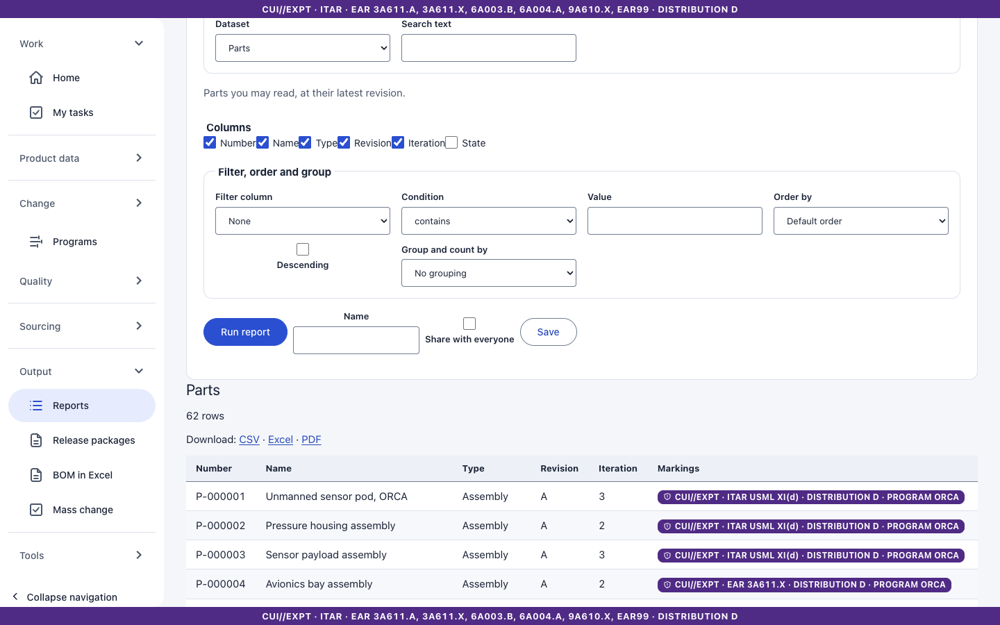
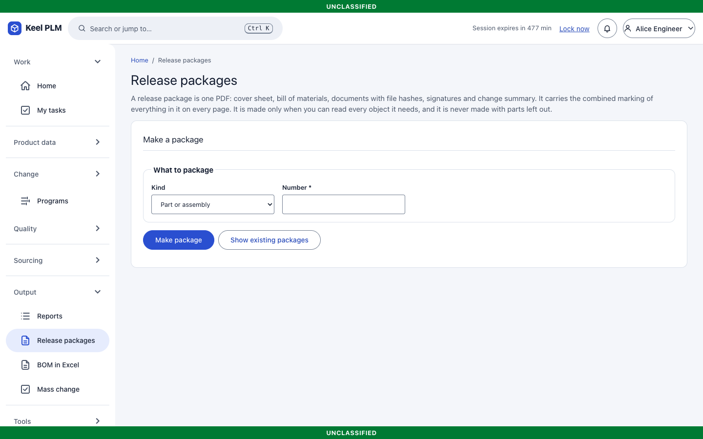
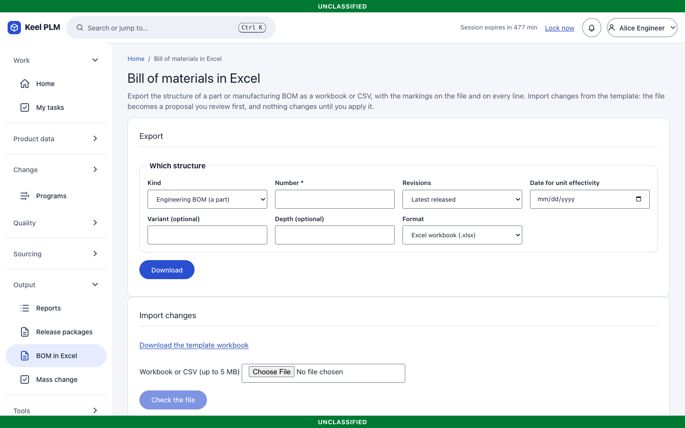
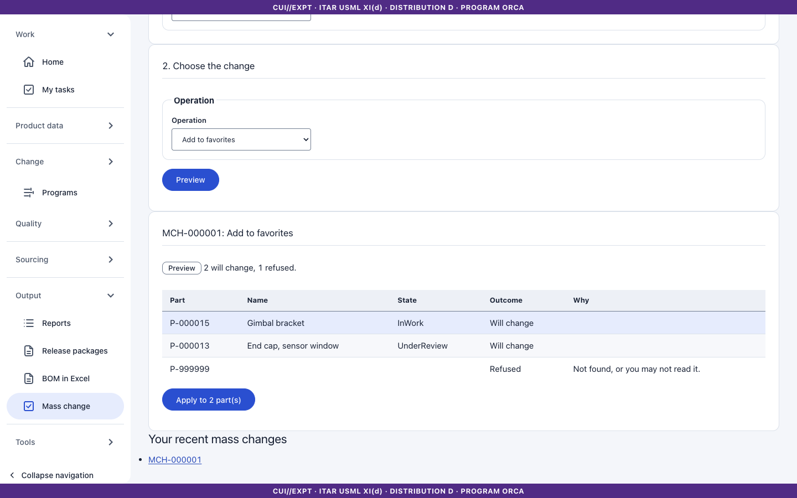

# 18. Reports, release packages, Excel BOM and mass change

The **Output** group holds four tools.

## Report builder

**Output > Reports** builds a report over one of eight datasets: parts, bill of materials, changes, baselines, quality records, requirement sets, compliance declarations and retention schedules.

1. Choose the **dataset**.
2. Tick the **columns** you want (at least one).
3. Add a **filter** (column, value), a **sort**, and optionally **group by** a column; groups show counts.
4. Select **Run**. The banner is the aggregate of the rows shown: a filter that matches nothing leaves no marked row and the banner drops to unclassified.
5. Export as **CSV**, **.xlsx** or **PDF**. Definitions can be saved and shared.

## Release packages (PDF)

For a released part or assembly, an ECN or an established baseline, **Output > Release packages** produces a PDF with: a cover sheet, the BOM report, the document list with file SHA-256, a signature page (signer, meaning, decision, UTC time, comment) and the change summary.

- The aggregate banner and every distribution notice are on the top and bottom of every page.
- If any included object is unreadable to you, the package is **refused**, never redacted.
- The result is stored in the vault, listed with its hash, and downloadable only while you may read every included object. Creating and downloading is audited.

## BOM in Excel

**Output > BOM in Excel** exchanges the bill of materials with spreadsheets.

1. **Export**: choose the part, the EBOM (latest, released, or as designed for one unit) or MBOM, and optionally a variant. The workbook has banner rows on top, find numbers, effectivity, option conditions and a markings column. Cells starting with a formula character are neutralized.
2. **Template**: download an empty import template.
3. **Import**: upload the filled workbook. Keel shows a reviewable proposal with a row-level dry run. **Apply** goes through the normal BOM working copy and check-in; you can apply repeatedly.
4. A bad workbook is reported in words (size and ZIP/XML-bomb limits apply).

## Mass change

**Output > Mass change** applies one operation to many parts: set an attribute, change markings (within your authority), add to a baseline proposal, submit for review, watch, or favorite.

1. Paste part numbers, one per line (at most 500).
2. Choose the **operation**.
3. Select **Preview**: each object shows *Will change*, or the reason it will not ("Not found, or you may not read it.").
4. Select **Apply to n part(s)**. Each object goes through the normal services under one correlation id; a partial failure is reported.
5. **Undo** reverses reversible operations; the status then reads Undone.

## Excel/PDF are generated on the server

Nothing leaves the host: exports are built from data you may read, at the time you ask.
