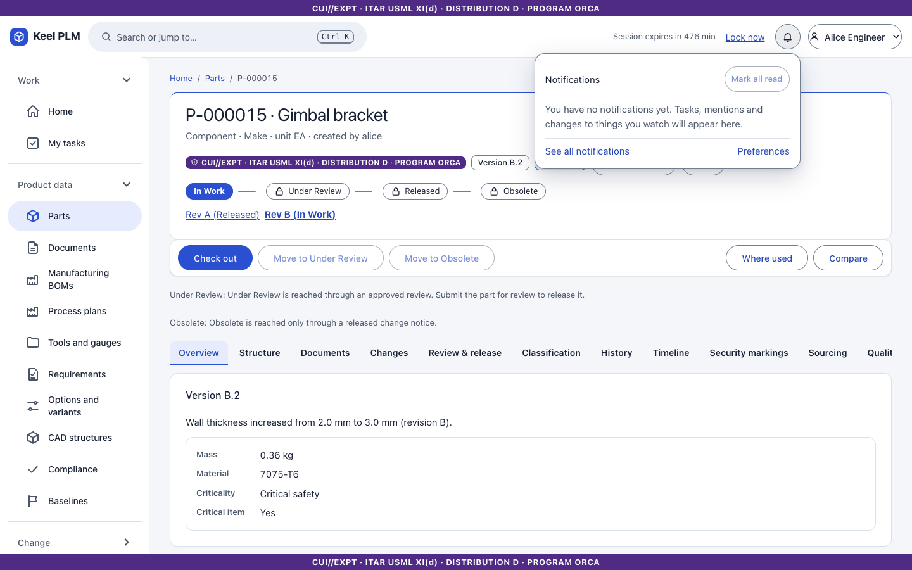
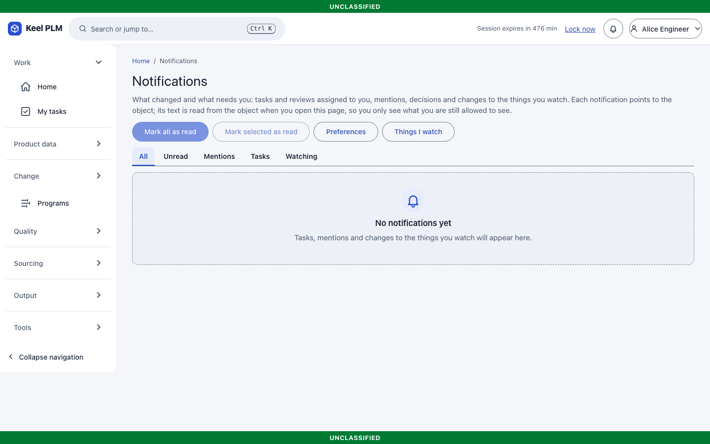
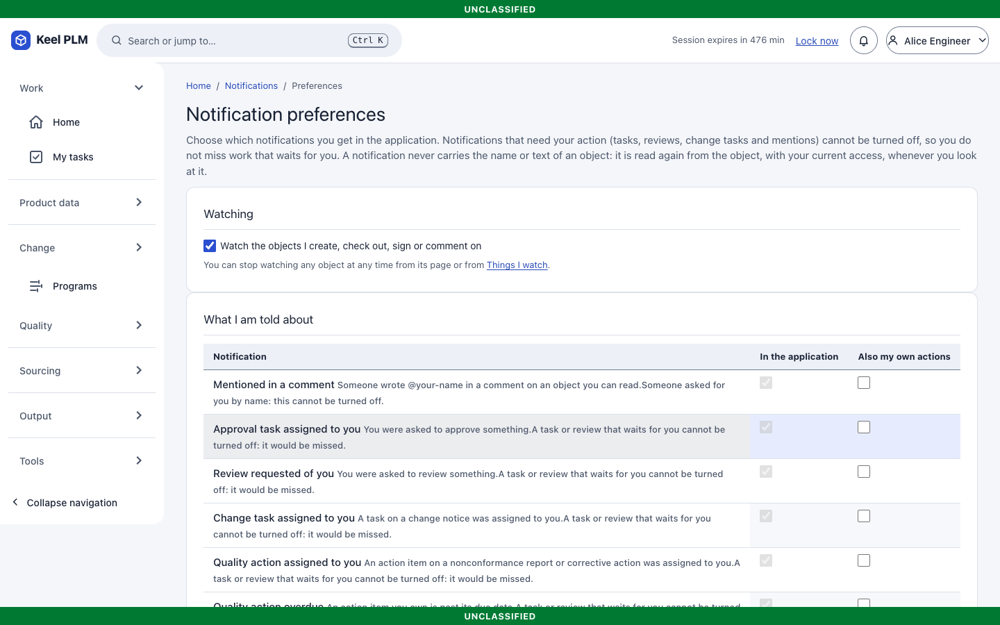
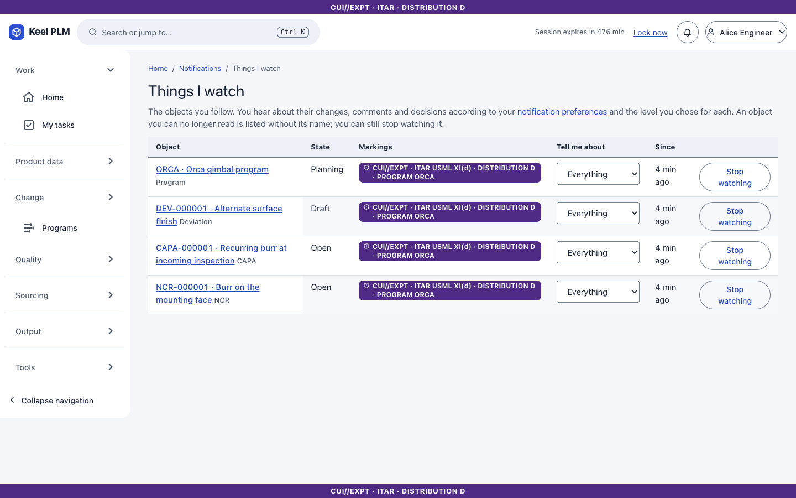
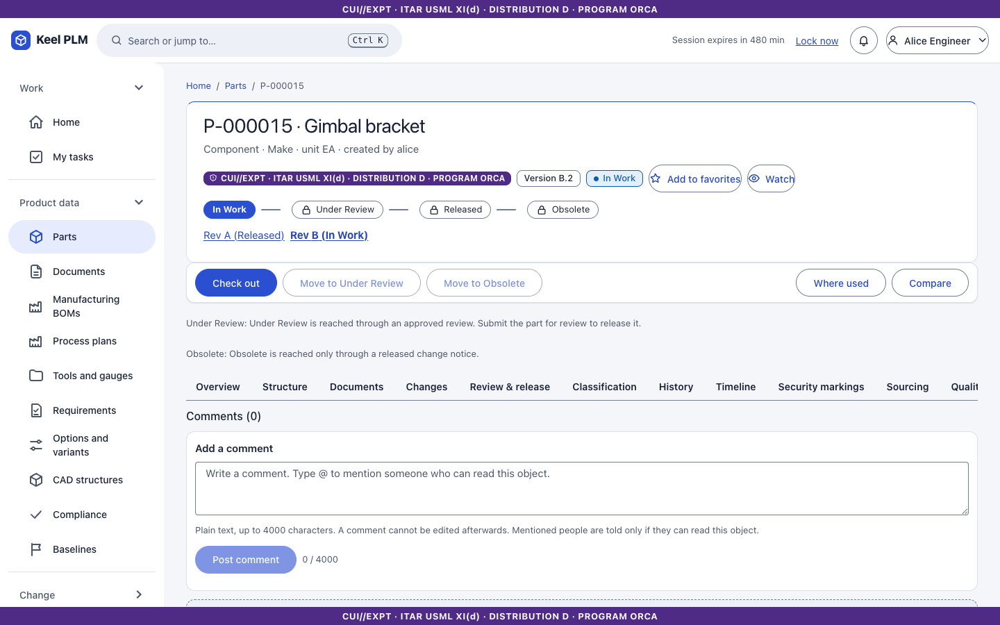
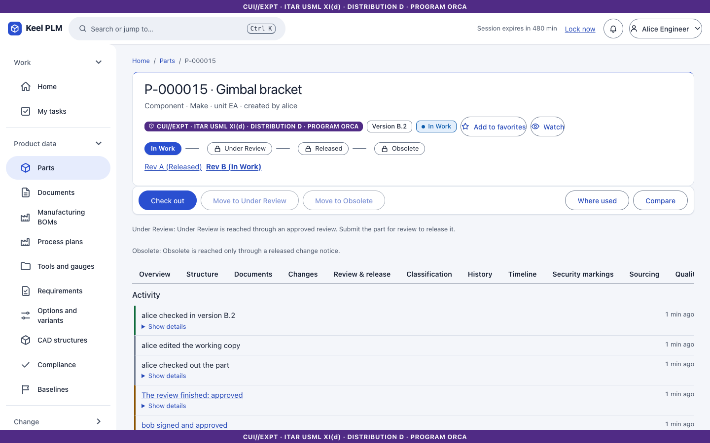

# 19. Notifications, watching, comments and activity

## The bell and the notification center

The **bell** at the top shows a badge with the number of unread notifications. Select it to open a flyout of the latest eight; select one to open the object (and, for a comment, the comment). New notifications appear within about a second without reloading.

**Notifications** (`/notifications`) has tabs **All, Unread, Mentions, Tasks, Watching**, grouped by day. Tick rows and mark them read in bulk.

If something you were told about is no longer readable to you, the row says only "A notification you can no longer view".

### Preferences

**Notifications > Preferences** chooses which kinds you receive. Mentions, tasks and approvals cannot be turned off, and the page says why. Optional e-mail delivery over an on-premises relay exists if your administrator turned it on ([ops/notifications.md](../ops/notifications.md)).

## Watching

Select **Watch** next to the star on a part, document, change, baseline or MBOM (and many other objects). Choose a level, for example **Decisions only**. **Notifications > Things I watch** (`/watching`) lists them, and Home has the card **Activity in things I watch**. Creating or changing something auto-watches it unless you turn that off.

## Comments and mentions

1. Open an object's **Comments** tab.
2. Type your comment. Type `@` and a few letters to pick a person: only people who can read the object are offered, so lena is not offered on an ITAR part.
3. Select **Post comment**. Reply to a comment from its thread; removing one leaves a tombstone. Comments are immutable and rate limited.
4. Viewers, authors, approvers and administrators can comment; auditors only read.

## Activity

The **Activity** tab tells in sentences who did what and when, with **Show details**. Views and downloads by colleagues are not listed (an auditor can switch them on).

