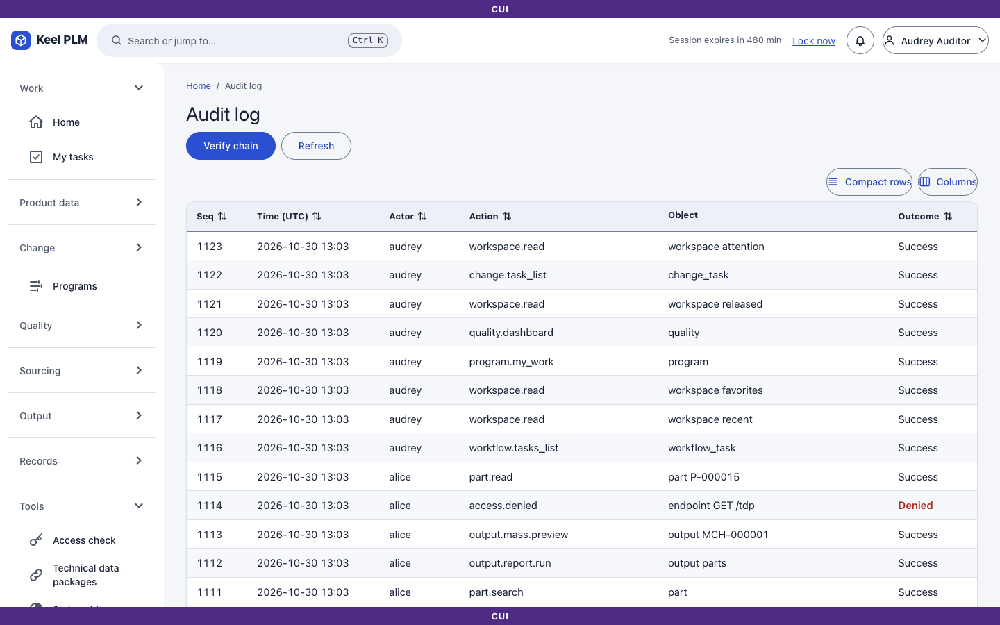
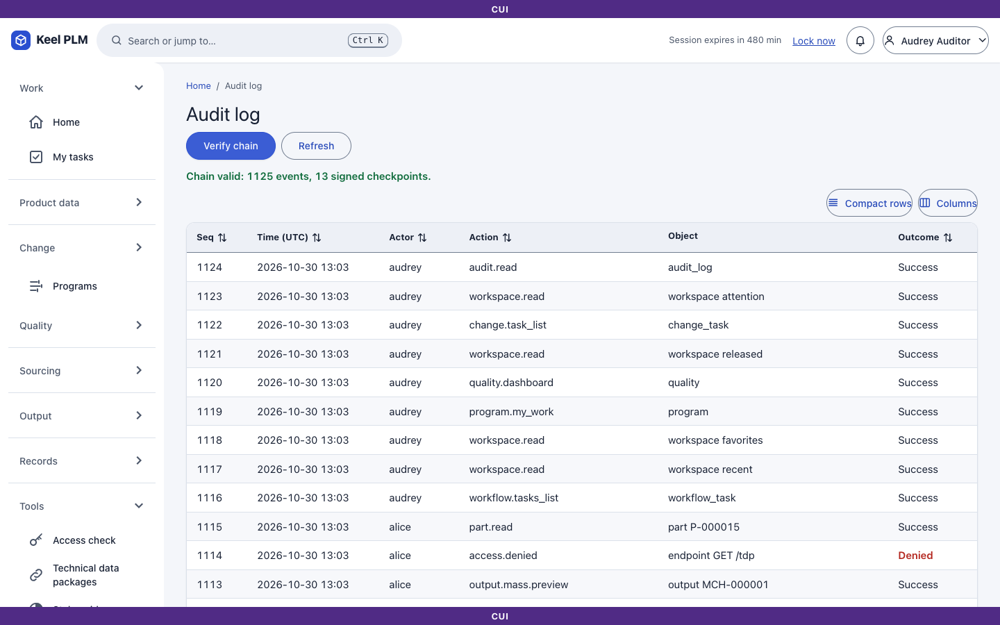

# 20. Audit and integrity verification

Every meaningful action in Keel, including every denial, writes an event to a **tamper-evident audit log**. Each event is hash-linked to the one before it, and the system periodically writes **signed checkpoints** with a private key the database never sees. The business change and its audit event are committed in one transaction.

## Read the audit log

The audit log is for **auditors** (dev user **audrey**). Open **Tools > Audit log** (`/audit`).

1. Events are listed newest first: time, who, action, the object and the outcome.
2. Sort and filter the list by the columns offered.
3. Audit details hold numbers, codes, counts and hashes, not titles, descriptions or attribute values.



## Verify the chain

1. On the audit page select **Verify chain**.
2. Keel recomputes the hash links and checks the signed checkpoints. The result says the chain is valid and how many events were checked, or lists the failures ("Chain INVALID", with the broken position).



An auditor can verify without being able to change anything. An administrator can create a checkpoint on demand but, like everyone, gets no bypass of markings.

## Verify offline

The command-line verifier `keel-audit verify` does the same check outside the application, against the database and the **public** checkpoint keys:

```
keel-audit verify --public-key <current-key> [--public-key <retired-key> ...]
```

Run it after every restore and as part of upgrades. Keep every retired public key forever: old checkpoints need them. (Setup details: [setup.md](../setup.md), [ops/backup-restore.md](../ops/backup-restore.md).)

## What is audited

Reads of marked objects, denials, check-outs and check-ins, state changes (including administrator overrides), signatures, downloads and views, uploads refused by the scanner, session locks and unlocks, TDP exports, administration changes, and the creation and download of release packages. Viewing the audit log and the migration pages is itself audited.

Colleagues' views and downloads are not shown in the Activity tab of objects ([chapter 19](19-notifications-and-activity.md)); they are in this log.

## Forward the log to a SIEM

Audit events can be forwarded in order, at least once, over TLS syslog or to an NDJSON file, with the chain data so the SIEM can prove nothing was removed. Setup is an operator task: [chapter 24](24-administrator-and-operator-guide.md), [ops/siem-onboarding.md](../ops/siem-onboarding.md).

## Limits to know

- Events written after the last checkpoint are protected only by the hash chain until the next checkpoint (every 15 minutes by default); SIEM forwarding closes this window.
- Unauthenticated (401) requests are logged, not chained into the audit log.
