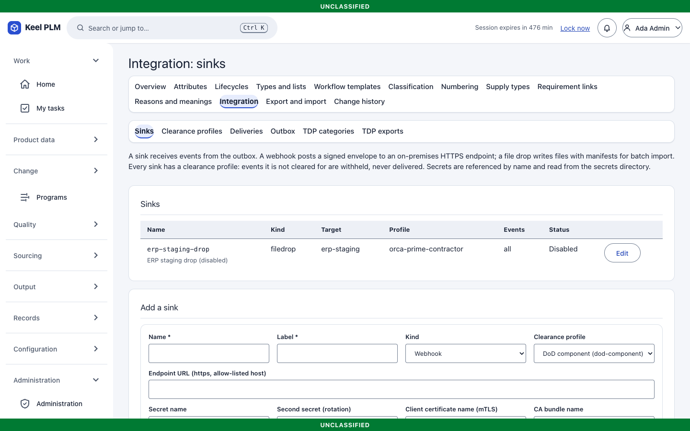
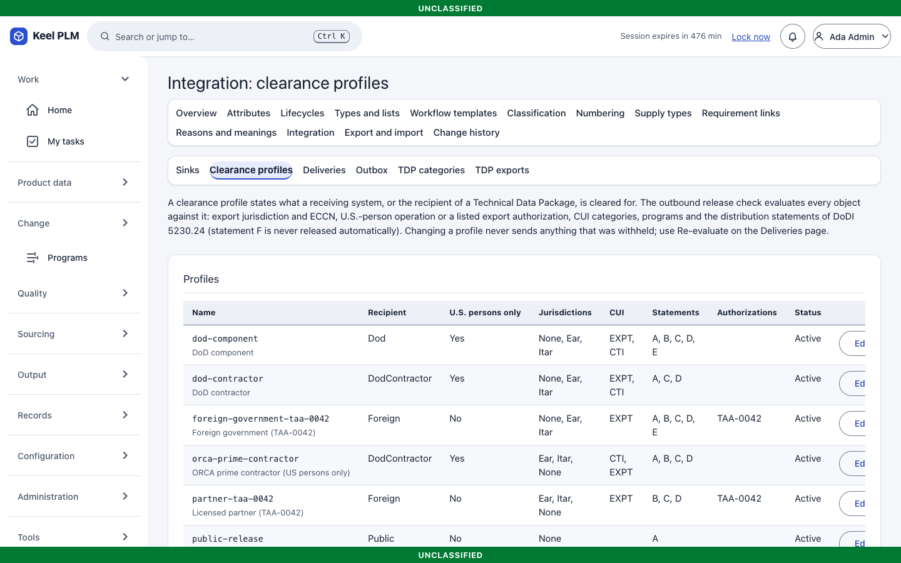
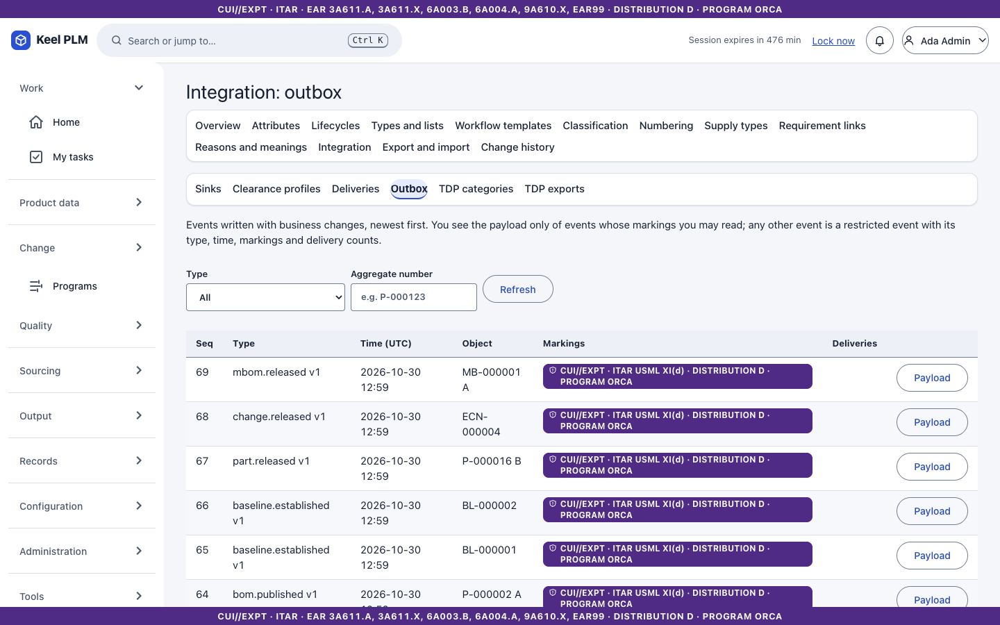
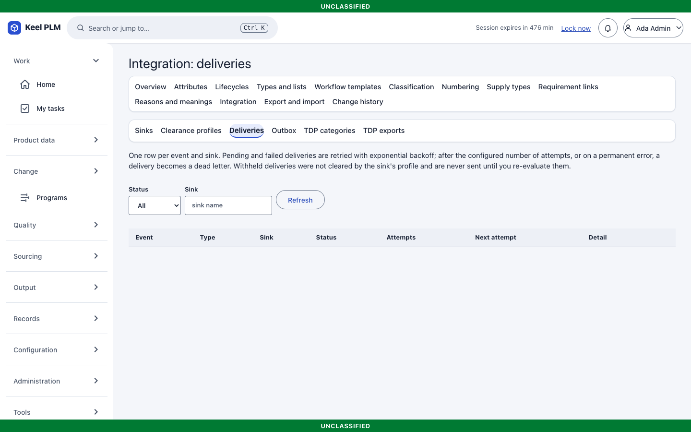
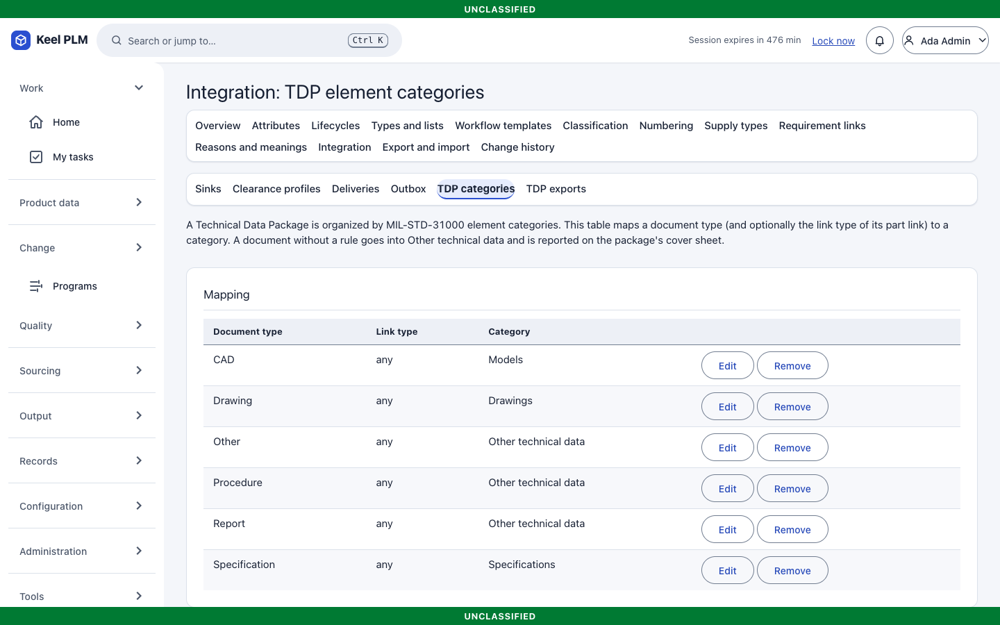
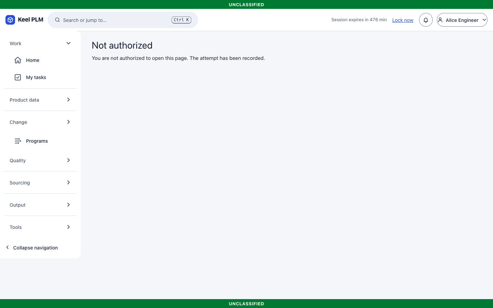

# 21. Integration: ERP events, the pull API and technical data packages

Keel talks to other systems through an **outbox**: when something important happens, the same transaction writes a signed event, and a dispatcher delivers it to the sinks you configure. Nothing is delivered until an administrator creates a sink and the operator turns the dispatcher on.

Developer-facing documents: [integration/README.md](../integration/README.md), [erp-contract.md](../integration/erp-contract.md) (envelope, signing, retries, schemas), [openapi.json](../integration/openapi.json).

## Events

| Event | When |
|---|---|
| `part.released`, `part.obsoleted` | A part revision is released or becomes obsolete |
| `document.released`, `document.obsoleted` | The same for documents |
| `change.approved` | An ECR is approved by the board |
| `change.released` | An ECN is released |
| `baseline.established` | A baseline is established |
| `bom.published` | An assembly revision is released: its one-level EBOM |
| `bom.structure.published` | The same for all levels, only for sinks that opted in, limited by size (larger structures are skipped and audited, never truncated) |
| `mbom.released` | An MBOM revision is released through review |
| `program.milestone_reached` | A program milestone is reached |
| `variant.released` | A variant is released (in a sink's default subscriptions) |

Each event has an id, type, version, markings and a JSON payload. Consumers ignore unknown fields.

## Clearance profiles

A **clearance profile** says what a recipient may receive. Before an event or package leaves, the release check compares the object's markings with the profile, and **withholds** what it does not allow. The demo has three profiles: `orca-prime-contractor`, `partner-taa-0042` and `public-release`.

## Administering integration

Administrators work under **Administration > Integration**.

| Page | Use |
|---|---|
| Sinks (`/admin/integration/sinks`) | Create a **webhook** (HMAC-signed, optionally mutual TLS) or **file drop** sink, choose events and a profile, validate, then enable |
| Profiles | Clearance profiles |
| Outbox | Every event; its payload is visible only if you may read the event's markings |
| Deliveries | Each attempt, with its status (pending, failed, delivered, withheld, dead) and error; **Requeue** a dead letter after fixing the cause |
| TDP categories | Maps Keel document types to the categories of a technical data package |

In the demo data the file-drop sink `erp-staging-drop` is **disabled**, because a sink pointing at a system that does not exist would only produce dead letters.

Preconditions for real delivery (operator): the dispatcher enabled in at least one replica, an allow-list of hosts or networks, secrets for HMAC, a file-drop root for file sinks. See [ops/integration.md](../ops/integration.md).

Not shipped: a message-broker sink (deferred); webhooks and file drops are the shipped sinks.

## Pull API

For reconciliation and backfill, a service account (role `plm-integration`, dev user `erp-service`) can read `GET /api/v1/integration/events?cursor=&limit=` in commit order, resolved BOMs (`/boms/{number}`, `/mboms/{number}?plant=`) and changes (`/changes/{number}`). Integration accounts may read; they never write.

## Technical data packages (TDP)

A **TDP** is a signed ZIP of a part's or baseline's technical data (MIL-STD-31000 style) for a recipient.

1. Open the part or baseline and use the **TDP export** panel.
2. Choose the **recipient profile**. Use **Preview** to see what would be included and what would be withheld.
3. Select **Export**. A package is complete or refused; a refusal states counts only.
4. The signed ZIP downloads. A record of the export is kept.

**Technical data packages** under Tools (`/tdp`) lists the export history. Anyone can verify a package against the trusted public keys (`POST /api/v1/tdp/{id}/verify`).

The server needs a signing key (`Keel:Integration:TdpSigningKeyPath`); without it the export answers 503. In the demo, the seeded export was signed with a key that existed only during seeding, so verifying it reports an untrusted signature by design. Limits: 2,000 parts and 5,000 documents per package by default.
