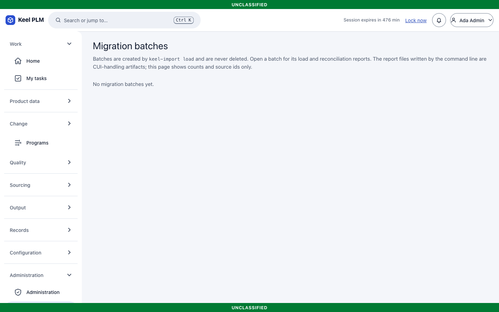

# 22. Migrating from Teamcenter and Windchill

`keel-import` moves parts, documents and files, BOM structure, revision and iteration history, lifecycle state, change history and links from Teamcenter (PLM XML) and Windchill (JSON or CSV extracts) into Keel. The full guide is [migration/README.md](../migration/README.md); this chapter is the user-level summary.

> **Read this first.** The input formats are subsets specified from public documentation. No real export from a customer site has been used. Real samples are required before relying on the importers for production data.

## The process

1. **Assess.** `keel-import inspect <package>` lists counts, states, units, types, users and properties.
2. **Map.** `keel-import map-template` writes a starter mapping file (JSON with comments). Decide every empty value: lifecycle states, units, types, users, attributes, **markings rules** (with the security office), change states and classes.
3. **Validate.** `validate --offline` while you iterate; then against a rehearsal database.
4. **Dry-run.** The full load is simulated in a transaction that is always rolled back. The report lists every problem with a code and fix hint, defaulted markings and quarantined objects.
5. **Review.** The security office reviews the markings distribution and the list of defaulted markings; engineering reviews the revision mapping; data owners resolve quarantined objects.
6. **Load.** Allowed only with the successful dry-run report of exactly this package and mapping, and `--yes`. It is resumable and idempotent.
7. **Reconcile.** Counts, BOM checksums, file hashes, state and markings distributions, id map, audit chain. Exit code 0 is the acceptance criterion.
8. **Parallel run and cutover.** See the runbook, [migration/runbook.md](../migration/runbook.md).

The tool has no implicit target: you name the database and vault explicitly.

## What is preserved

Original numbers, names and dates; revisions in source order with the original label kept; iterations; the current lifecycle state (Released items arrive locked); BOM lines on the correct parent; files with SHA-256 verified; part-document links; change history (as historical records, flagged as migrated); users as names, mapped to Keel users or a flagged fallback user. **Markings come only from your rules and fail closed.** Classification and structured effectivity load only when `classification.load` and `effectivity.load` are switched on in the mapping.

## In the browser

Administrators can follow loads under **Administration > Migration** (`/admin/migration`, and one page per batch). The pages show counts, codes and source ids only (UNCLASSIFIED); viewing them is audited.

## Not shipped

Migration of real data has not been rehearsed against a real export. Quality records, requirements, suppliers and other later modules are not importer targets.
