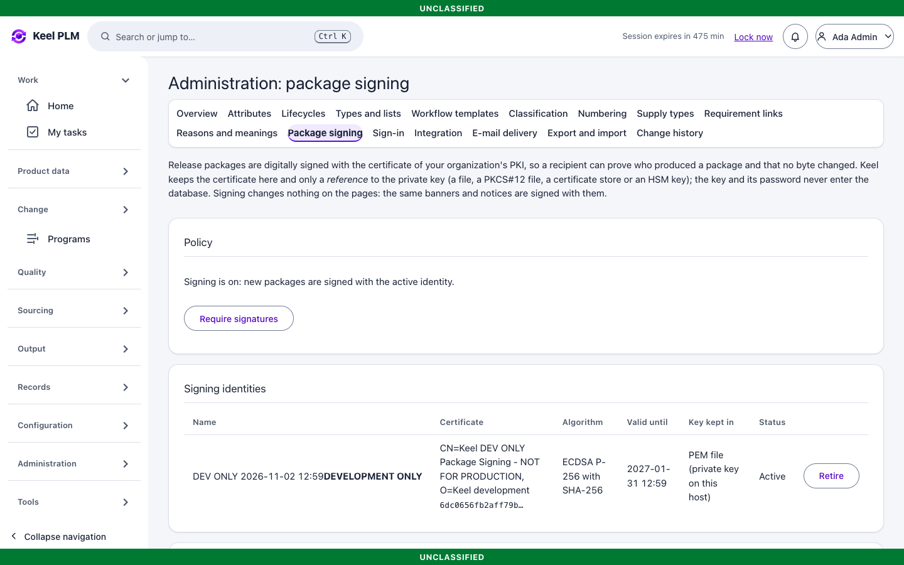

# 23. Administration (configuring Keel in the browser)

Administrators (dev user **ada**) configure how Keel behaves. This chapter covers the pages in the **Configuration** and **Administration** rail groups. Install, secrets and backups are in [chapter 24](24-administrator-and-operator-guide.md).

Administrators change configuration but get no bypass of markings. Every change is audited and many ask for a reason.

## Page by page

The Administration page has a tab bar: **Overview, Attributes, Lifecycles, Types and lists, Workflow templates, Classification, Numbering, Supply types, Requirement links, Reasons and meanings, Package signing, Sign-in, Integration, Export and import, Change history**. Every change is validated, recorded with its before and after values, and shown under Change history. Each page shows the effect before you confirm.

| Page | What you do there |
|---|---|
| **Attributes** | Part attribute definitions with units, lists, formats and ranges; retire without losing stored values |
| **Lifecycles** | Versioned states and transitions. **Validate**, **publish** a new immutable version, and **migrate** existing objects with a state mapping. Protected states that code relies on cannot be removed; PR, ECR, ECN, CT, MBOM and quality lifecycles are view-only |
| **Types and lists** | Part types, sources, units, document types, change priorities, and the office and program pickers (pickers only: access still comes from the identity provider's attributes). Entries are retired, never deleted |
| **Workflow templates** | Edit, validate and publish review workflows, and pin the template each object type uses. Running reviews keep the version they started with |
| **Classification** | The class hierarchy (depth up to 12) with inherited attribute sets, safe move and retire, import and export ([migration/classification-format.md](../migration/classification-format.md)) |
| **Numbering** | Prefixes and widths with a safe preview of the next number. Counters only advance |
| **Supply types** | How MBOM lines are supplied (Make, Buy, Consume and your own); retire with a reason |
| **Requirement links** | Link types for requirement traceability (five are built in) |
| **Reasons and meanings** | Signature meanings and change reason codes |
| **Package signing** | The certificate that digitally signs release packages, where its private key is kept, whether signatures are required ([below](#package-signing)) |
| **Sign-in** | Read-only: how this host signs people in, the level e-signatures require, and warnings ([below](#sign-in-status)) |
| **Integration** | Sinks, profiles, outbox, deliveries, TDP categories ([chapter 21](21-integration-and-tdp.md)) |
| **Export and import** | Export the whole configuration as a file and import it elsewhere; every import is a confirmed, audited step |
| **Change history** | Who changed which configuration, when and why |
| **Migration** (rail: Administration) | Import batches ([chapter 22](22-migration.md)) |
| **Workflows** (rail: Configuration) | Every workflow: reassign, cancel, verify signatures ([chapter 6](06-lifecycles-workflow-signatures.md)) |

Other administrator tasks live elsewhere: supplier **Portal access** on a supplier ([chapter 12](12-sourcing-and-portal.md)), plants and **work centers** with their MBOM and process pages ([chapters 4, 13](04-boms-variants-mbom.md)), effectivity contexts in the configuration area ([chapter 8](08-baselines-effectivity.md)), and regulatory list versions under Compliance ([chapter 15](15-compliance.md)).

## Routine tasks

**Add a part attribute.** Attributes > add; choose kind and whether it is required; save. The quick add form asks for a required attribute at once; optional ones are under More details. Classification attributes belong to classes.

**Change a lifecycle.** Lifecycles > open the family > edit a draft version > **Validate** > **Publish**. New objects use the new version; to move existing objects, choose **Migrate** and map old states to new ones. Both steps are confirmed and audited.

**Edit a workflow template.** Workflow templates > edit a draft > validate > publish > pin it for the object kind. Reviews already running keep their version.

**Move configuration between environments.** Config export on the source, import on the target (after a dry run if offered), then check the history page.

## Limits

Only parts store attribute values today; document and change attributes are not shipped. Lifecycles of PR, ECR, ECN, CT, MBOM and quality records are view-only. Server-side sorting is available on the main lists. Roles themselves (viewer, author, approver, admin, auditor, records, supplier, integration) come from the identity provider, not from Keel.

## Sign-in status

**Administration > Sign-in** shows how this Keel host is set up to sign people in. It is read-only: nothing on it can be changed, and it never shows a secret. Settings live in the host configuration ([ops/configuration.md](../ops/configuration.md)); change them there and restart.

- **Warnings and notes** come first, worst first, each with its plain-language reason. Examples: password sign-in is the declared method in a Production profile; a password fallback exists beside the certificate sign-in; a password could sign because no signature level is required; demo sign-in is on; the identity provider address is not https; FIPS is not required; your own token is missing a security claim.
- **Effective configuration** lists each setting with its value and the setting that controls it: the declared sign-in method, the identity provider, the web client, the level (`acr`) e-signatures require, the fresh sign-in window, the session lifetime and idle lock, FIPS, proxy and cookie settings.
- **Your current sign-in** shows the level, the methods and the time the identity provider released for *your* session, and which security claims (`us_person`, `citizenship`, `org`, `programs`, `export_authorizations`, `cui_categories`) arrived and which did not. Only names are shown, not values. A claim that is absent is treated as the most restrictive value, so this is the quickest way to see why a person has too little access.
- **Check the identity provider** reads the public discovery document at the configured address (one read-only request, to that address only) and compares it: issuer, PKCE, the levels it advertises, the token algorithms.

Two settings are statements by the operator, not measurements: the sign-in method (`Password`, `Certificate` or `Federated`) and whether a password fallback exists. Keel cannot see inside the identity provider's login flows, so it uses these to decide which warnings apply. Setup guides: [CAC/PIV sign-in](../ops/cac-piv-sign-in.md) and [connecting your own identity provider](../ops/sso-integration.md).

## Package signing

**Administration > Package signing** sets up the digital signature on release packages ([chapter 18](18-reports-and-output.md)). Keel keeps the certificate and only a *reference* to the private key; the key and its password never enter the database, the audit log or the screen.

1. Have your PKI's certificate bundle ready: the signing certificate first, then the certificates above it, the root last (RSA 2048 bits or more, or ECDSA P-256, P-384 or P-521; SHA-256 or stronger).
2. Under **Add an identity** fill in the name, **Private key is kept in** (PEM file, PKCS#12 file, certificate store, or OpenSSL provider key for an HSM), the **Certificate bundle**, the **Key reference** (a path, a store name or a key URI; the hint under the field says which) and, if the key has a password, a **Password reference** (`env:NAME` or `file:/path`, never the password itself). Add **What a signature means** (for example "Approved for release") and the **Signing location**. Select **Add identity**. Keel loads the key and proves that it belongs to the certificate before storing anything, and says in words what is wrong when it does not.
3. In the table, select **Activate** on the identity. New packages are signed from then on.
4. Optional: **Require signatures**. While required, a package that cannot be signed is refused, never made unsigned.
5. To change certificates, add the new one, **Activate** it and **Retire** the old one. A retired identity never signs again, and packages it signed still verify.

On a development host only, **Generate a development certificate** creates a throw-away certificate marked DEVELOPMENT ONLY so you can see signing work. Production hosts do not show it. Setup details, key sources, rotation and verification with standard tools: [docs/ops/package-signing.md](../ops/package-signing.md).

