# 23. Administration (configuring Keel in the browser)

Administrators (dev user **ada**) configure how Keel behaves. This chapter covers the pages in the **Configuration** and **Administration** rail groups. Install, secrets and backups are in [chapter 24](24-administrator-and-operator-guide.md).

Administrators change configuration but get no bypass of markings. Every change is audited and many ask for a reason.

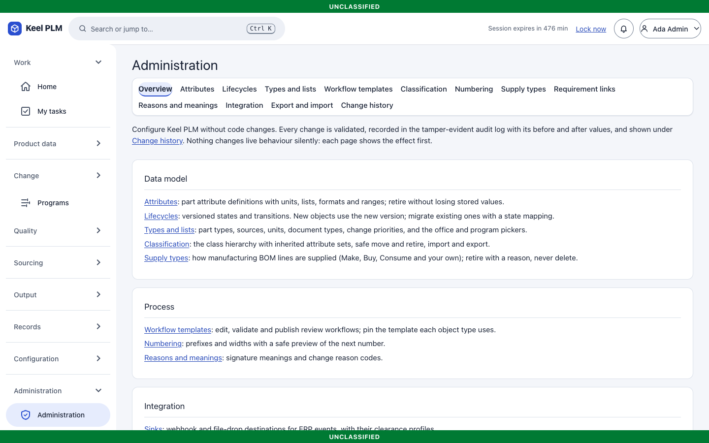

## Page by page

The Administration page has a tab bar: **Overview, Attributes, Lifecycles, Types and lists, Workflow templates, Classification, Numbering, Supply types, Requirement links, Reasons and meanings, Integration, Export and import, Change history**. Every change is validated, recorded with its before and after values, and shown under Change history. Each page shows the effect before you confirm.

| Page | What you do there |
|---|---|
| **Attributes** | Part attribute definitions with units, lists, formats and ranges; retire without losing stored values |
| **Lifecycles** | Versioned states and transitions. **Validate**, **publish** a new immutable version, and **migrate** existing objects with a state mapping. Protected states that code relies on cannot be removed; PR, ECR, ECN, CT, MBOM and quality lifecycles are view-only |
| **Types and lists** | Part types, sources, units, document types, change priorities, and the office and program pickers (pickers only: access still comes from the identity provider's attributes). Entries are retired, never deleted |
| **Workflow templates** | Edit, validate and publish review workflows, and pin the template each object type uses. Running reviews keep the version they started with |
| **Classification** | The class hierarchy (depth up to 12) with inherited attribute sets, safe move and retire, import and export ([migration/classification-format.md](../migration/classification-format.md)) |
| **Numbering** | Prefixes and widths with a safe preview of the next number. Counters only advance |
| **Supply types** | How MBOM lines are supplied (Make, Buy, Consume and your own); retire with a reason |
| **Requirement links** | Link types for requirement traceability (five are built in) |
| **Reasons and meanings** | Signature meanings and change reason codes |
| **Integration** | Sinks, profiles, outbox, deliveries, TDP categories ([chapter 21](21-integration-and-tdp.md)) |
| **Export and import** | Export the whole configuration as a file and import it elsewhere; every import is a confirmed, audited step |
| **Change history** | Who changed which configuration, when and why |
| **Migration** (rail: Administration) | Import batches ([chapter 22](22-migration.md)) |
| **Workflows** (rail: Configuration) | Every workflow: reassign, cancel, verify signatures ([chapter 6](06-lifecycles-workflow-signatures.md)) |

Other administrator tasks live elsewhere: supplier **Portal access** on a supplier ([chapter 12](12-sourcing-and-portal.md)), plants and **work centers** with their MBOM and process pages ([chapters 4, 13](04-boms-variants-mbom.md)), effectivity contexts in the configuration area ([chapter 8](08-baselines-effectivity.md)), and regulatory list versions under Compliance ([chapter 15](15-compliance.md)).

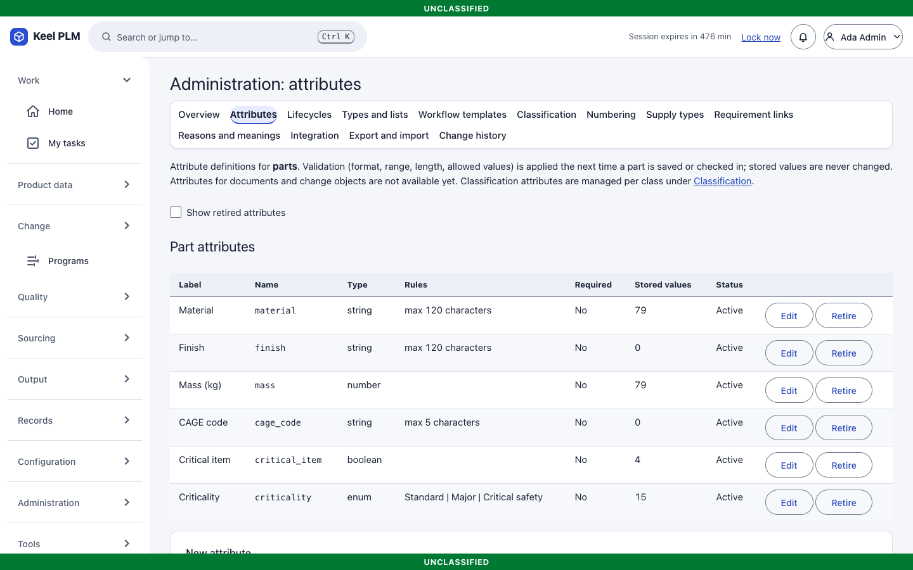
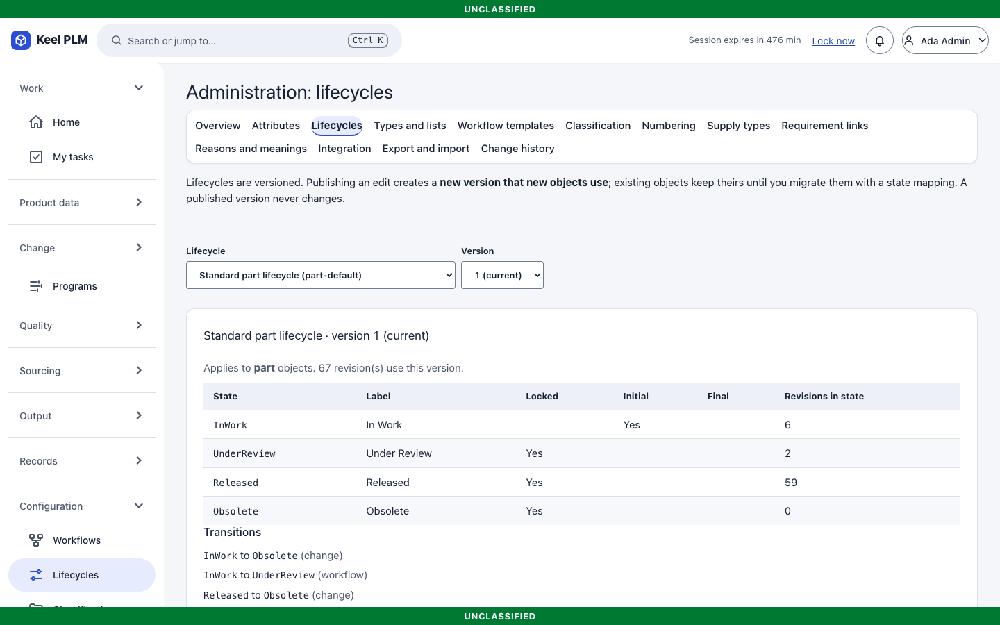
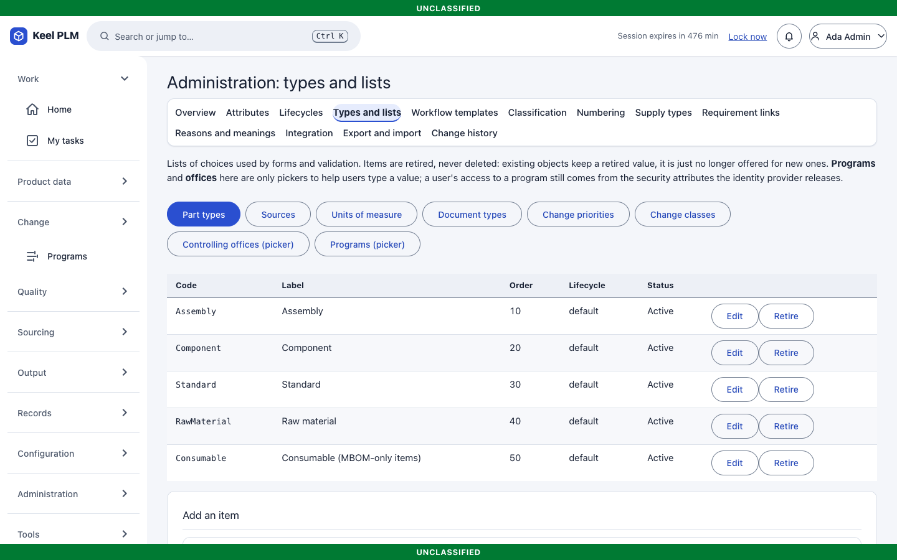
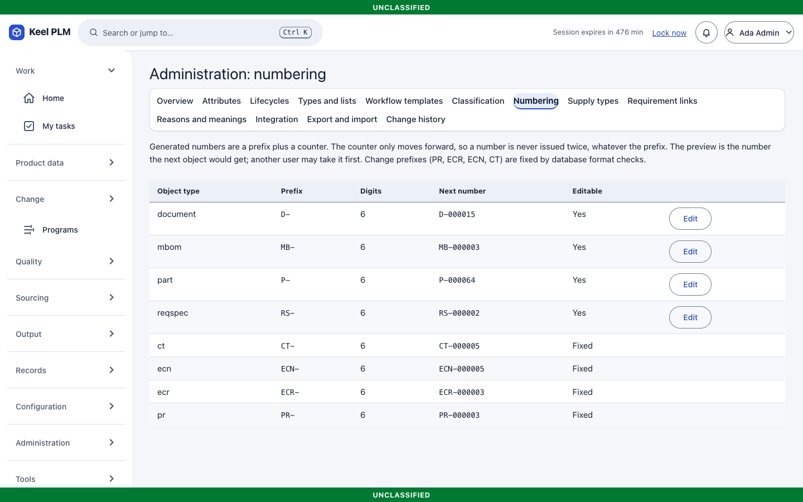
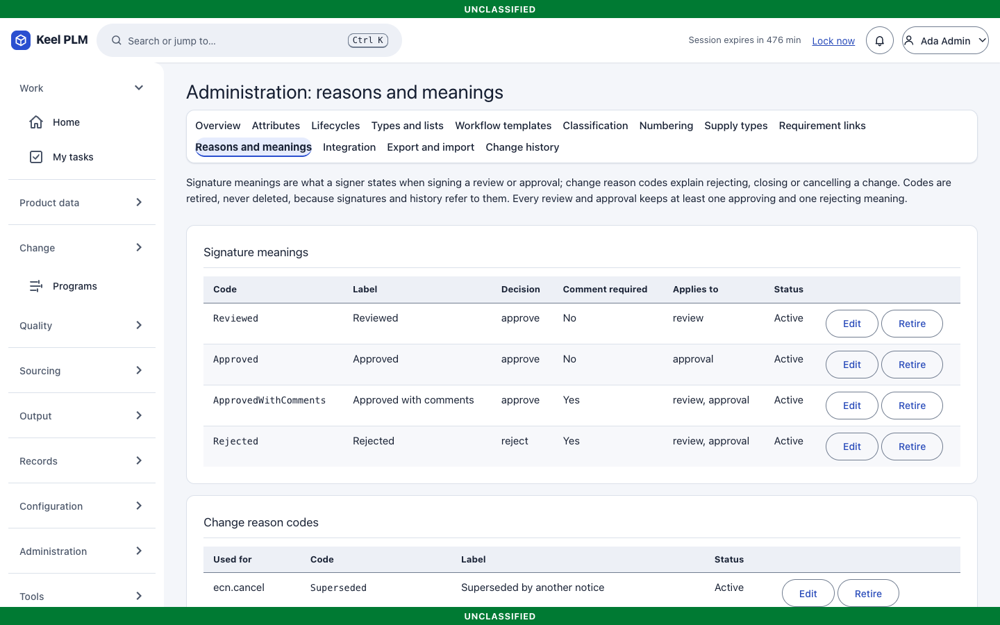
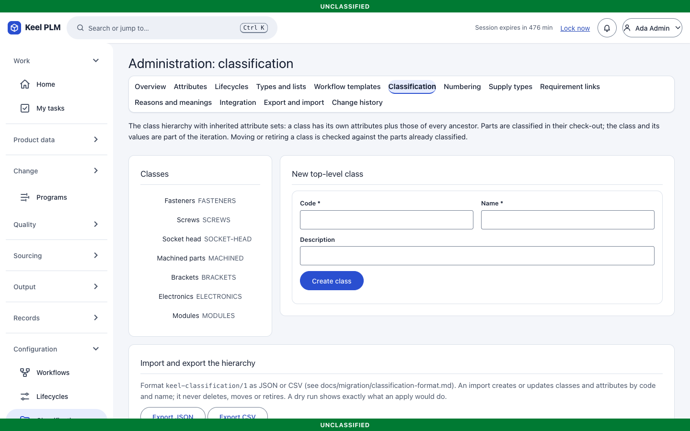
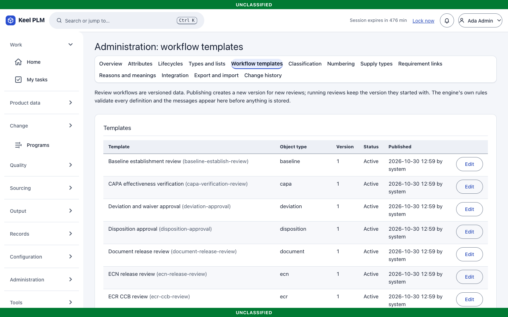
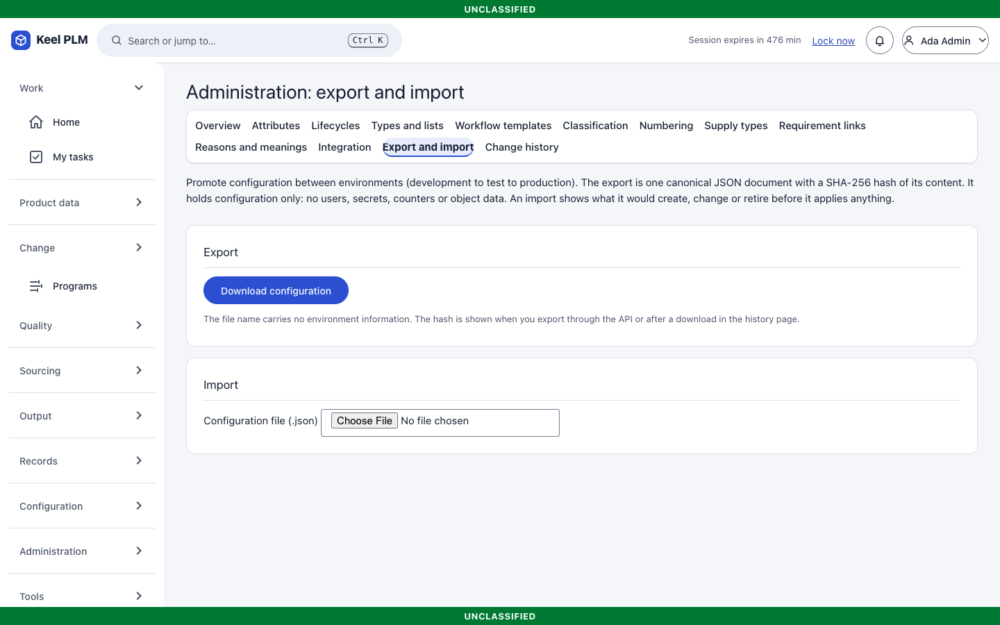
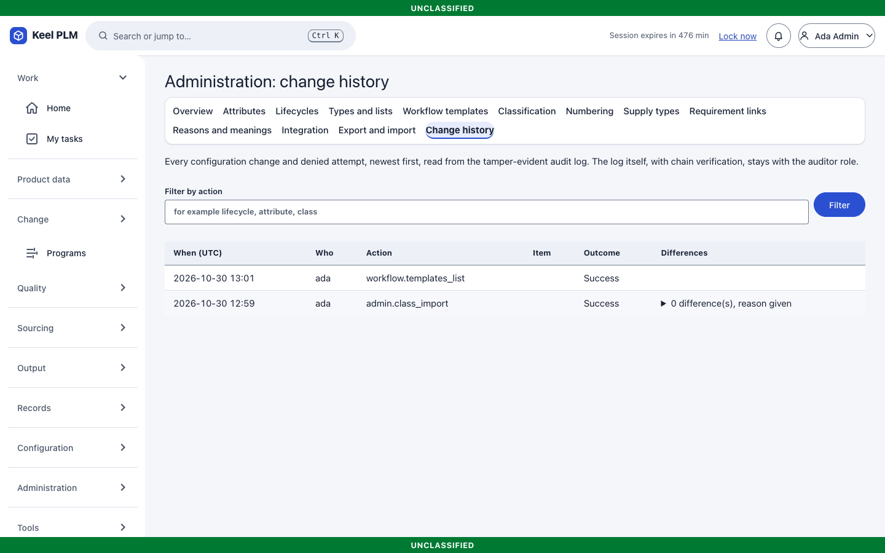
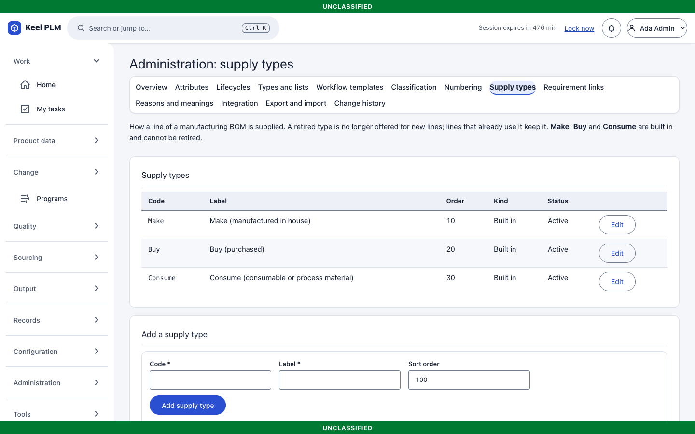
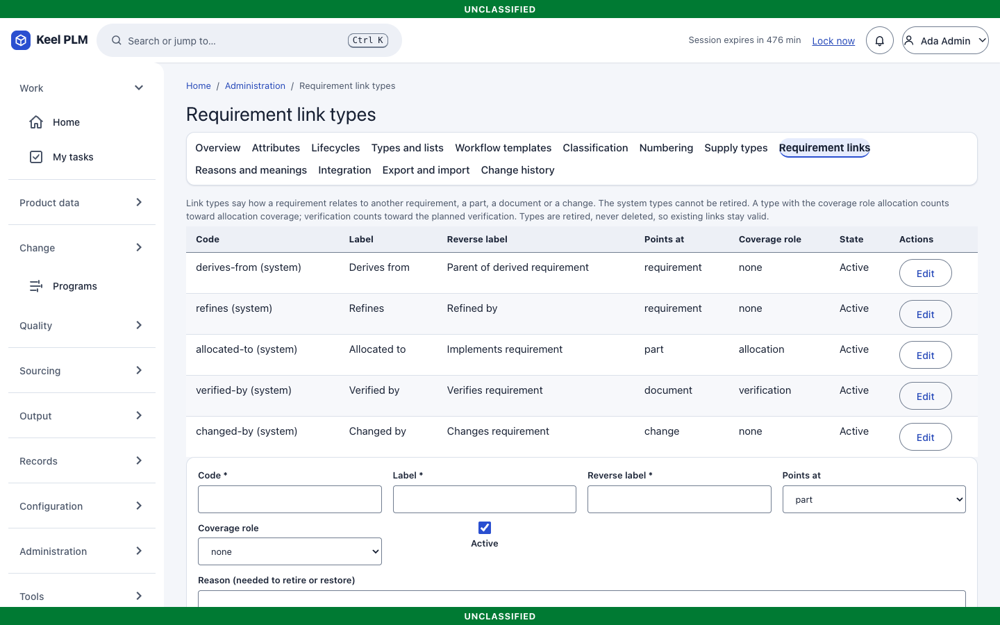
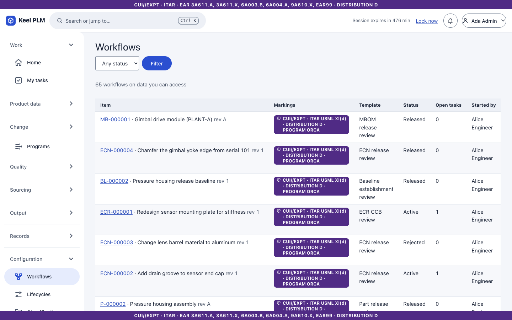

## Routine tasks

**Add a part attribute.** Attributes > add; choose kind and whether it is required; save. New part forms show it at once. Classification attributes belong to classes.

**Change a lifecycle.** Lifecycles > open the family > edit a draft version > **Validate** > **Publish**. New objects use the new version; to move existing objects, choose **Migrate** and map old states to new ones. Both steps are confirmed and audited.

**Edit a workflow template.** Workflow templates > edit a draft > validate > publish > pin it for the object kind. Reviews already running keep their version.

**Move configuration between environments.** Config export on the source, import on the target (after a dry run if offered), then check the history page.

## Limits

Only parts store attribute values today; document and change attributes are not shipped. Lifecycles of PR, ECR, ECN, CT, MBOM and quality records are view-only. Server-side sorting is available on the main lists. Roles themselves (viewer, author, approver, admin, auditor, records, supplier, integration) come from the identity provider, not from Keel.
